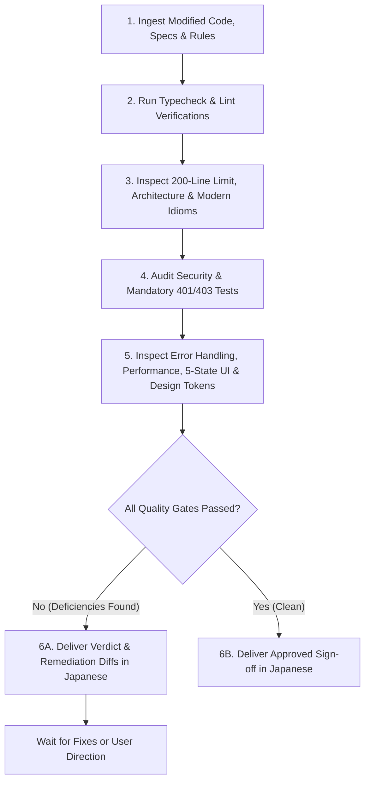

# Code Review Skill

This skill acts as a Principal Software Engineer & Code Quality Auditor. It executes rigorous code quality reviews on implementation slices created during vertical development. It directly enforces project-specific coding standards defined in `.agents/rules/coding-rules.md` (e.g., the 200-line file limit, strict type safety, modern idioms & zero deprecated code, zero linter warnings) and styling standards in `.agents/rules/design-rules.md` (semantic tokens, forbidden raw hex colors), mandates negative authorization testing (401/403 tests), verifies defensive error handling, and prevents DoS or N+1 performance bottlenecks.

> [!IMPORTANT]
> **Language & Output Rule**:
> All interactive communication, code review findings, line-by-line critiques, verdict declarations, and remediation diffs to the user **MUST always be delivered in Japanese**.

---

## 1. Activation Triggers

Triggered when the user or orchestrator requests:

- 「コードをレビューして」「実装をチェックして」「型エラーやバグがないか確認して」
- 「セキュリティ・認可テストをチェックして」「パフォーマンスやN+1を検証して」
- 「coding-rules 準拠をチェックして」「スライスのコードレビューをお願いします」
- Direct invocation via `/code-review` or `code-review`

---

## 2. Inputs & Outputs

- **Inputs**:
  - Source code files modified or added in the target slice (backend, frontend, DB migrations, automated tests).
  - Target design and spec documents: `specs/requirements.md`, slice-specific design specs.
  - Project coding & architectural standards: `.agents/rules/coding-rules.md`, `.agents/rules/design-rules.md`.
- **Outputs**:
  - Code Review Audit Report in Japanese (Verdict, Critical Vulnerabilities, Type/Lint Deficiencies, Refactoring Recommendations).
  - Concrete, drop-in replacement code diffs.
  - Verification that automated tests (including 401/403 authorization tests) pass.

---

## 3. Core Review Checklist & Quality Gates

The auditor **MUST** inspect implemented code against the following non-negotiable quality gates:

### A. Zero Errors: Static Types, Build & Lint (CRITICAL)

1. **Strict Type Safety**:
   - Zero compilation or type errors.
   - Prohibit escape hatches (`any`, `@ts-ignore`, unsafe type assertions) unless accompanied by a verified type guard and explanatory comment.
2. **Zero Lint & Formatting Warnings**:
   - The code **MUST** pass all project linter and formatter checks without errors or unapproved warning suppressions.
3. **Single Trailing Newline & POSIX Hygiene**:
   - Verify that every created or modified file terminates with strictly a single newline (`\n`). Consecutive blank lines at the end of a file (`\n\n+`) are strictly forbidden.

### B. Project Coding Rules (`coding-rules.md`), 200-Line Limit & Modern Idioms

1. **File Size & Modularity (CRITICAL)**:
   - Verify that every production source file remains under **200 lines** (hard ceiling: 250 lines). If exceeded, reject the review and provide concrete refactoring diffs splitting logic into sub-components, custom hooks, or utility functions.
   - _Exemptions_: Auto-generated files, DB migrations, declarative schemas, and comprehensive test files (`*.test.*` / `*.spec.*`, allowed up to 350 lines) are exempt.
2. **Directory & Architectural Boundaries**:
   - Verify that file placement, module encapsulation, and path alias rules strictly conform to `.agents/rules/coding-rules.md`.
3. **Modern Idioms & Zero Deprecated / Legacy Code (CRITICAL)**:
   - Audit implemented code against `.agents/rules/coding-rules.md` (Section 1.5 & Section 2.3).
   - Strictly prohibit deprecated APIs, legacy language constructs, and obsolete architectural patterns lingering in LLM pre-training data.
   - Reject code using outdated idioms when the target stack provides modern, first-class alternatives. Provide concrete modernization diffs.
4. **Sub-module Architecture & Layer Separation**:
   - Verify that multi-input forms and complex modal containers adhere to the 3-layer architecture (`types/`, `hooks/`, `Component`) to keep individual files modular and testable.
   - Verify that server action or API handler files approaching file size limits are split by sub-domain and re-exported via central barrel files.

### C. Security, Authorization & Mandatory 401/403 Tests

1. **Universal Authorization Guard**:
   - Every server-side endpoint, RPC handler, and Server Action **MUST** explicitly verify session authentication, user permissions, and tenant ownership before reading or modifying data.
2. **Hierarchical Entity Security (Tenant ID Tampering Defense)**:
   - For creation or mutation of nested child entities (subtasks, comments, etc.), verify that the server action/handler does NOT accept client-provided tenant/workspace IDs. The handler MUST forcefully derive the tenant ID from the authenticated parent entity.
3. **Mandatory 401/403 Automated Tests & Zero Hollow Mocks (NON-NEGOTIABLE)**:
   - Every slice containing authenticated or role-restricted server logic **MUST** implement automated tests verifying that unauthenticated or unauthorized requests are strictly rejected with HTTP 401 / 403 (or equivalent forbidden errors). For intentionally public endpoints (e.g., login, public landing), automated 400 input-validation rejection tests are required instead.
   - **Prohibition of Hollow Mocks**: Tests **MUST NOT** mock the authorization guard or the target business logic function itself to fake a 401/403 return. Only external boundaries (e.g., session retrieval context or external APIs) may be mocked.
   - A review **CANNOT BE APPROVED** if negative security/authorization tests are missing or hollow.
4. **Injection, Vulnerability & Environment Config Defense**:
   - Parameterized queries / ORM methods only (no raw SQL string concatenation).
   - Proper output encoding and sanitized HTML rendering to prevent XSS.
   - No hardcoded secrets, API keys, or credentials; any new environment variables **MUST** be validated via schema and synchronized in `.env.example`.

### D. Error Handling & Information Leaks

1. **No Silent Failures**:
   - Catch blocks **MUST NOT** silently swallow exceptions (`catch (e) {}` is strictly forbidden).
   - Fallback strategies or explicit structured error logging must be present.
2. **Safe Error Responses**:
   - Server errors returned to clients **MUST NOT** leak database internals, system paths, or stack traces.

### E. Performance, DoS & Resource Safety

1. **Database & Query Hygiene**:
   - Prohibit unindexed queries and N+1 query patterns (require explicit batch loading, joins, or dataloaders).
   - Mandate limits and pagination on list queries (no unbounded `SELECT *`).
2. **Resource & Payload Protection**:
   - Validate and constrain request payload sizes.
   - Ensure event listeners, database connections, and streams are properly closed and cleaned up.

### F. Universal 5-State UI Implementation & Design Token Compliance

1. **Full State Representation**:
   - Frontend components **MUST** render appropriate UI for all 5 states:
     - **Empty**: Informative zero-data display.
     - **Loading**: Skeletons or spinners without UI jumping.
     - **Success**: Interactive content display.
     - **Error**: User-friendly message with recovery options.
     - **Disabled / Unauthorized**: Disabled interactive elements, login prompts, or forbidden indicators.
2. **Prohibition of Hardcoded Colors & Mandatory Semantic Tokens (CRITICAL)**:
   - Direct hardcoding of raw hex colors (`#3b82f6`), RGB/HSL values, or raw utility palette classes (e.g., `blue-500`, `zinc-900`) is **STRICTLY PROHIBITED**.
   - Components **MUST** strictly use semantic tokens defined in `.agents/rules/design-rules.md` (e.g., `primary`, `background`, `card`, `muted`, `accent`, `destructive`, `border`).
3. **Form UX & Interactive Defense**:
   - Async submit/action buttons **MUST** be disabled while pending to prevent duplicate submissions.
   - Field-level validation errors must render inline next to inputs, while global/system errors use toast/alert banners.
   - Browser-native `window.confirm()` and `window.alert()` are strictly prohibited.
4. **Semantic Markup & Accessibility (a11y)**:
   - Use semantic HTML tags (`<main>`, `<section>`, `<button>`, `<form>`) rather than unsemantic clickable `
` / `` elements.
   - Interactive elements must maintain minimum 44x44px touch targets on mobile viewports and preserve visible focus rings (`:focus-visible`).
5. **Component Procurement Traceability & No Bare Tag Fallbacks (CRITICAL)**:
   - Verify that all UI elements conform to `specs/components.md`. Reject implementations that silently fall back to unstyled bare native HTML elements (`<select>`, `<input type="date">`, `<dialog>`) when an accessible component is specified.
   - Verify that complex UI primitives strictly follow the accessible Compound Component pattern (Root, Trigger, Value, Content, Item) rather than shallow HTML tag wrappers.
6. **UI Dialog/Modal Props Consistency**:
   - Verify that dialog and modal components standardize on `open` / `onOpenChange` for visibility, and `isPending` for in-flight async operations.

---

## 4. Step-by-Step Execution Workflow

### Step 1: Ingest Modified Code, Specs & Rules (`coding-rules.md`, `design-rules.md`)

- Inspect the git diff or specified source files.
- Read `.agents/rules/coding-rules.md`, `.agents/rules/design-rules.md`, and `specs/requirements.md` to establish audit baselines.

### Step 2: Run Typecheck & Lint Verifications

- Execute project verification commands (e.g., `pnpm typecheck`, `cargo check`, `npm run lint`).
- Confirm zero errors and zero unhandled warnings.

### Step 3: Inspect 200-Line Limit, Architecture & Modern Idioms

- Check line counts of all modified/created files. Flag any file approaching or exceeding 200 lines.
- Verify module encapsulation, imports, and separation of concerns against `coding-rules.md`.
- Inspect syntax against `.agents/rules/coding-rules.md` (Section 1.5 & Section 2.3) to reject deprecated APIs and obsolete patterns.

### Step 4: Audit Security & Mandatory 401/403 Tests

- Verify entrypoint authentication and role checks.
- Inspect test suites to confirm mandatory automated 401/403 tests exist and pass.

### Step 5: Inspect Error Handling, Performance, 5-State UI & Design Tokens

- Verify catch blocks, error responses, database query patterns (no N+1), 5-state UI coverage, and semantic design token compliance.

### Step 6: Deliver Review Report (in Japanese)

- **Verdict**: `承認 (Approved)` or `要修正 (Changes Requested)`.
- **Review Summary Table**:
  - 静的型検査・ビルド・Lint結果
  - 200行制限・モジュール分割準拠状況
  - 最新構文準拠・非推奨（Deprecated）コード排除状況
  - 認可ガード・401/403テスト合格状況（ハリボテモック有無含む）
  - エラー処理・環境変数同期（`.env.example`）・パフォーマンス評価
  - 5大ステートUI・フォーム防御・デザイントークン準拠状況
- **Line-by-Line Findings & Remediation Diffs**: Provide concrete drop-in replacement code for all identified issues.
- **On Approval (Sign-off Actions)**: When Verdict is `承認 (Approved)`, update the slice status in `specs/slices.md` to `[x] 完了`, record any reusable template/rule insights in `doc-updates.todo.md`, and propose a concise Japanese Git commit message (do NOT execute `git commit` without user confirmation).
