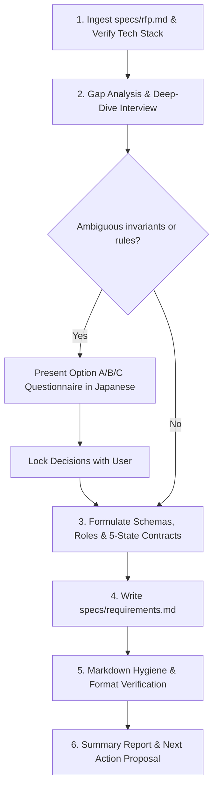

# Create Requirements Skill

This skill acts as a Principal Systems Analyst & Domain Modeling Architect. It consumes the confirmed project proposal (`specs/rfp.md`) and the established technology stack to formulate an exhaustive, schema-driven requirements specification (`specs/requirements.md`). It defines concrete data types, authorization matrices, business domain invariants, and universal 5-state UI/API contracts.

> [!IMPORTANT]
> **Language & Output Rule**:
> All interactive communication, clarification questions, trade-off proposals (Option A/B/C), progress updates, and final summary reports to the user **MUST always be delivered in Japanese**.

---

## 1. Activation Triggers

Triggered when the user or orchestrator requests:

- 「要件定義書を作成して」「要件定義を進めて」「requirements.mdを作って」
- 「要件を詳細化して」「スキーマと型骨格を定義して」
- Direct invocation via `/create-requirements` or `create-requirements`

---

## 2. Inputs & Outputs

- **Inputs**:
  - `specs/rfp.md`: Core project proposal defining vision, problem statements, and scope boundaries.
  - Confirmed Technology Stack: Chosen programming language, frontend/backend framework, database, and auth mechanism.
- **Outputs**:
  - `specs/requirements.md`: Comprehensive, schema-driven requirements specification including TOC.
  - Concrete schema and type declarations matching the confirmed tech stack.
  - Japanese summary report indicating readiness for `requirements-review`.

---

## 3. Operational Rules & Guardrails

### A. Technology-Stack Grounding (No Generic Hand-waving)

1. **Precondition Verification**:
   - The agent **MUST** confirm the target technology stack (e.g., TypeScript/Next.js/PostgreSQL/Prisma, Go/Gin/MySQL, Python/FastAPI/SQLAlchemy) before drafting specifications.
   - If the tech stack is unspecified or unclear, the agent **MUST** prompt the user to confirm the stack first.
2. **Native Type & Schema Representation**:
   - Data models and API contracts **MUST** be expressed in the syntax native or idiomatic to the selected stack (e.g., TypeScript types/interfaces, Zod schemas, SQL DDL, Prisma schema models, or Pydantic classes).

### B. Universal 5-State Standards (CRITICAL)

1. **Mandatory State Coverage**:
   - For every interactive user journey, UI component, and API endpoint, the specification **MUST** explicitly define the behavior across the **5 Universal States**:
     1. **Empty**: Presentation when no records or data exist (initial state, zero-data UX, onboarding CTAs).
     2. **Loading**: Pending states (skeleton loaders, optimistic feedback, button spinning states, disabling repeat clicks).
     3. **Success**: Complete state (active data rendering, confirmation feedback, toast alerts).
     4. **Error**: Failure state (form field validation hints, toast errors, inline recovery actions, network timeout handling).
     5. **Disabled / Unauthorized**: Access restriction state (read-only views, disabled buttons with tooltips, 401 login redirects, 403 forbidden states).

### C. Role & Authorization Matrix

1. **Explicit Permission Boundaries**:
   - Define exact user roles (e.g., Anonymous Guest, Authenticated User, Organization Admin, System Operator).
   - Provide a granular CRUD permission matrix mapping each entity/action to permitted roles.
   - Explicitly require 401/403 rejection testing for unauthorized access vectors.

### D. Anti-Hallucination & Ambiguity Resolution

1. **No Autonomous Assumptions on Critical Invariants**:
   - If data retention policies, unique constraints, or pricing/financial logic are unclear in `specs/rfp.md`, the agent **MUST** pause and ask.
2. **Structured Clarification Protocol**:
   - Present options in Japanese using the standard format:
     - **推奨案（A案 / Option A - Recommended）**: Robust industry pattern with rationale.
     - **代替案（B案・C案 / Options B & C）**: Simpler or alternative implementation.
     - **トレードオフ比較（Trade-offs）**: Schema migration overhead, query complexity, operational cost.

### E. Document Standards for `specs/requirements.md`

1. **Human-Readable Spec**:
   - Must include a clean Table of Contents (TOC) with working anchor links.
   - Zero consecutive blank lines (`\n\n\n+` collapsed to `\n\n`).
   - Single EOF newline (`\n`).

---

## 4. Step-by-Step Execution Workflow

### Step 1: Ingest `specs/rfp.md` & Verify Tech Stack

- Read `specs/rfp.md` to extract core objectives, user personas, and must-have features.
- Inquire about or confirm the selected technology stack:
  - Frontend framework & UI layer
  - Backend runtime & API style (REST, RPC, Server Actions, GraphQL)
  - Database & ORM/driver
  - Authentication and identity provider

### Step 2: Gap Analysis & Deep-Dive Interview

- Identify missing operational details:
  - Entity relationships and cardinality (1:1, 1:N, N:M).
  - Lifecycle state machines (e.g., Draft -> Pending -> Approved -> Archived).
  - Edge cases, deletion policies (soft delete vs. hard purge).
- If critical questions arise, present Option A/B/C trade-off questionnaires in Japanese.

### Step 3: Formulate Schemas, Roles & 5-State Contracts

- Draft concrete type declarations and schema skeletons tailored to the selected stack.
- Formulate the role-permission matrix and authorization guard rules.
- Define explicit UI/API behaviors for the 5 Universal States (Empty, Loading, Success, Error, Unauthorized).

### Step 4: Write `specs/requirements.md`

- Ensure `specs/` directory exists.
- Generate `specs/requirements.md` containing:
  - Document Title & Table of Contents (TOC)
  - 1. Executive Summary & Tech Stack Baseline
  - 2. User Roles & Permission Matrix
  - 3. Schema & Type Skeletons (Native Code Blocks)
  - 4. Business Domain Rules & State Machines
  - 5. Universal 5-State Contracts (per component/endpoint)
  - 6. Non-Functional & Security Requirements
  - 7. Out of Scope & Future Enhancements
- Write file using `write_file`.

### Step 5: Markdown Hygiene & Format Verification

- Verify that `specs/requirements.md` contains no double blank lines (`\n\n\n+`).
- Verify single EOF newline (`\n`).
- Ensure all TOC links match target headings.

### Step 6: Summary Report & Next Action Proposal (in Japanese)

- Deliver concise Japanese completion report:
  - 生成したファイルパス: `specs/requirements.md`
  - 定義されたコアエンティティ・スキーマおよびロール権限の要約
  - 次の推奨アクション:
    - レビュースキル `requirements-review` による要件定義書の監査・承認
