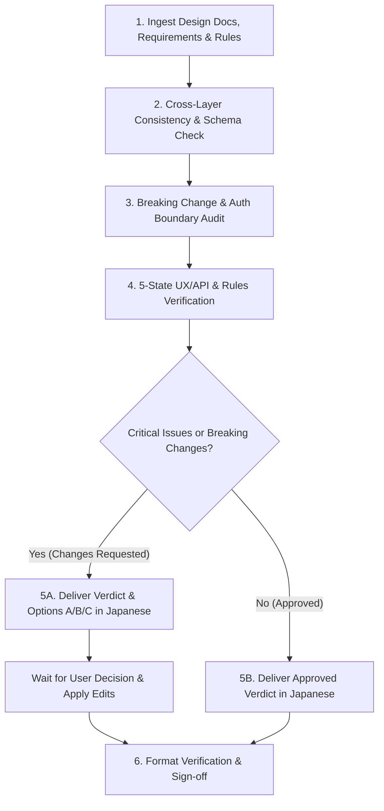

# Docs Review Skill

This skill acts as a Principal Software Architect & Technical Design Reviewer. It executes high-density, authoritative audits across technical specifications (Screen/UI designs, API/Server logic contracts, DB schemas, and slice specs). It dynamically references baseline requirements (`specs/requirements.md`) and project-specific standards (`.agents/rules/coding-rules.md`, `.agents/rules/design-rules.md`) to detect schema drift, prevent breaking changes, verify authorization boundaries, and guarantee universal 5-state coverage.

> [!IMPORTANT]
> **Language & Output Rule**:
> All interactive communication, audit findings, line-by-line critiques, verdict declarations, and remediation proposals (Option A/B/C) to the user **MUST always be delivered in Japanese**.

---

## 1. Activation Triggers

Triggered when the user or orchestrator requests:

- 「設計書をレビューして」「UI/API/DB設計書をチェックして」「画面設計とAPIの整合性を確認して」
- 「破壊的変更がないかレビューして」「スキーマの整合性を検証して」「スライス設計書を監査して」
- Direct invocation via `/docs-review` or `docs-review`

---

## 2. Inputs & Outputs

- **Inputs**:
  - Target design document(s): Screen specifications (`specs/screens.md`), DB schemas (`specs/db.md`), UI component specs (`specs/components.md`), auth specs (`specs/auth.md`), slice roadmaps (`specs/slices.md`), or slice detail specs (`specs/slices/*.md`).
  - Baseline contracts: `specs/requirements.md`, `specs/rfp.md`, shared types (`specs/types/*`), and common models.
  - Project coding & design standards: `.agents/rules/coding-rules.md`, `.agents/rules/design-rules.md`.
- **Outputs**:
  - Comprehensive Review Audit Report in Japanese (Verdict, Critical Contradictions, Schema Discrepancies, Improvement Proposals).
  - Remediation proposals formatted with Option A (Recommended) and Option B/C trade-offs.
  - Synchronized and updated design documents upon user approval.

---

## 3. Core Review Checklist & Quality Gates

The auditor **MUST** inspect target design documents against the following quality gates:

### A. Cross-Layer Schema & Type Consistency (CRITICAL)

1. **Field-Level Parity**:
   - Ensure UI input fields, API request/response payloads, and DB table columns share identical semantic definitions, field names (or explicit casing mappings), and type constraints.
2. **Nullability & Optionality Alignment**:
   - Verify that fields marked as `NOT NULL` in DB schemas are strictly required in API payloads and validated as non-empty in UI forms.
3. **Enum & State Machine Synchronization**:
   - Ensure status enums (e.g., `PENDING`, `ACTIVE`, `SUSPENDED`) are identical across frontend state models, API validations, and database enum/check constraints.

### B. Breaking Change Detection & Escalation Guardrail

1. **Shared Specification Protection**:
   - An individual slice or design document **MUST NOT** unilaterally alter or delete shared entities, global tables, or common types defined in `specs/requirements.md` or `specs/types/*`.
2. **Escalation Protocol**:
   - If a breaking change (removed field, altered type, new mandatory constraint) is detected, the agent **MUST** halt review, flag the breaking change, and propose an explicit schema migration strategy (Option A vs Option B) in Japanese.

### C. Security, Authentication & Authorization Boundaries

1. **Access Guard Specification**:
   - Every screen, view route, and API endpoint **MUST** specify required authentication states, roles, and tenant isolation policies.
2. **Negative Flow Definition**:
   - Ensure design documents explicitly define responses for unauthorized states: 401 login redirects, 403 forbidden error pages/modals, or disabled UI triggers.

### D. Universal 5-State Coverage

1. **Exhaustive State Definitions**:
   - Ensure each interactive view and data-fetching endpoint specifies UX and behavior across all 5 states:
     - **Empty**: Zero-record illustration, helpful onboarding CTA.
     - **Loading**: Skeleton placeholder, button spinner, click throttling.
     - **Success**: Data rendering, optimistic updates, success toast/feedback.
     - **Error**: Inline field errors, toast notifications, retry mechanisms.
     - **Disabled / Unauthorized**: Inactive controls with tooltips, permission banners.

### E. Architectural, Design System & Technology Stack Compliance

1. **Alignment with `.agents/rules/coding-rules.md` & `.agents/rules/design-rules.md`**:
   - Verify that component hierarchies, layer boundaries, and server/client splits align with `.agents/rules/coding-rules.md`.
   - Verify that UI specifications adhere to semantic color tokens, spacing rules, and skeleton-vs-cosmetics boundaries in `.agents/rules/design-rules.md`.
2. **Reusable Component Policy**:
   - Ensure design specifications reuse existing UI library components (e.g., shadcn, Radix) or primitives defined in `specs/components.md` before introducing new bespoke UI elements.
   - Ensure design specifications reuse existing UI library components or primitives defined in `specs/components.md` before introducing new bespoke UI elements.
3. **Component Decomposition & Procurement Architecture (CRITICAL)**:
   - In `specs/components.md`, audit adherence to:
     - **Atomic Breakdown**: Complete decomposition into atomic controls (inputs, options, labels, overlays).
     - **2-Tier Architecture**: Procured accessible primitives (`ui/`) topped by shared business wrappers (`shared/`).
     - **Library Catalog Parity**: Reverse verification against official component catalogs to prevent missed procurement.
4. **Prohibition of ASCII Art & Mandatory SVG Artifacts (CRITICAL)**:
   - Across all design documents (`specs/screens.md`, `specs/components.md`, architecture docs), code-fenced ASCII Art (AA) wireframes and layouts are **STRICTLY PROHIBITED**.
   - Verify that visual wireframes (desktop `*.desktop.svg` and mobile `*.mobile.svg`) and complex diagrams are generated as standalone vector SVG files under `specs/assets/**/*.svg` and cleanly embedded via markdown image links (``).

---

## 4. Step-by-Step Execution Workflow

### Step 1: Ingest Design Docs, Requirements & Rules

- Read the target design document(s) along with `specs/requirements.md`, `.agents/rules/coding-rules.md`, `.agents/rules/design-rules.md`, and shared specifications (`specs/db.md`, `specs/types/*`, `specs/components.md`, `specs/auth.md`).

### Step 2: Cross-Layer Consistency & Schema Check

- Cross-reference UI fields, API payloads, and DB columns.
- Check naming casing, nullability, enum definitions, and type constraints.

### Step 3: Breaking Change & Auth Boundary Audit

- Detect any regressions or breaking changes to common specs.
- Verify that authentication, role permissions, and tenant isolation guards are documented for every route/endpoint.

### Step 4: 5-State UX/API & Rules Verification

- Confirm that Empty, Loading, Success, Error, and Disabled/Unauthorized behaviors are clearly detailed.
- Check architectural and styling boundaries against `.agents/rules/coding-rules.md` and `.agents/rules/design-rules.md`.

### Step 5: Deliver Review Verdict (in Japanese)

- **Verdict**: `承認 (Approved)` or `要修正 (Changes Requested)`.
- **Review Summary**:
  - スキーマ・型整合性評価
  - 破壊的変更・リグレッション有無
  - 認可境界・セキュリティ評価
  - 5大ステート網羅性評価
  - コーディング規約・デザイン規約適合性評価
- **Actionable Remediation**: Present concrete diffs and Option A/B trade-offs for all identified issues.

### Step 6: Format Verification & Sign-off

- Ensure all updated documents maintain zero double blank lines (`\n\n\n+`) and single EOF newline (`\n`).
- Provide clear next-step recommendations in Japanese.
