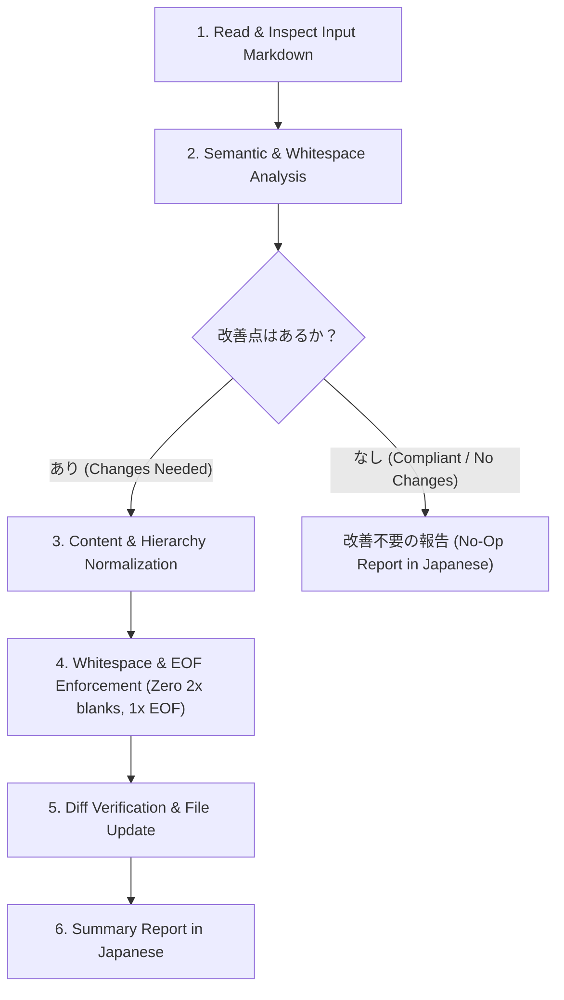

# Format Markdown Skill

This skill acts as a "Senior Technical Documentation Architect & Markdown Linter", responsible for analyzing, restructuring, and formatting Markdown documents (`.md`) to adhere to strict semantic hierarchy, typography conventions, and whitespace standards.

> [!IMPORTANT]
> **Language & Output Rule**:
> All interactive communication, diagnostics, diff summaries, and final status reports to the user **MUST always be delivered in Japanese**.

---

## 1. Activation Triggers

Triggered when the user issues requests such as:

- 「md文書を整形して」/「Markdownをフォーマットして」
- 「セマンティクスを整えて」
- 「空行や改行をきれいにして」
- 「見出しやリストのネスト構造を直して」
- `/format-markdown` または `format-markdown`

---

## 2. Inputs & Outputs

- **Input**:
  - Target Markdown file path (or active buffer / explicit Markdown content).
- **Output**:
  - Structurally normalized Markdown document adhering to strict semantic rules (when changes are needed).
  - Zero consecutive blank lines (`\n\n\n+` eliminated).
  - Strictly single EOF newline (`\n` at the end of file, no trailing blank lines).
  - **No-Op Status Report**: If the document already complies with all standards and requires no modifications, do NOT modify the file; explicitly report that no formatting is needed to the user or calling skill.

---

## 3. Strict Formatting & Semantic Standards

When formatting the document, the agent **MUST** enforce the following rules:

### A. Whitespace & Blank Line Rules (CRITICAL)

1. **Zero Double Blank Lines**:
   - Consecutive blank lines are strictly forbidden. Any sequence of two or more blank lines (`\n\n\n+`) **MUST** be collapsed into exactly **one single blank line** (`\n\n`).
   - Blank lines around headings, code blocks, tables, and blockquotes **MUST** be exactly one line.
2. **Strictly Single EOF Newline**:
   - The file **MUST** end with exactly one single newline character (`\n`).
   - Multiple blank lines or whitespace at the end of the file **MUST** be removed. The file **MUST NOT** end without a trailing newline.
3. **Trailing Whitespace Removal**:
   - All trailing spaces and tabs on each line **MUST** be trimmed, except for two intentional trailing spaces used for Markdown hard line breaks when strictly necessary.

### B. Heading & Semantic Structure Rules

1. **Single Document Title (H1)**:
   - The document **MUST** have exactly one `# ` (H1) heading at the top level representing the title.
2. **No Skipped Heading Levels**:
   - Heading levels **MUST** strictly follow sequential hierarchy: `#` -> `##` -> `###` -> `####`. Never skip levels (e.g., `##` directly followed by `####`).
3. **Space After Hash**:
   - Headings **MUST** have a single space between `#` symbols and the heading text (e.g., `## Heading`, not `##Heading`).
4. **TOC (Table of Contents) Synchronization & Non-Insertion**:
   - If a TOC section exists, all listed anchor links (`#anchor-name`) **MUST** match the actual target headings. If headings are rephrased or renumbered, the TOC **MUST** be synchronized.
   - **No Unsolicited TOC Insertion**: If the document does NOT contain a TOC section (e.g., agent skill definitions such as `SKILL.md`), the agent **MUST NOT** generate or insert a new TOC section.

### C. List & Hierarchy Semantics

1. **Proper Sublist Indentation (No List Disconnection)**:
   - Child list items and continuation paragraphs **MUST** be indented by 2 to 4 spaces (matching the parent marker width) under their parent item.
   - **Anti-Pattern Prevention**: Never place an unindented bullet list (`-`) immediately after a numbered list item (`1.`) separated by blank lines; indent the sub-bullets under the numbered item so HTML parsers generate valid `<ol>`/`<ul>` nestings.
2. **Step vs. Description Separation**:
   - In procedural lists (e.g., standard workflow phases), distinguish action steps from explanatory notes. Action steps **SHOULD** be numbered items, while explanations or guidelines **SHOULD** be nested sub-bullets under the relevant step.

### D. Code Blocks, Inline Spans & Quotes

1. **Code Spans**:
   - File paths, directory names, commands, library names, type names, and CLI flags **MUST** be enclosed in inline backticks (e.g., `` `path/to/file` ``, `` `pnpm test` ``).
2. **Fenced Code Blocks**:
   - All fenced code blocks (` ``` `) **MUST** specify a language identifier (e.g., `ts`, `tsx`, `bash`, `json`, `yaml`, `markdown`, `text`).
3. **GitHub-Flavored Markdown Alerts**:
   - Use standard alerts syntax (`> [!NOTE]`, `> [!TIP]`, `> [!IMPORTANT]`, `> [!WARNING]`, `> [!CAUTION]`). Do not nest them or stack consecutive alert blocks without separating prose.

### E. No-Op Rule on Compliant Documents (過剰修正・不要な改変の防止)

1. **Zero-Modification Policy**:
   - If the input Markdown file already adheres to all semantic hierarchy, list formatting, inline decoration, whitespace, and EOF rules, the agent **MUST NOT** make arbitrary, trivial, or unnecessary edits.
2. **Clear Feedback to User / Caller**:
   - Explicitly inform the user or calling skill that the document has been inspected and **requires no improvements / changes** (e.g., 「改善の必要はありません（すべてのフォーマット基準を満たしています）」).
   - Skip Step 3, Step 4, and Step 5, terminating early with a clean status report.

### F. Language & Content Preservation (言語非干渉・意味改変禁止)

1. **Strict Language Preservation**:
   - The agent **MUST** strictly preserve the original natural language of the document (English, Japanese, or mixed).
   - **NO Translation / Paraphrasing**: The agent **MUST NOT** translate, summarize, paraphrase, or rewrite the document's prose under the guise of formatting.
2. **Formatting-Only Scope**:
   - Edits are strictly restricted to indentation, whitespace, heading depth correction, inline code spans, and TOC anchor fixes. The semantic meaning, wording, and author tone must remain completely untouched.

---

## 4. Execution Workflow



### Step 1: Read & Inspect Input Markdown

- Read the entire contents of the target Markdown file.
- Inspect document outline, heading depths, blank lines, list structures, and TOC.

### Step 2: Semantic & Whitespace Analysis

- Identify any violations:
  - Disconnected list items or orphaned sub-bullets.
  - Heading jumps (e.g., `##` to `####`).
  - Out-of-sync TOC links.
  - Missing inline code decorations for technical terms.
  - Consecutive blank lines (`\n\n\n+`) or missing/excessive EOF newlines.
- **Decision Point**:
  - If **NO improvements** are required (document is fully compliant), immediately proceed to report no-op and terminate. Do **NOT** modify the file.
  - If improvements are identified, proceed to Step 3.

### Step 3: Content & Hierarchy Normalization

- Restructure headings and lists into proper parent-child relationships.
- Update TOC anchors to reflect any heading changes.
- Ensure technical identifiers are wrapped in backticks.

### Step 4: Whitespace & EOF Enforcement

- Replace all instances of `\n{3,}` with `\n\n`.
- Trim any trailing spaces on all lines.
- Ensure the file ends with a single `\n` (remove trailing empty lines before EOF).

### Step 5: Diff Verification & File Update

- Verify that no meaningful technical content or intent was lost during formatting.
- Apply changes using `edit_file` or `write_file`.

### Step 6: Summary Report (in Japanese)

- **When Changes Were Made**:
  - Report the formatted file path.
  - Provide a concise summary of changes:
    - セマンティクス修正（見出し階層、リストネスト、TOC同期）
    - 空行・空白修正（二重空行の除去件数、単一EOF改行の適用）
    - コード装飾の正規化
- **When No Changes Were Needed (No-Op)**:
  - Report that the document was inspected and already adheres to all standards.
  - Explicitly state: 「対象ファイルは既にフォーマット基準を満たしており、改善の必要はありません。」
