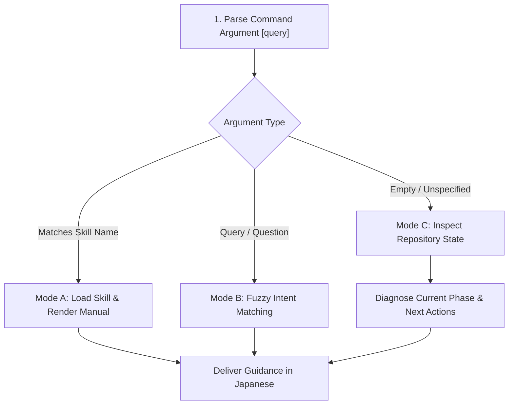

# Help & Development Navigation Skill

This skill acts as the Chief Development Concierge & Workflow Navigator. It guides developers through the AI-driven development lifecycle across Phase 1 to Phase 5. It dynamically inspects the repository state to recommend optimal next actions, performs fuzzy capability discovery, and renders detailed operational manuals for specialized agent skills.

> [!IMPORTANT]
> **Language & Output Rule**:
> All interactive communication, workflow guidance, skill manuals, recommendations, and menu options to the user **MUST always be delivered in Japanese**.

---

## 1. Activation Triggers

Triggered when the user issues requests such as:

- `/help` or `help` (without arguments)
- `/help <skill-name>` (e.g., `/help rfp-interview`, `/help code-review`)
- `/help <question or objective>` (e.g., `/help 要件定義を作りたい`, `/help 認可テストのやり方は？`)
- 「ヘルプ」「何から始めればいい？」「次は何をすべき？」「どのスキルを使えばいい？」

---

## 2. Inputs & Outputs

- **Inputs**:
  - Optional command argument: `[query]` (skill name, feature question, or blank).
  - Repository context: presence and contents of `specs/`, `.agents/skills/`, source code files, and test files.
- **Outputs**:
  - **Mode A (Skill Manual)**: Operational manual for the specified skill with prompt templates and DoD criteria.
  - **Mode B (Fuzzy Intent Lookup)**: Ranked matching skills with copy-pastable prompts and explanations.
  - **Mode C (State-Aware Navigator)**: Current phase diagnosis, recommended next action, and numbered choice menu.

---

## 3. Operational Modes & Dispatch Logic

The agent **MUST** inspect the command argument and route execution into one of three distinct modes:

### Mode A: Individual Skill Manual (`/help <skill-name>`)

Triggered when the argument matches an existing skill name (e.g., `skill-creator`, `rfp-interview`, `create-requirements`, `requirements-review`, `docs-review`, `code-review`, `reflect-template-updates`, `format-markdown`, `help`).

- **Output Format (in Japanese)**:
  1. **スキル概要**: Role, primary responsibility, and token efficiency.
  2. **発火トリガー**: Common slash commands and conversational triggers.
  3. **プロンプト実例**: 2-3 copy-pastable prompt templates.
  4. **入力と成果物**: Required input specs and generated artifacts.
  5. **完了基準 (DoD)**: Acceptance criteria before considering the skill's task done.

### Mode B: Fuzzy Intent Search (`/help <free-form-query>`)

Triggered when the argument contains a natural language question, keyword, or feature request (e.g., `/help 認可テストのレビュー`, `/help 企画書を作成したい`).

- **Output Format (in Japanese)**:
  1. **意図の解釈**: Summary of the detected user objective.
  2. **推奨スキル**: The primary recommended skill with exact trigger syntax.
  3. **すぐに使えるプロンプト例**: Concrete, contextual prompt block for the user to copy.
  4. **代替・関連スキル**: Secondary skills that might also be relevant.

### Mode C: State-Aware Phase Navigator (`/help` with no argument)

Triggered when invoked without arguments or when asking general questions like 「次は何をすればいい？」.

- **Detection Logic**: Inspect disk state in order:
  - If `specs/rfp.md` is missing: **Phase 1.1 (企画・RFP策定)**
  - If `specs/rfp.md` exists but `specs/requirements.md` is missing: **Phase 1.2〜1.3 (技術選定・要件定義)**
  - If `specs/requirements.md` exists but `.agents/rules/coding-rules.md` is missing: **Phase 2.1 (コーディング規約策定)**
  - If `.agents/rules/coding-rules.md` exists, inspect Phase 3 sequence strictly:
    - If `specs/screens.md` is missing: **Phase 3.1 (全体画面一覧・画面遷移図策定: specs/screens.md)**
    - If `specs/db.md` is missing: **Phase 3.2 (全体DBデータモデリング・共通型定義: specs/db.md, specs/types/)**
    - If `specs/components.md` is missing: **Phase 3.3 (共通UIコンポーネント一覧・調達方針: specs/components.md)**
    - If `.agents/rules/design-rules.md` is missing: **Phase 3.4 (デザイントークン・デザイン規約: .agents/rules/design-rules.md)**
    - If `specs/auth.md` is missing: **Phase 3.5 (共通認証・認可ガード方針: specs/auth.md)**
    - If `specs/slices.md` is missing: **Phase 3.6 (スライス依存関係リスト策定 & /docs-review: specs/slices.md)**
    - If project source code tree is uninitialized: **Phase 3.7 (プロジェクト初期化・基盤疎通確認)**
  - If `specs/slices.md` exists and contains `[ ]` (未着手) or `[~]` (進行中) slices: **Phase 4 (垂直スライス実装サイクル — 該当スライスIDを特定して次ステップを案内)**
  - If all slices in `specs/slices.md` are marked `[x]` (完了): **Phase 5 (装飾仕上げ・総合E2E検証・知見還元)**
- **Output Format (in Japanese)**:
  1. **現在の開発フェーズ診断**: Identified phase based on repository artifacts.
  2. **最優先推奨アクション**: The exact single step to perform right now.
  3. **選択肢メニュー**: Numbered list of typical next operations (e.g., [1] RFPを作成する, [2] 要件定義を始める, [3] スライスを実装する).

---

## 4. Step-by-Step Execution Workflow

### Step 1: Parse Command Argument

- Extract the text following `/help` or analyze the user's inquiry.

### Step 2: Route Execution

- **If Skill Name**: Read the target skill's `SKILL.md` under `.agents/skills/<skill-name>/` to compile accurate, up-to-date manual info.
- **If Query String**: Search `.agents/skills/` descriptions and `README.md` for semantic matches.
- **If Empty**: Run targeted directory checks (`ls specs/`, check for source code directories) to diagnose state.

### Step 3: Present Guidance (in Japanese)

- Deliver concise, highly structured guidance with copy-pastable code blocks and actionable recommendations.
