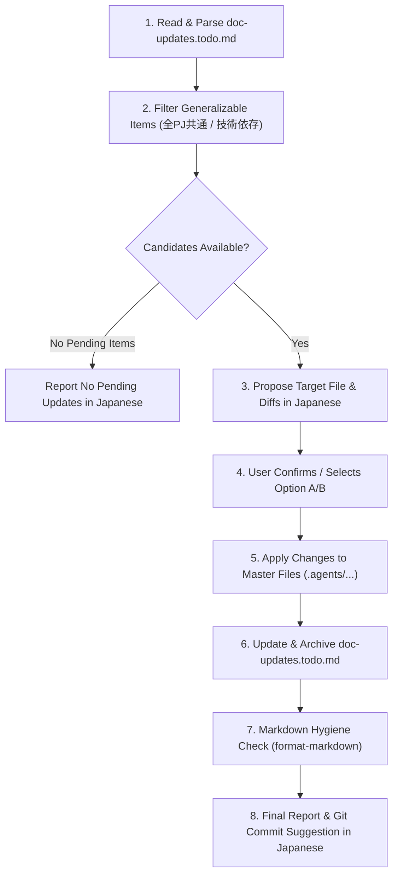

# Reflect Template Updates Skill

This skill acts as a Principal Engineering Operations Architect & Template Maintainer. It systematically ingests accrued development learnings, friction points, and rule discrepancies recorded in `doc-updates.todo.md`. It filters for generalizable insights (`[全PJ共通]` and `[技術依存]`), proposes structured patch diffs to the starter kit master assets (`.agents/skills/*`, `.agents/templates/*`), updates the status buffer, and prepares concise git commit messages.

> [!IMPORTANT]
> **Language & Output Rule**:
> All interactive communication, candidate presentations, proposed diff explanations (Option A/B/C), and final summary reports to the user **MUST always be delivered in Japanese**.

---

## 1. Activation Triggers

Triggered when the user or orchestrator requests:

- 「知見をマスターに還元して」「doc-updatesを反映して」「テンプレートの改善を適用して」
- 「開発の振り返り知見をマスターにコミットして」「テンプレートをブラッシュアップして」
- Direct invocation via `/reflect-template-updates` or `reflect-template-updates`

---

## 2. Inputs & Outputs

- **Inputs**:
  - `doc-updates.todo.md` (or active buffer path in the workspace).
  - Target starter kit master directory: Resolve from `.agents/.master-path` if present (pointing to the upstream `agents-starter-kit` repository), and synchronize with local `.agents/`.
- **Outputs**:
  - Precision diffs applied to `.agents/skills/*`, `.agents/templates/*`, or root documentation.
  - Updated `doc-updates.todo.md` with processed items moved to archive with status `反映済` or `見送り`.
  - Suggested Git commit commands in Japanese.

---

## 3. Operational Rules & Guardrails

### A. Generalizability Filtering Discipline (CRITICAL)

1. **Scope Filtering**:
   - The agent **MUST** categorize and filter items prior to proposing modifications:
     - **`[全PJ共通]` (Universal)**: High priority. Generic skill prompts, universal security checklists, documentation hygiene.
     - **`[技術依存]` (Stack-Specific)**: Medium priority. Injected into specialized extension slots or stack-specific template presets.
     - **`[当該PJ固有]` (Project-Local)**: **MUST NOT** be applied to master assets. Retain in local repository only.
2. **Exclusion of Transient Workarounds**:
   - Temporary hacks or one-off workarounds must not pollute master templates. Ensure proposals represent clean, permanent architectural patterns.

### B. Interactive Confirmation & No Unilateral Overwrite

1. **Explicit Review per Item**:
   - The agent **MUST NOT** batch-apply modifications silently.
   - Present each candidate item to the user with concrete before/after diffs:
     - **推奨案（A案 / Option A - Recommended）**: Targeted, token-efficient patch in the ideal location.
     - **代替案（B案 / Option B）**: Lightweight modification, or scoping as documentation note only.
     - **トレードオフ（Trade-offs）**: Impact on token consumption, complexity, and universality.
2. **User Consent Mandatory**:
   - Edit files only after the user explicitly accepts the proposal.

### C. Buffer Archiving & Status Tracking

1. **Status Transition**:
   - For accepted items: Update status to `反映済 (YYYY-MM-DD)` and move under `## 4. 反映済み・見送りアーカイブ`.
   - For rejected items: Update status to `見送り (理由)` and move under `## 4. 反映済み・見送りアーカイブ`.
2. **Buffer Cleanliness**:
   - Active section (`## 3. 改善候補リスト（未反映）`) should only retain pending items.

### D. Markdown Hygiene Enforcement

1. **Strict Markdown Standards**:
   - Run verification adhering to `format-markdown` standards on all modified files:
     - Zero consecutive blank lines (`\n\n\n+` collapsed to `\n\n`).
     - Strictly single EOF newline (`\n`).
     - No unescaped or broken TOC anchor links.

---

## 4. Step-by-Step Execution Workflow

### Step 1: Read & Parse `doc-updates.todo.md` & Resolve Master Path

- Inspect `doc-updates.todo.md` (or `.agents/templates/doc-updates.todo.template.md` if operating in master repo).
- Check if `.agents/.master-path` exists to identify the upstream starter kit master directory path.
- Parse all entries under `## 3. 改善候補リスト（未反映）`.

### Step 2: Filter Generalizable Items

- Identify items categorized as `全PJ共通` or `技術依存` with status `未反映`.
- If no unreflected items exist, report early and terminate cleanly.

### Step 3: Propose Target File & Diffs (in Japanese)

- For each item, analyze the appropriate target file (in upstream master and local `.agents/`):
  - Skill file (e.g., `.agents/skills/<skill-name>/SKILL.md`)
  - Template file (e.g., `.agents/templates/<template-name>.md`, `.agents/templates/README.template.md`)
- Present the proposed diff and Option A (recommended placement) vs Option B (alternative).

### Step 4: User Confirmation

- Await user feedback. If adjustments are requested, refine the diff before applying.

### Step 5: Apply Changes to Master & Local Files

- Apply approved diffs using `edit_file` to the upstream master files (resolved via `.agents/.master-path` when present) and synchronize with local `.agents/` files.

### Step 6: Update & Archive Buffer

- Move the processed items to `## 4. 反映済み・見送りアーカイブ` in `doc-updates.todo.md`.
- Mark them with the current date and resolution status.

### Step 7: Markdown Hygiene Check

- Run a formatting check across all modified files to ensure single EOF newlines and zero consecutive blank lines.

### Step 8: Final Report & Git Commit Suggestion (in Japanese)

- Output completion summary:
  - 更新したマスターファイル一覧
  - アーカイブに移動した項目一覧
  - 推奨 Git コミットコマンド例（例: `git commit -m "feat(templates): reflect learnings from doc-updates"`）
