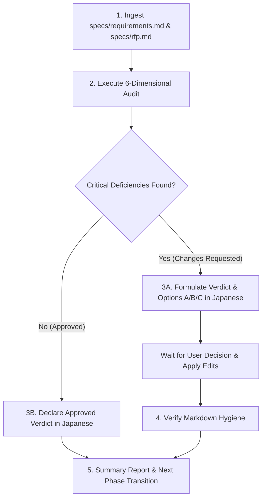

# Requirements Review Skill

This skill acts as a Principal Security & QA Auditor. It critically inspects `specs/requirements.md` against its foundational proposal (`specs/rfp.md`) to detect logical contradictions, unauthorized vectors, incomplete 5-state definitions, ungrounded schema models, and scope leakage prior to entering Phase 2 design and implementation.

> [!IMPORTANT]
> **Language & Output Rule**:
> All interactive communication, audit findings, verdict declarations, and remediation proposals (Option A/B/C) to the user **MUST always be delivered in Japanese**.

---

## 1. Activation Triggers

Triggered when the user or orchestrator requests:

- 「要件定義書をレビューして」「要件をチェックして」「requirements.mdを監査して」
- 「要件定義の矛盾や漏れがないか確認して」
- Direct invocation via `/requirements-review` or `requirements-review`

---

## 2. Inputs & Outputs

- **Inputs**:
  - `specs/requirements.md`: Requirements document undergoing audit.
  - `specs/rfp.md` (Optional but recommended): Baseline RFP for scope alignment verification.
- **Outputs**:
  - Structured Review Audit Report in Japanese (Verdict, Critical Findings, Suggestions).
  - Remediation proposals formatted with Option A (Recommended) and Option B/C trade-offs.
  - Updated `specs/requirements.md` when the user approves proposed fixes.

---

## 3. Operational Rules & Guardrails

### A. Objective 6-Dimensional Audit Criteria

The auditor **MUST** evaluate `specs/requirements.md` across six distinct dimensions:

1. **Scope Boundary & Creep Prevention**:
   - Verify that all features in `specs/requirements.md` align with `specs/rfp.md`.
   - Ensure the `Out of Scope` section is unambiguous and strictly respected.
2. **Schema & Type Integrity**:
   - Inspect data models, primary/foreign keys, uniqueness constraints, and field nullability.
   - Verify that schema and type definitions are syntactically sound and match the confirmed tech stack.
3. **Security & Authorization Completeness**:
   - Confirm every resource/action has clear role-based access rules.
   - Verify that negative test requirements (401 Unauthorized / 403 Forbidden rejection tests) are explicitly defined.
4. **Universal 5-State Coverage**:
   - Ensure interactive UI components and endpoints define behavior across all 5 states: Empty, Loading, Success, Error, and Disabled/Unauthorized.
5. **Business Logic & Edge Cases**:
   - Check state machines for deadlocks, invalid transitions, or unhandled exceptions (e.g., concurrent edits, race conditions, soft-delete visibility).
6. **Technical Feasibility & Simplicity**:
   - Flag unnecessary architectural complexity, premature optimizations, or high-risk dependencies.

### B. Verdict & Remediation Protocol

1. **Explicit Verdict Classification**:
   - **承認（Approved）**: Requirements are complete, consistent, and ready for baseline sign-off.
   - **要修正（Changes Requested）**: Contains critical ambiguities, security oversights, or schema contradictions.
2. **No Unilateral Edits**:
   - The agent **MUST NOT** silently overwrite `specs/requirements.md`.
   - Present defects with concrete remediation proposals (Option A vs Option B) in Japanese, and wait for user approval before modifying the document.

---

## 4. Step-by-Step Execution Workflow

### Step 1: Ingest Documents & Outline Context

- Read `specs/requirements.md`.
- Read `specs/rfp.md` if available to trace requirement origins and out-of-scope boundaries.

### Step 2: Execute 6-Dimensional Audit

- Perform systematic checks across the 6 criteria:
  1. Scope Boundaries
  2. Schema Integrity
  3. Security & Auth (401/403)
  4. 5-State Coverage
  5. Business Logic & Edge Cases
  6. Technical Feasibility

### Step 3: Deliver Audit Report (in Japanese)

- Structure the report clearly:
  - **総合判定（Verdict）**: `承認 (Approved)` または `要修正 (Changes Requested)`
  - **監査スコア・評価要約**: 6観点ごとの合否状況
  - **重大な指摘事項（Critical Issues）**: 矛盾、認可漏れ、スキーマ不整合
  - **推奨改善提案（Suggestions with Option A/B）**: 具体的修正案とトレードオフ
- If changes are needed, ask the user which option to adopt.

### Step 4: Apply Approved Adjustments (Upon Approval)

- Update `specs/requirements.md` using `edit_file` with the approved changes.
- Ensure TOC anchors remain synchronized.
- Verify zero double blank lines (`\n\n\n+`) and single EOF newline (`\n`).

### Step 5: Summary Report & Phase 2 Transition (in Japanese)

- Deliver final approval status.
- Recommend transition to **Phase 2: 基盤設計・コーディング規約策定**:
  - `.agents/templates/coding-rules.template.md` をベースとした `.agents/rules/coding-rules.md` の策定
