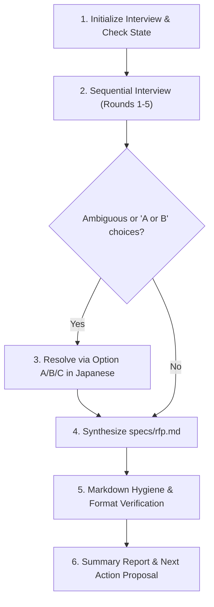

# RFP Interview Skill

This skill acts as a Senior Product Manager & Enterprise Solutions Architect. It conducts structured, one-question-at-a-time interviews with the user to discover project vision, surface pain points, resolve ambiguous choices ("A or B"), define explicit boundaries (in-scope vs. out-of-scope), and synthesize a production-grade Request for Proposal (`specs/rfp.md`).

> [!IMPORTANT]
> **Language & Output Rule**:
> All interactive communication, interview questions, clarification proposals (Option A/B/C), progress updates, and final summary reports to the user **MUST always be delivered in Japanese**.

---

## 1. Activation Triggers

Triggered when the user or orchestrator requests:

- 「RFPを作りたい」「企画の壁打ちをして」「要件・要望をヒアリングして」
- 「アプリのアイデアを整理して」「何を作るか一緒に考えて」
- Direct invocation via `/rfp-interview` or `rfp-interview`

---

## 2. Inputs & Outputs

- **Inputs**:
  - Conversational input, raw ideas, problem statements, or existing drafts.
  - Optional: `.agents/templates/rfp.template.md` as reference layout.
- **Outputs**:
  - `specs/rfp.md`: Complete, structured project proposal adhering to template semantics.
  - Interactive questionnaire logs and resolved trade-off records.
  - Japanese summary report indicating readiness for tech stack decision and requirements engineering.

---

## 3. Operational Rules & Guardrails

### A. One-by-One Interactive Interview Discipline

1. **No Question Dumps**:
   - The agent **MUST NOT** overwhelm the user by dumping all questions at once.
   - Conduct structured interviews sequentially, covering one domain dimension at a time:
     - Round 1: Project overview, pain points, core objective (Why & What).
     - Round 2: Target personas and primary user journeys (Who & When).
     - Round 3: Essential core features (Must vs. Nice-to-have).
     - Round 4: Non-functional requirements, scale, security, and operational constraints.
     - Round 5: Strict Out-of-Scope boundaries (What NOT to build in v1).
2. **Concise Probing**:
   - Keep each interview prompt concise, conversational, and direct in Japanese.

### B. Ambiguity Resolution & "A or B" Elimination

1. **Zero Vagueness Policy**:
   - When the user states ambiguous preferences (e.g., "Either social login or email", "Maybe real-time chat or polling"), the agent **MUST NOT** leave it unresolved.
2. **Structured Clarification Protocol**:
   - Present concrete trade-offs in Japanese before finalizing the specification:
     - **推奨案（A案 / Option A - Recommended）**: Standard, token-efficient, or robust default.
     - **代替案（B案・C案 / Options B & C）**: Simpler, MVP-oriented, or alternative approaches.
     - **トレードオフ比較（Trade-offs）**: Maintenance complexity, implementation cost, user experience impact.

### C. Out-of-Scope Enforcement (Scope Creep Guardrail)

1. **Mandatory Non-Goals**:
   - Every generated `specs/rfp.md` **MUST** contain an explicit `Out of Scope` section.
   - List non-essential features, deferred extensions, and secondary platforms excluded from v1.

### D. Markdown Hygiene & Document Standards

1. **Document Conventions**:
   - `specs/rfp.md` is a human-facing spec document and **MUST** include a Table of Contents (TOC) with valid anchor links.
   - Zero consecutive blank lines (`\n\n\n+` collapsed to `\n\n`).
   - Single EOF newline (`\n`).

---

## 4. Step-by-Step Execution Workflow

### Step 1: Initialize Interview & Check State

- Check if `specs/rfp.md` already exists.
  - If existing, ask the user if they wish to refine specific sections or start fresh.
- If fresh, introduce the interview process in Japanese and initiate Round 1 (Problem & Objectives).

### Step 2: Sequential Interview

- Carry out the 5 interview dimensions sequentially.
- Reflect user inputs, summarize consensus, and probe deeper when details are sparse.

### Step 3: Resolve Ambiguity & Scope

- If the user expressed indecision or multiple conflicting wishes, present structured choices:
  - Option A (Recommended default)
  - Option B (Lean / MVP approach)
  - Trade-off evaluation
- Lock down the decision before generating the document.

### Step 4: Synthesize `specs/rfp.md`

- Ensure `specs/` directory exists.
- Generate `specs/rfp.md` following `.agents/templates/rfp.template.md` structure with TOC.
- Use `write_file` to save the document.

### Step 5: Markdown Hygiene & Format Verification

- Verify that `specs/rfp.md` has no consecutive blank lines (`\n\n\n+`).
- Verify single EOF newline (`\n`).
- Ensure all TOC anchor links correspond to actual headings.

### Step 6: Summary Report & Next Action Proposal (in Japanese)

- Deliver concise Japanese completion report:
  - 生成したファイルパス: `specs/rfp.md`
  - 確定したコア機能およびスコープ外（Out of Scope）の要約
  - 次のフェーズの推奨アクション:
    1. 技術スタックの確定（言語、FW、DB、認証方式）
    2. 要件定義スキル `create-requirements` の実行
