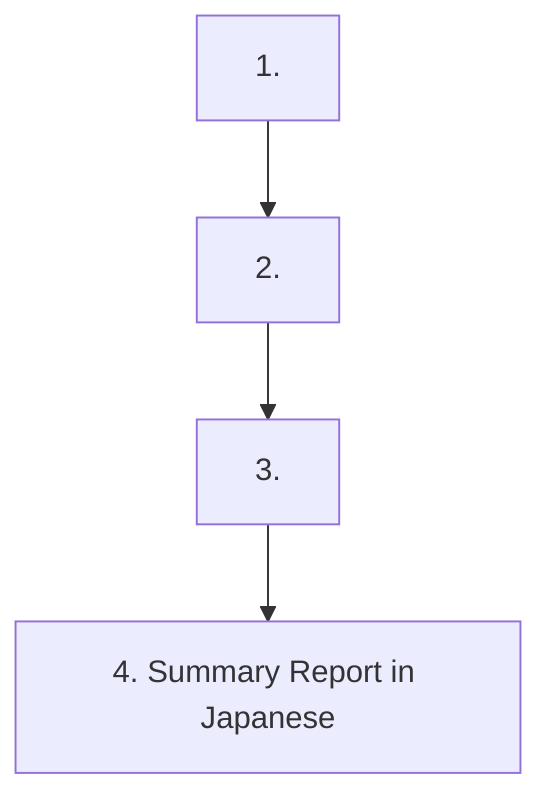
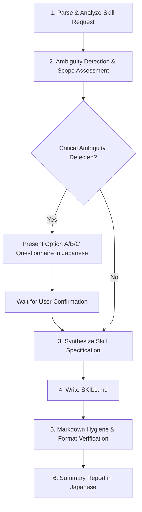

# Skill Creator

This meta-skill acts as the master factory for authoring, refactoring, and standardizing specialized agent skills (`SKILL.md`) under `.agents/skills/<skill-name>/SKILL.md`. It enforces strict token-efficiency principles, prevents autonomous hallucination through structured clarification questionnaires, and guarantees consistent architectural standards across all skills.

> [!IMPORTANT]
> **Language & Output Guardrail**:
> All interactive communication, clarification questions, trade-off proposals (Option A/B/C), progress updates, and final summary reports to the user **MUST always be delivered in Japanese**.

---

## 1. Activation Triggers

Triggered when the user or an orchestrating workflow requests:

- Creating a new skill (e.g., 「新しいスキルを作成して」「スキル定義を作って」, "Create a new skill for X")
- Standardizing, refactoring, or optimizing an existing skill (e.g., 「スキルをリファクタリングして」「トークン効率を改善して」)
- Defining lifecycle skills for web app development phases (e.g., RFP, requirements, reviews, doc updates)
- Direct invocation via `/skill-creator` or `skill-creator`

---

## 2. Inputs & Outputs

- **Inputs**:
  - Skill name (kebab-case, e.g., `rfp-interview`, `create-requirements`).
  - Target domain, functional requirements, operational phase, and trigger phrases.
  - Optional: Target directory path (defaults to `.agents/skills/<skill-name>/SKILL.md`).
- **Outputs**:
  - Canonical `.agents/skills/<skill-name>/SKILL.md` compliant with all token-efficiency and structural rules.
  - Formatted according to strict markdown hygiene (zero double blank lines, single EOF newline, no TOC).
  - Japanese completion summary report with applied guardrails and recommended next steps.

---

## 3. Core Architectural Principles & Guardrails

All generated skills, as well as this meta-skill itself, **MUST** strictly enforce the following principles:

### A. Token Optimization & Two-Tier Language Architecture (CRITICAL)

1. **Frontmatter `description` in Japanese**:
   - The YAML frontmatter `description` **MUST** be written in concise Japanese to support localized agent selection, UI search, and semantic routing.
   - A brief English summary in parentheses is recommended: `<日本語概要> (<English summary>)`.
2. **Body Content in Pure English**:
   - The entire body of `SKILL.md` (headings, rules, workflows, mermaid diagrams, templates) **MUST** be written in English.
   - English subword tokenization saves 40–60% tokens compared to Japanese, optimizing context windows and maximizing LLM instruction-following precision.
3. **Strict Table of Contents (TOC) Exclusion**:
   - Agent skills are executable instructions consumed by LLMs, not human manuals. TOC sections consume valuable context without operational value and **MUST NEVER** be included.
4. **Output Language Enforcement**:
   - Every skill **MUST** include an explicit alert banner mandating that all user-facing communication, questions, and final reports be delivered in Japanese:
     ```markdown
     > [!IMPORTANT]
     > **Language & Output Rule**:
     > All interactive communication, questions, clarifications, and final reports to the user **MUST always be delivered in Japanese**.
     ```
5. **High-Density Declarative Syntax**:
   - Eliminate pleasantries, discursive intros, and conversational filler. Use bullet points, imperative directives (`MUST`, `MUST NOT`, `SHOULD`), and inline code spans.

### B. Anti-Hallucination & Ambiguity Clarification Guardrail

1. **Zero Unilateral Assumptions on Critical Ambiguity**:
   - The agent is strictly forbidden from guessing, inventing, or unilaterally selecting an architectural path when user requests are ambiguous, open-ended, or contain conflicting requirements (e.g., data models, authorization boundaries, schema strategy, third-party integrations).
2. **Mandatory Clarification Format in Japanese**:
   - When critical ambiguity is detected, the agent **MUST** pause execution and present structured options to the user before generating code or skill definitions:
     - **推奨案（A案 / Option A - Recommended）**: Standard best practice, token efficiency, and clear technical rationale.
     - **代替案（B案・C案 / Options B & C）**: Minimalist approach, alternative architecture, or lightweight trade-off.
     - **トレードオフ比較（Trade-offs）**: Concrete comparison of token efficiency, maintainability, flexibility, and implementation cost.
3. **Trivial vs. Critical Threshold**:
   - **Critical (Clarification Required)**: Domain model boundaries, schema definitions, authentication/authorization levels, lifecycle states, destructive change policies.
   - **Trivial (Autonomous Resolution Allowed)**: Internal naming conventions, routine regex patterns, helper decomposition, standard markdown formatting.

### C. Markdown Hygiene Standards

1. **Zero Consecutive Blank Lines**:
   - Any sequence of two or more blank lines (`\n\n\n+`) **MUST** be collapsed into exactly one blank line (`\n\n`).
2. **Strictly Single EOF Newline**:
   - The file **MUST** end with exactly one single newline character (`\n`). No trailing blank lines or EOF omissions.
3. **Fenced Code Blocks & Code Spans**:
   - All fenced code blocks **MUST** specify a language tag (e.g., `markdown`, `bash`, `mermaid`, `json`).
   - File paths, command names, flags, and technical identifiers **MUST** be wrapped in backticks.

---

## 4. Standard Skill Template Structure

Every skill created by `skill-creator` **MUST** follow this canonical template structure:

````markdown
---
name: <kebab-case-skill-name>
description: <日本語による簡潔なスキルの説明と選定基準> (<Concise English summary>)
---

# <Title Case Skill Name>

<High-density 1-2 sentence role definition and core objective.>

> [!IMPORTANT]
> **Language & Output Rule**:
> All interactive communication, questions, clarifications, and final reports to the user **MUST always be delivered in Japanese**.

---

## 1. Activation Triggers

Triggered when the user issues requests such as:

- <Specific trigger phrase 1 in Japanese / English>
- <Specific trigger phrase 2 in Japanese / English>
- `/<skill-name>` or `<skill-name>`

---

## 2. Inputs & Outputs

- **Inputs**:
  - <Input specifications: file paths, parameters, schemas, or conversation context>
- **Outputs**:
  - <Output specifications: generated artifacts, modified files, diffs>
  - <No-Op / Early exit condition when already compliant>

---

## 3. Operational Rules & Guardrails

### A. <Domain Rules & Security Standards>

1. **<Rule 1>**: <Imperative directive with code spans>
2. **<Rule 2>**: <Imperative directive>

### B. <Ambiguity & Clarification Protocol>

- <Guidelines for pausing on ambiguity and presenting Option A/B trade-offs in Japanese>

---

## 4. Step-by-Step Execution Workflow



### Step 1: <Step Name>

- <Actionable bullet points with explicit tool usage instructions>

### Step 2: <Step Name>

- <Actionable bullet points with validation criteria>

### Step 3: <Step Name>

- <File modification, verification, or test execution>

### Step 4: Summary Report (in Japanese)

- <Structured summary report format delivered in Japanese>
````

---

## 5. Step-by-Step Execution Workflow



### Step 1: Parse & Analyze Skill Request

- Extract target skill name, domain phase, purpose, inputs, and outputs.
- Verify that skill name uses valid `kebab-case` naming.

### Step 2: Ambiguity Detection & Scope Assessment

- Check for open-ended requirements, conflicting options, or unspecified architecture boundaries.
- **Decision Point**:
  - If critical ambiguities exist: Pause execution. Formulate Option A (Recommended), Option B/C (Alternatives), and trade-offs. Present in Japanese and wait for confirmation.
  - If the requirement is clear and unambiguous: Proceed directly to Step 3.

### Step 3: Synthesize Skill Specification

- Draft the skill content adhering to the standard template:
  - Concise Japanese `description` in YAML frontmatter.
  - 100% English body content.
  - Zero Table of Contents (TOC).
  - Mandatory Japanese output guardrail alert.
  - High-density imperative syntax.
  - Explicit activation triggers, inputs/outputs, guardrails, and mermaid workflow.

### Step 4: Write SKILL.md

- Ensure directory `.agents/skills/<skill-name>/` exists.
- Write content to `.agents/skills/<skill-name>/SKILL.md` using `write_file`.

### Step 5: Markdown Hygiene & Format Verification

- Verify that the generated file contains zero double blank lines (`\n\n\n+`).
- Verify that the file ends with a single EOF newline (`\n`).
- Ensure all list indentations and fenced code blocks have proper language identifiers.
- Run `format-markdown` check if any formatting irregularities are detected.

### Step 6: Summary Report (in Japanese)

- Deliver concise Japanese completion report:
  - 作成したスキルファイルパス
  - スキルの目的と発火トリガー
  - 準拠した設計原則（トークン節約、言語二層化、TOC排除、逆質問ガードレール）
  - 次のステップ（関連スキル作成やテスト実行）
