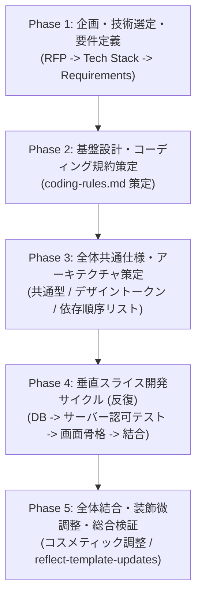

# AI駆動 WebApp開発プロジェクト ガイド

本リポジトリは、**「AI駆動 WebApp開発初期セット（Agents Starter Kit）」** が展開されたプロジェクトです。
AIエージェントと協調し、企画構想（RFP）から技術選定、要件定義、共通基盤策定、そして機能ごとの垂直スライス実装までを一気通貫で進めるためのレールが敷かれています。

> [!TIP]
> 迷ったときはいつでもチャットで **`/help`** と送信してください。現在の開発フェーズに応じた次アクションの提案や、各スキルの個別マニュアルを確認できます。

## 目次

1. [前提条件と動作環境](#1-前提条件と動作環境)
2. [開発標準フロー概要](#2-開発標準フロー概要)
3. [Phase別 実践ガイド＆プロンプト集](#3-phase別-実践ガイドプロンプト集)
   - [Phase 1: 企画・技術選定・要件定義](#phase-1-企画技術選定要件定義)
   - [Phase 2: 基盤設計・コーディング規約策定](#phase-2-基盤設計コーディング規約策定)
   - [Phase 3: 全体共通仕様・アーキテクチャ策定](#phase-3-全体共通仕様アーキテクチャ策定)
   - [Phase 4: 垂直スライス開発サイクル](#phase-4-垂直スライス開発サイクル)
   - [Phase 5: 全体結合・装飾微調整・マスター還元](#phase-5-全体結合装飾微調整マスター還元)
4. [Definition of Done（DoD: スライス完了基準）](#4-definition-of-done-dod-スライス完了基準)
5. [知見の記録ルール (doc-updates.todo.md)](#5-知見の記録ルール-doc-updatestodomd)
6. [初期提供スキル＆ナビゲーション一覧](#6-初期提供スキルナビゲーション一覧)

---

## 1. 前提条件と動作環境

- **OS / 実行環境**: Linux / macOS / WSL（Windows Subsystem for Linux）上の `bash`
- **AIエージェント**: Antigravity / Claude Code / Cursor 等のファイル読み書き・コマンド実行が可能なAI開発環境
- **リポジトリ構造**:
  - `.agents/skills/`: 開発を支援するエージェントスキル群
  - `.agents/rules/`: コーディング規約（coding-rules.md）等の監査ルール群
  - `.agents/templates/`: 各種仕様書・規約・バッファ用テンプレート
  - `specs/`: プロジェクトの企画書・要件定義書・設計書群（Phase進行とともに生成）
  - `doc-updates.todo.md`: 開発中の気づき・改善案のリアルタイム蓄積バッファ

---

## 2. 開発標準フロー概要

手戻りを最小化するため、**「企画の確定直後に技術スタックを決定し、型・スキーマを具体化した上で、機能単位の垂直スライス（DB〜認可テスト〜画面骨格〜結合）で開発する」** スパイラルサイクルを採用します。



---

## 3. Phase別 実践ガイド＆プロンプト集

各フェーズでAIエージェントに投げる推奨プロンプトです。そのままコピー＆ペーストしてご利用いただけます。

### Phase 1: 企画・技術選定・要件定義

#### 1.1 企画構想（RFP）の作成

- **手書き派**: 以下のコマンドでテンプレートを複製し、箇条書きで記入します。
  ```bash
  mkdir -p specs && cp .agents/templates/rfp.template.md specs/rfp.md
  ```
- **対話派**: エージェントと一問一答で作成します。
  ```markdown
  /rfp-interview
  新しいWebアプリケーションの企画構想を整理したいです。
  一問一答形式でヒアリングを行い、specs/rfp.md を生成してください。
  ```

#### 1.2 技術スタックの確定

`specs/rfp.md` をインプットとし、採用技術（言語・FW・DB・認証・CSS方針）を決定・合意します。

```markdown
specs/rfp.md を読み込み、本プロダクトに最適な技術スタック（言語、フロントエンド/バックエンドFW、DB/ORM、認証基盤、UIライブラリ方針）の推奨案（A案）、軽量代替案（B案）、およびトレードオフを提示してください。
私が案を選択したら、確定した技術スタックを specs/rfp.md の「7. 技術選定の希望・前提条件」セクションに確定事項として更新・保存してください。
```

#### 1.3 要件定義書の作成 (`create-requirements`)

決定した技術スタックと `specs/rfp.md` を前提に、具体的な型・スキーマ骨格と5大ステートを深掘りします。

```markdown
/create-requirements
specs/rfp.md（確定した技術スタックを含む）に基づき、スキーマ・型骨格、ロール権限マトリクス、業務ルール、および5大ステート標準を定義して specs/requirements.md を作成してください。
```

#### 1.4 要件定義書のレビュー (`requirements-review`)

```markdown
/requirements-review
specs/requirements.md を監査し、スコープ境界、スキーマ整合性、認可テスト観点（401/403）、5大ステート網羅性の観点からレビュー結果と判定を報告してください。
```

---

### Phase 2: 基盤設計・コーディング規約策定

Phase 1 で決定した技術スタックを前提に、コード生成と品質監査の共通基準となるコーディング規約（`coding-rules.md`）を策定します。

#### 2.1 コーディング規約の策定 (`coding-rules.md`)

`.agents/templates/coding-rules.template.md` をベースに、選定した技術スタックに応じたディレクトリ構成や記法規約を具体化します。
※ エージェントは受動的にスロットを埋めるだけでなく、決定した技術スタックに応じた推奨論点（型安全性強度、モジュール境界、パスエイリアス、アロー関数統一、JSDoc義務化等）を能動的にチェックリスト/推奨案（Option A）として提案してください。

```markdown
specs/requirements.md の技術スタックと .agents/templates/coding-rules.template.md をベースに、本プロジェクトのコーディング規約を具体化し、.agents/rules/coding-rules.md を生成してください。
ファイル行数200行制限、最新構文準拠・非推奨コード排除、型安全性、エラーハンドリング、ディレクトリ構造、インポート規約、FW固有記法を網羅してください。
※ 策定にあたり、採用技術スタックにおいて事前に固めておくべき推奨アーキテクチャ規約・コードスタイル論点をチェックリストとして能動的に提示し、私の合意を得てから反映してください。
```

> [!NOTE]
> **完了時の次の推奨ステップ**: **Phase 3.1: 全体画面一覧・画面遷移図の策定 (`specs/screens.md`)** に進みます。

---

### Phase 3: 全体共通仕様・アーキテクチャ策定

垂直スライス実装に入る前に、全スライスで共有する共通基盤、アーキテクチャ、およびデザイン規約を段階的に策定し、ベースラインコードベースを構築します。
※ AIの出力トークン上限や論理依存の破綻を防ぐため、以下の7つのステップに分割して順次進めます。設計上の重要な分岐や未決事項がある場合は勝手に推測せず、推奨案（A案）と代替案（B案）を提示して確認してください。

#### 3.1 全体画面一覧・画面遷移図の策定 (`specs/screens.md`)

```markdown
specs/requirements.md を読み込み、全体の画面一覧、URLルーティング、ロール別アクセス権限、および画面遷移図を定義した specs/screens.md を策定してください。
各画面における主要UIブロックおよび5大ステート（Empty, Loading, Success, Error, Disabled）の表示方針も含めてください。
※ UIワイヤーフレームのコードブロック内アスキーアート（AA）記述は禁止です。視覚的配置レイアウトはベクター形式の SVG ファイル（デスクトップ: specs/assets/screens/<screen-id>.desktop.svg、モバイル差分がある場合は <screen-id>.mobile.svg）として出力し、Markdown内から画像参照（）してください。
```

> [!NOTE]
> **完了時の次の推奨ステップ**: **Phase 3.2: 全体DBデータモデリング・共通型定義 (`specs/db.md`, `specs/types/`)** に進みます。

#### 3.2 全体DBデータモデリング・共通型定義 (`specs/db.md`, `specs/types/`)

```markdown
specs/requirements.md と specs/screens.md を読み込み、全体DBスキーマ設計書（specs/db.md）および共通型定義ブループリント（specs/types/）を策定してください。
テーブル定義、PK/FK、一意性制約、ステータスEnum、インデックス設計を網羅してください。
※ specs/types/ は Phase 3.7 のプロジェクト初期化時に実装コードツリー（src/types/ や src/schemas/ 等）へ正式移行し、以降は実装側の型・スキーマを正本（Single Source of Truth）として運用します。
```

> [!NOTE]
> **完了時の次の推奨ステップ**: **Phase 3.3: 共通UIコンポーネント一覧・調達方針の策定 (`specs/components.md`)** に進みます。

#### 3.3 共通UIコンポーネント一覧・調達方針の策定 (`specs/components.md`)

```markdown
specs/screens.md を読み込み、画面群で共通利用するUI部品の一覧と調達方針を定義した specs/components.md を策定してください。
以下の3原則を徹底してください：

1. 【Atomic Breakdown（UI原子分解）】画面複合ブロックから入力、選択肢、ポップオーバー、ラベル、タイポグラフィ等の最小構成単位を網羅的に分解・抽出する。
2. 【調達プリミティブ（ui/）＋共有ラッパー（shared/）の2層原則】自前実装（div + CSS）に頼らず、まずアクセシビリティを担保する基盤プリミティブを調達し、その上に業務ロジックを載せた共有ラッパーを構築する。
3. 【ライブラリカタログ全件逆引き突合】採用UIライブラリの公式コンポーネント一覧と画面要件を機械的に突き合わせ、流用可能なプリミティブの調達漏れを未然に防止する。
   ※ 複雑なコンポーネント構造やステート変化図を視覚化する場合は、アスキーアートを用いず specs/assets/components/ 配下の SVG ファイルとして出力・参照してください。
```

> [!NOTE]
> **完了時の次の推奨ステップ**: **Phase 3.4: デザイントークン・デザイン規約の策定 (`.agents/rules/design-rules.md`)** に進みます。

#### 3.4 デザイントークン・デザイン規約の策定 (`.agents/rules/design-rules.md`)

```markdown
.agents/templates/design-rules.template.md と specs/components.md をベースに、決定した技術スタックに合わせたデザイン規約を具体化し、.agents/rules/design-rules.md を生成してください。
セマンティックカラートークン（Light/Dark）、タイポグラフィ階層、4px/8px余白グリッド、角丸、生カラー禁止規約を網羅してください。
```

> [!NOTE]
> **完了時の次の推奨ステップ**: **Phase 3.5: 共通認証・認可ガード方針の策定 (`specs/auth.md`)** に進みます。

#### 3.5 共通認証・認可ガード方針の策定 (`specs/auth.md`)

```markdown
specs/requirements.md と specs/db.md に基づき、共通の認証・認可アーキテクチャ方針（specs/auth.md）を策定してください。
セッション管理、認可ガードヘルパー、未認証(401)/権限不足(403)のハンドリング方針、および共通セキュリティ防御策を定義してください。
```

> [!NOTE]
> **完了時の次の推奨ステップ**: **Phase 3.6: 垂直スライスの依存関係・着手順序リスト策定＆共通設計レビュー (`specs/slices.md`)** に進みます。

#### 3.6 垂直スライスの依存関係・着手順序リスト策定＆共通設計レビュー (`specs/slices.md`)

```markdown
/docs-review
ここまでに策定した画面設計・DB設計・コンポーネント・認証方針を踏まえ、Phase 4 で実装する機能単位と着手順序リスト（specs/slices.md）を策定し、続けて docs-review スキルで Phase 3 全設計書の整合性を監査してください。
※レイヤー別の水平分割（DBのみ、APIのみ等）は禁止し、Slice 0（認証・共通レイアウト基盤）以降は「1スライス＝1ユースケース（DB〜API〜UI貫通）」の単位で、スライスID・進捗ステータス（[ ] 未着手 / [~] 進行中 / [x] 完了）・対象画面・API・テーブル・先行依存関係を明記してください。
```

#### 3.7 プロジェクト初期化・全基盤ライブラリ導入＆疎通確認

```markdown
これまでに策定した技術スタック、specs/components.md、.agents/rules/design-rules.md、および specs/auth.md に基づき、プロジェクトの初期化（スキャフォールド）と基盤ライブラリのインストールを行ってください。
【重要】作業ディレクトリには既に .agents/, specs/, README.md, doc-updates.todo.md が存在します。スキャフォールド実行時にこれらが上書き・消去されないよう一時退避・復元して確実に保護してください。
ORM、ローカルDB環境（Docker Compose またはローカルDB設定）、環境変数テンプレート（.env.example と型安全な環境変数バリデーション）、UIライブラリ（shadcn/ui等）、認証SDK、CSS設定、Linter/テストランナーを一括導入し、specs/types/ の共通型を実装ディレクトリへ配置、design-rules.md のCSSトークンを初期注入した上で、空の状態で型検査・ビルド・Lint・テストがオールグリーンであることを確認してください。
```

---

### Phase 4: 垂直スライス開発サイクル

Phase 3 で策定した「スライスの依存関係・着手順序リスト（`specs/slices.md`）」に従い、**1機能（ユースケース）単位** で以下を反復します。

#### ステップ1: 当該機能の仕様詳細・スキーマ定義＆レビュー

```markdown
/docs-review
specs/slices.md の対象スライスを [~] 進行中 に更新した上で、スライス [スライスID: スライス名] の詳細設計書（specs/slices/[スライスID].md）を作成し、docs-review スキルで共通仕様（specs/db.md, 共通型, specs/auth.md, .agents/rules/design-rules.md）との整合性・認可境界・5大ステートをレビューしてください。
```

#### ステップ2: DBマイグレーション＆初期シードデータ作成

```markdown
スライス [スライスID: スライス名] のDBテーブルマイグレーションファイルを生成してマイグレーションを実行し、動作確認およびテストに必要な初期シードデータ（Seedスクリプト）を作成・更新してください。
```

#### ステップ3: サーバーロジック実装＆認可テスト

> [!IMPORTANT]
> 正常系だけでなく、「権限外アクセスが401/403で遮断されるテスト」の実装が必須です（公開エンドポイントの場合は入力バリデーション400テストを実装）。認可ガードや検証対象ロジック自体をモック化したテストは禁止です。

```markdown
スライス [スライスID: スライス名] のサーバーロジック/APIを実装してください。
正常系テストに加え、未認証・不正権限アクセスを拒絶する401/403認可テスト（実際の認可ガードを通すテスト）を必ず実装し、テストをすべてパスさせてください。
```

#### ステップ4: 画面骨格・UI実装＆結合

> [!NOTE]
> この段階ではピクセル単位の装飾やアニメーションは施さず、DOM構造・基本レイアウト・5大ステート（Empty/Loading/Success/Error/Disabled）およびフォーム防御（二重送信防止・エラー表示分岐）を確実に実装してデータ層と結合します。

```markdown
スライス [スライスID: スライス名] のUIコンポーネントを実装し、データ層と結合してください。
5大ステート（Empty, Loading, Success, Error, Disabled/Unauthorized）の表示切り替え、非同期送信中のボタン二重押下防止、および .agents/rules/design-rules.md のセマンティックトークン準拠を網羅し、テストを通してください。
```

#### ステップ5: スライスのコードレビュー・進捗更新＆コミット提案

```markdown
/code-review
スライス [スライスID: スライス名] の実装コード一式をレビューしてください。
型エラーゼロ、Lintゼロ、200行制限、最新構文準拠、認可ガード（モックなしの401/403テスト必須）、および coding-rules.md / design-rules.md 準拠の観点から検証してください。
承認（Approved）となった場合は、specs/slices.md の当該スライスを [x] 完了 に更新し、改善点があれば doc-updates.todo.md に追記した上で、このスライスの Git コミットメッセージ案を提示してください。
```

---

### Phase 5: 全体結合・装飾微調整・マスター還元

#### 5.1 スタイリング微調整・演出付与

```markdown
全スライスの実装完了後、Phase 3 で策定した .agents/rules/design-rules.md に準拠したカラー・余白の微調整、およびホバー/モーダル/ローディング等のアニメーション・トランジション演出を付与してください。
```

#### 5.2 主要ユーザーフローの総合検証・E2Eテスト

```markdown
全スライスを横断する主要ユーザーシナリオ（ログイン〜主要機能のCRUD〜権限エラー境界〜ログアウト）の結合・E2Eテストを実行し、型検査・ビルド・Lint・全テストスイートがオールグリーンであることを最終検証してください。
```

#### 5.3 開発知見のマスター還元 (`reflect-template-updates`)

開発中に `doc-updates.todo.md` へ記録した知見を、マスターテンプレートへ還元します。

```markdown
/reflect-template-updates
doc-updates.todo.md に蓄積された改善知見を読み込み、汎用的なものをマスター（.agents/）へ差分反映してください。
```

---

## 4. Definition of Done（DoD: スライス完了基準）

各スライスは、以下の基準をすべて満たして初めて完了とみなされます：

1. **型・ビルド・Lint**: 静的型エラーゼロ、ビルドエラーゼロ、Lint警告ゼロ
2. **認可テスト網羅**: 正常系テストに加え、未認証・権限外アクセスを拒絶する **401/403 テストが作成され、全件パスしていること**
3. **5大ステート網羅**: UIおよびAPIにおいて、Empty, Loading, Success, Error, Disabled/Unauthorized の表示・挙動が正しく実装されていること
4. **共通スキーマ整合性**: 共通仕様（`specs/types/*`, `specs/db.md`）との間に不整合がなく、破壊的変更がある場合はユーザー合意を得ていること
5. **コードレビュー承認**: 作業リポジトリ用レビュースキルによる `承認 (Approved)` を得ていること

---

## 5. 知見の記録ルール (doc-updates.todo.md)

開発中に「初期テンプレートやスキルに足りない観点があった」「規約と実態にズレがあった」と気づいた場合は、**`doc-updates.todo.md` の末尾にリアルタイムでメモを追記** してください。

```markdown
### [ITEM-XXX] <タイトル>

- **対象**: <スキル名 / テンプレート名 / 規約など>
- **汎用性分類**: <全PJ共通 / 技術依存 / 当該PJ固有>
- **ステータス**: 未反映
- **事象・課題**: <何が起きたか>
- **改善案**: <どう直すべきか>
```

---

## 6. 初期提供スキル＆ナビゲーション一覧

| コマンド / スキル名             | 主な役割                                                         |
| :------------------------------ | :--------------------------------------------------------------- |
| **`/help [任意メッセージ]`**    | 総合ナビゲーション（個別マニュアル、逆引き検索、現状診断）       |
| **`/rfp-interview`**            | 企画構想（RFP）の対話型ヒアリング・壁打ち                        |
| **`/create-requirements`**      | 型・スキーマ骨格と5大ステートを含む要件定義書の作成              |
| **`/requirements-review`**      | 要件定義書の矛盾・認可漏れ・スコープ外境界の監査                 |
| **`/docs-review`**              | UI・API・DB設計書のスキーマ整合性・破壊的変更監査                |
| **`/code-review`**              | 実装コードの型安全性・401/403認可テスト・coding-rules.md準拠監査 |
| **`/reflect-template-updates`** | `doc-updates.todo.md` からマスターへの知見還元                   |
| **`/format-markdown`**          | Markdownドキュメントの構文・二重空行・単一EOF改行の厳格整形      |
| **`/skill-creator`**            | トークン節約規律・逆質問ガードレール準拠の新規スキル作成         |
