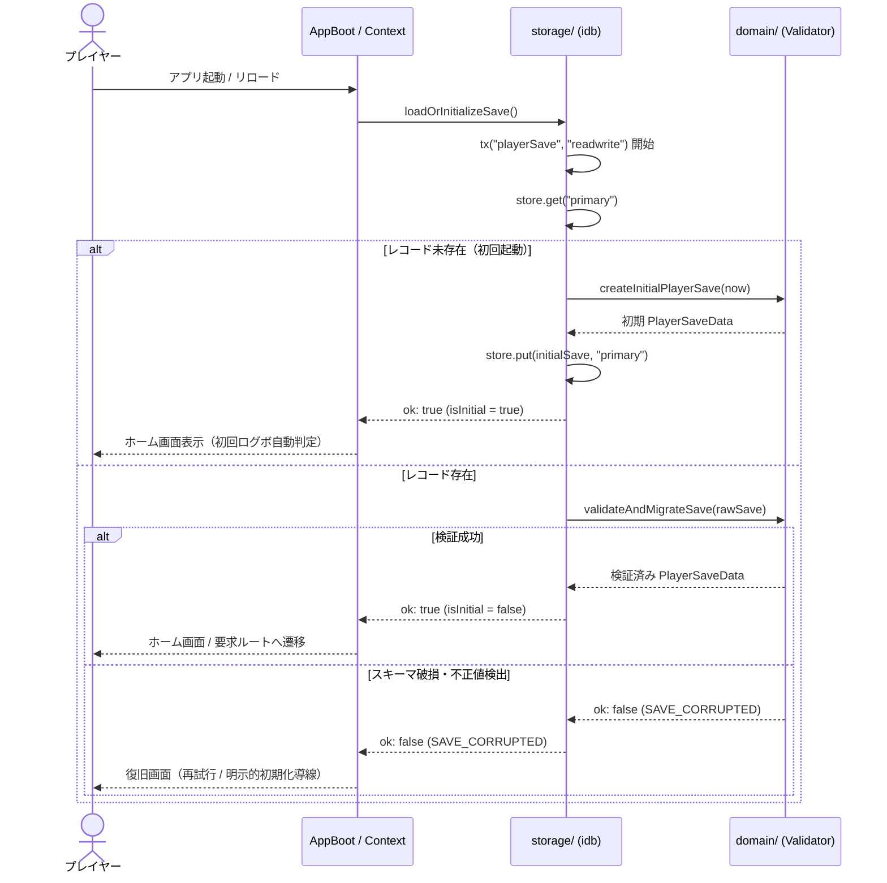

# 認証・認可アーキテクチャ方針書 (Auth & Guard Specification): 穢土浄化奇譚 〜 妖魔祓ひの旅路 〜

本書は、[specs/requirements.md](./requirements.md)、[specs/db.md](./db.md)、および [specs/screens.md](./screens.md) に基づき、完全クライアント完結型Webゲーム『穢土浄化奇譚 〜 妖魔祓ひの旅路 〜』におけるセッション管理、ドメイン認可ガードヘルパー、未認証（401）/ 権限不足（403）相当のハンドリング方針、および共通セキュリティ防御策を定義します。

## 目次

1. [認証・認可モデルの位置づけ](#1-認証認可モデルの位置づけ)
2. [セッション管理方針](#2-セッション管理方針)
3. [認可ガードヘルパー設計](#3-認可ガードヘルパー設計)
4. [未認証(401) / 権限不足(403) 等価ハンドリング方針](#4-未認証401--権限不足403-等価ハンドリング方針)
5. [共通セキュリティ防御策](#5-共通セキュリティ防御策)
6. [将来拡張時の移行境界（v2以降）](#6-将来拡張時の移行境界v2以降)

---

## 1. 認証・認可モデルの位置づけ

### 1.1 完全クライアント完結型における基本方針

本アプリケーションは外部サーバー通信・アカウント登録・OAuth/JWT 認証を持たない**完全クライアント完結型 SPA**（React 19 + Vite + TypeScript + IndexedDB）であり、v1 において外部認証基盤は Out of Scope である。

そのため、本設計では従来のサーバーサイド認証・認可を以下の2軸へ再定義して同等の堅牢性を担保する。

1. **ローカルセッション確立（401 相当の境界）**: ブラウザの IndexedDB（`edo-purification-db` / `playerSave` / キー `"primary"`）から有効なセーブコンテキストが読み込まれ、ランタイム検証を通過していること。
2. **ドメイン事前条件ガード（403 相当の境界）**: ユーザーロール（`PLAYER`）およびシステム自動処理（`SYSTEM`）の権限境界、ならびにリソース所有権・解放状態・通貨残高・操作上限を `domain/` および `storage/` 層で強制すること。

### 1.2 ロール定義と権限境界

| ロールID | ロール名           | 担当レイヤー・主体                                 | 許可される主な責務                                                                                                                        |
| :------- | :----------------- | :------------------------------------------------- | :---------------------------------------------------------------------------------------------------------------------------------------- |
| `PLAYER` | ローカルプレイヤー | UI 操作起点（`features/`）                         | セーブ読込・明示的初期化、通貨消費を伴うガチャ・永続強化、所持内での編成変更、解放済みステージへの出撃、当日ログボ受取                    |
| `SYSTEM` | システム自動処理   | 起動ブート・イベント終端（`storage/` / `domain/`） | 初回起動時の初期セーブ自動生成、0:00 日付境界判定、ガチャ重複時の自動覚醒・精錬・勾玉変換、バトル終了イベント経由のステージ解放・報酬確定 |

> [!IMPORTANT]
> `SYSTEM` に属する状態更新（ステージ解放・クリアフラグ付与・通貨の無償付与）は、対応する正規イベント（起動ブート・バトル終了・当日初回ログボ）経由でのみ実行し、`PLAYER` が任意のステージIDや通貨値を直接指定・書き換えできる UI やアクションは提供しない。

---

## 2. セッション管理方針

本プロダクトでは、ライフサイクルの異なる2種類のセッションコンテキストを明確に分離して管理する。

### 2.1 コンテキスト種別と保持場所

| コンテキスト名                                          | 保持場所                                          | 永続性 | ライフサイクル                                       | 役割                                                |
| :------------------------------------------------------ | :------------------------------------------------ | :----: | :--------------------------------------------------- | :-------------------------------------------------- |
| **永続プレイヤーコンテキスト (`PlayerSessionContext`)** | IndexedDB (`playerSave["primary"]`) ＋ React 状態 |  永続  | アプリ起動 〜 タブ終了（永続データはブラウザに保持） | プレイヤーの資産・解放状態・装備編成の唯一の正本    |
| **バトルランセッション (`BattleRunSession`)**           | オンメモリ（`useRef` / `engine/` インスタンス）   | 非永続 | `/battle/:stageId` 進入 〜 勝敗決定/撤退/リロード    | 60fps 戦闘状態、現在Wave、結界HP、3択バフ状態の保持 |

### 2.2 アプリ起動・セッション確立フロー



### 2.3 セッション一貫性・マルチタブ対策

- **Single Source of Truth は常に IndexedDB**: React メモリ上の `PlayerSaveData` は表示用スナップショットとして扱い、書き込みを伴うすべてのアクション（ガチャ・強化・編成変更・ログボ受取・バトル報酬確定）では、**`storage/` の `readwrite` トランザクション内で最新の `"primary"` レコードを再読込**してから `domain/` のガードと状態計算を実行する。
- **インフライト排他制御（二重送信防止）**: 書き込みトランザクション実行中およびバトル結果保存中は UI 側で `isPending: boolean` を立て、同一操作の連打や別画面への割り込み遷移を抑止する。
- **バトルランセッションの非永続原則**: `/battle/:stageId` でブラウザリロードまたは直リンクが行われた場合、オンメモリの戦闘状態は復元せず、新規出撃としてルートガードを再評価する。

---

## 3. 認可ガードヘルパー設計

UI コンポーネント側の `disabled` 制御はあくまで UX 向上のための事前抑止であり、セキュリティおよび整合性の最終防壁は **`domain/` 層の純粋ガード関数** と **`app/` のルートガード** が担う。

### 3.1 ガードヘルパーの標準インターフェース

すべてのガードおよびドメイン更新関数は例外を無秩序に投げず、[specs/types/common.ts](./types/common.ts) に定義された `DomainResult<T>` および `DomainErrorCode` を返却する（純粋関数として React / DOM / IndexedDB に依存しない）。

```typescript
import type { DomainError, DomainResult } from "@/specs/types/common";

export const ok = <T>(data: T): DomainResult<T> => ({ ok: true, data });

export const err = (
  code: DomainError["code"],
  message: string,
): DomainResult<never> => ({
  ok: false,
  error: { code, message },
});
```

### 3.2 ドメイン層 認可・事前条件ガードヘルパー一覧

| ヘルパー関数名（`domain/`）                       | 検証対象・事前条件                                                                            | 拒否時の `DomainErrorCode`                                                        | 主な呼び出し元                        |
| :------------------------------------------------ | :-------------------------------------------------------------------------------------------- | :-------------------------------------------------------------------------------- | :------------------------------------ |
| `validatePlayerSaveData(raw)`                     | 必須キー存在、数値の有限性・非負性、マスタFK整合性、`equipped*` 所有整合性                    | `SAVE_CORRUPTED`                                                                  | `storage/` 読込時・マイグレーション後 |
| `guardCurrencySufficient(save, type, cost)`       | `cost >= 0` の整数であり、対象通貨残高 `>= cost`                                              | `INSUFFICIENT_MAGATAMA` / `INSUFFICIENT_HISUI`                                    | ガチャ・永続強化・バトル3択リロール   |
| `guardLoginBonusClaimable(save, todayKey)`        | `save.lastLoginBonusDate !== todayKey`（ローカル 0:00 基準 `YYYY-MM-DD`）                     | `LOGIN_BONUS_ALREADY_CLAIMED`                                                     | ログインボーナス受取アクション        |
| `guardEnhanceable(save, statKey, maxLv, cost)`    | 現在レベル `< maxLv` かつ勾玉残高 `>= cost`                                                   | `ALREADY_MAX_LEVEL` / `INSUFFICIENT_MAGATAMA`                                     | 社（強化）永続強化アクション          |
| `guardEquipmentSelection(save, charId, weaponId)` | `charId` が `ownedCharacters` に存在、`weaponId` が空でなく `ownedWeapons` に存在             | `UNOWNED_CHARACTER` / `EMPTY_WEAPON_SELECTION` / `UNOWNED_WEAPON`                 | 編成変更アクション                    |
| `guardBattleSortie(save, stageId, stageMap)`      | `stageId` が `stageMap` に存在、`unlockedStageIds` に含まれる、かつ `equippedWeaponId` が有効 | `INVALID_STAGE_ID` / `STAGE_LOCKED` / `EMPTY_WEAPON_SELECTION` / `UNOWNED_WEAPON` | ステージ出撃アクション・ルートガード  |

### 3.3 ルートガード仕様（`/battle/:stageId` 直アクセス防御）

URL パラメータを伴う `/battle/:stageId` への遷移およびブラウザ直リンク・リロード時は、バトルエンジン初期化前にルートガードを実行する。

1. `PlayerSessionContext` が `loading` の間はローディング表示（「霊脈接続中…」）で待機し、未確定状態でのバトル起動を禁止する。
2. `PlayerSessionContext` が `corrupted` / `error` の場合はホーム画面（`/`）のエラー復旧ステートへリダイレクトする。
3. `guardBattleSortie(save, stageId, STAGE_MASTER_MAP)` が `{ ok: false }` を返した場合は、即座に `/stages` へリダイレクトし、エラー内容に応じたトースト通知（例：「このステージはまだ解放されていません」「持ち込み武器を1つ選択してください」）を表示する。
4. 未定義ルート（`*`）へのアクセスは `/`（ホーム画面）へフォールバックリダイレクトする。

---

## 4. 未認証(401) / 権限不足(403) 等価ハンドリング方針

本アプリケーションでは HTTP ステータスとしての 401 / 403 は発生しないが、セーブコンテキスト未確立（401 相当）および事前条件・権限境界違反（403 相当）を明確に分類し、5大ステート標準（[specs/requirements.md](./requirements.md) セクション5）と一貫したハンドリングを行う。

### 4.1 エラー分類とハンドリングマッピング

| 分類（等価ステータス）                       | 該当 `DomainErrorCode`                                                                              | 発生シナリオ例                                                                                    | UI / ルーティング上の振る舞い                                                                                                                                             |
| :------------------------------------------- | :-------------------------------------------------------------------------------------------------- | :------------------------------------------------------------------------------------------------ | :------------------------------------------------------------------------------------------------------------------------------------------------------------------------ |
| **401 相当（コンテキスト未確立 / 破損）**    | `SAVE_CORRUPTED`, `STORAGE_ERROR`                                                                   | IndexedDB 読込失敗、ブラウザストレージ容量エラー、セーブデータのスキーマ破損・手動改ざん検出      | すべての保護アクションを遮断し、ホーム画面の **Error ステート** を表示。「再試行」ボタンおよび「確認モーダル付きセーブデータ初期化復旧」導線を提示。                      |
| **403 相当（進行・所有権・リソースロック）** | `STAGE_LOCKED`, `INVALID_STAGE_ID`, `UNOWNED_CHARACTER`, `UNOWNED_WEAPON`, `EMPTY_WEAPON_SELECTION` | 未解放ステージへの直リンク出撃、未所持キャラ/武器の装備指定、武器未装備（空）での出撃・編成保存   | 事前表示は `Disabled`（鍵アイコン・注記）。直接実行・直リンク時はトランザクションを実行せず拒否し、`/stages` へのリダイレクトおよびエラートースト／インライン警告を表示。 |
| **403 相当（残高・上限・重複受取拒否）**     | `INSUFFICIENT_MAGATAMA`, `INSUFFICIENT_HISUI`, `ALREADY_MAX_LEVEL`, `LOGIN_BONUS_ALREADY_CLAIMED`   | 翡翠不足での召喚実行、勾玉不足・最大Lvでの強化実行、同日ログボの二重受取、勾玉不足での3択リロール | 事前表示は `Disabled`（不足数表示・受取済みバッジ）。直接実行時はトランザクションをアボートして状態不変を保ち、トーストで理由を通知。                                     |

### 4.2 エラー伝達とロールバック原則

- **サイレント握りつぶしの禁止**: `storage/` および `domain/` のエラーを空の `catch` で握りつぶすことは厳禁とする。捕捉した予期せぬ例外はコンテキスト情報付きで構造化ログ（`console.error` 等）に記録した上で、`STORAGE_ERROR` として UI へ返却する。
- **内部情報の非露出**: ブラウザの内部スタックトレースや生例外文字列をそのままユーザー向けモーダル・トーストに表示せず、`DomainErrorCode` に対応した日本語メッセージへ変換して提示する。
- **アトミックロールバック**: IndexedDB の `readwrite` トランザクション失敗時やガード拒否時は、React メモリ状態（通貨・所持一覧・強化レベル）を一切更新せず、整合性を維持する。

### 4.3 401/403 相当拒否テストの必須化（No Hollow Mocks）

`.agents/rules/coding-rules.md` に準拠し、保護されたすべてのドメイン操作およびストレージ更新関数に対して、**実際のガード関数とバリデーションを実行する拒否系単体テスト（Vitest）**を必須とする。

- **モック禁止対象**: テスト対象となるガード関数（`guard*` / `validatePlayerSaveData`）やドメイン計算関数をモックして強制パスさせること（Hollow Mock）は厳禁とする。
- **必須検証項目**:
  - 残高不足時のガチャ・永続強化・リロール拒否（`INSUFFICIENT_HISUI` / `INSUFFICIENT_MAGATAMA`、残高不変）。
  - 未解放・不正ステージID出撃の拒否（`STAGE_LOCKED` / `INVALID_STAGE_ID`）。
  - 未所持キャラ/武器の装備拒否および武器空選択の拒否（`UNOWNED_CHARACTER` / `UNOWNED_WEAPON` / `EMPTY_WEAPON_SELECTION`）。
  - 同日 0:00 境界内でのログボ二重受取拒否（`LOGIN_BONUS_ALREADY_CLAIMED`）。
  - 破損セーブデータ（負数通貨、未知の装備ID、欠損フィールド等）に対する `SAVE_CORRUPTED` 返却。

---

## 5. 共通セキュリティ防御策

完全クライアント完結型 SPA であっても、ブラウザ環境特有の脅威（ローカルデータ改ざん、XSS、DOM インジェクション、誤操作によるデータ消失）に対して以下の共通防御策を適用する。

### 5.1 IndexedDB データの外部入力扱い（改ざん・破損耐性）

ブラウザの DevTools からユーザー自身が IndexedDB を書き換え可能であることを前提とし、読込データは**信頼できない外部入力**として扱う。

- **型・範囲検証**: `schemaVersion` が正の整数であること、`currencies` と `permanentStats` の全数値が `Number.isFinite(v) && Number.isInteger(v) && v >= 0` であることを検証する。
- **参照整合性検証（FK チェック）**: `equippedCharacterId` が `ownedCharacters` および `CHARACTER_MASTERS` に存在し、`equippedWeaponId` が `ownedWeapons` および `WEAPON_MASTERS` に存在することを検証する。
- **コレクション重複・不変性保護**: `unlockedStageIds` / `clearedStageIds` の重複排除、および `clearedStageIds ⊆ unlockedStageIds` の部分集合制約を検証する。

### 5.2 XSS・任意コード実行・プロトタイプ汚染の防止

- **React JSX 自動エスケープの徹底**: すべてのテキスト描画は React JSX の標準エスケープを経由し、`dangerouslySetInnerHTML`、`innerHTML`、`outerHTML`、`document.write`、`eval`、`new Function` の使用を全面禁止する。
- **URL パラメータのホワイトリスト検証**: `/battle/:stageId` の `stageId` は文字列としてそのまま DOM や Canvas に描画せず、必ず `STAGE_MASTER_MAP` との完全一致照合を通過した正規IDのみを使用する。
- **プロトタイプ汚染防御**: IndexedDB から復元したオブジェクトをマップ参照（`ownedCharacters[id]` 等）する際は、`Object.hasOwn(map, id)` を使用して `__proto__` や `constructor` 等のプロトタイププロパティ誤参照を防ぐ。

### 5.3 破壊的操作・誤操作防止とダイアログ規約

- **ネイティブダイアログ禁止**: `window.alert()` / `window.confirm()` / `window.prompt()` の使用は全面禁止とする。
- **セーブ初期化の明示的承認**: セーブデータの削除・初期化は、カスタム確認ダイアログ（`ConfirmAlertDialog`）で破壊的操作である旨を明示した上でユーザーの明示的承認を得た場合のみ実行する。

### 5.4 シークレット非保持・外部通信ゼロ方針

- クライアントバンドル内に API キー、認証シークレット、署名鍵等を一切含めない（`.env` へも機密値を配置しない）。
- 外部ネットワーク通信を行わない設計を維持し、ホスティング時は `default-src 'self'` を基調とした Content Security Policy (CSP) 構成と両立できる静的ビルドを出力する（Google Fonts 等の静的アセット利用方針がある場合はそのオリジンのみ最小許可）。

---

## 6. 将来拡張時の移行境界（v2以降）

将来的にオンラインランキング、クラウドセーブ同期、またはアカウント連携（v2以降）を導入する場合に備え、以下のレイヤー境界を維持する。

1. **リポジトリ抽象の維持**: `features/` は `window.indexedDB` を直接参照せず、`storage/` のリポジトリ API 経由でのみ永続化を行う。クラウド同期導入時は `storage/` 配下にリモート同期アダプタを追加するだけで UI 層への影響を局所化できる。
2. **ドメインロジックのサーバー移植性**: `domain/` 配下の関数はブラウザ API（`window` / `document` / `indexedDB`）および `react` に依存しない純粋 TypeScript で記述するため、将来バックエンド（Node.js / Edge Functions）を導入する際も、同一のガード・計算ロジックをそのままサーバー側認可として再利用できる。
3. **認証導入時のプロトコル**: サーバー連携時は `HttpOnly` + `Secure` + `SameSite=Lax` 属性付きセッション Cookie または短期トークンを採用し、クライアント側にはトークン生値を `localStorage` 等へ保存しない方針を採る。
