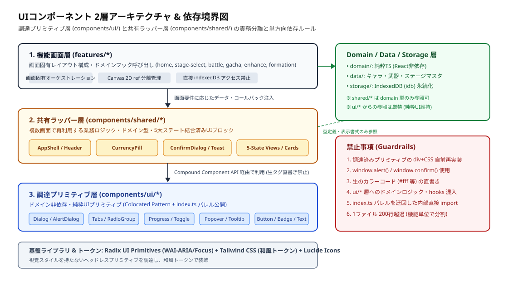
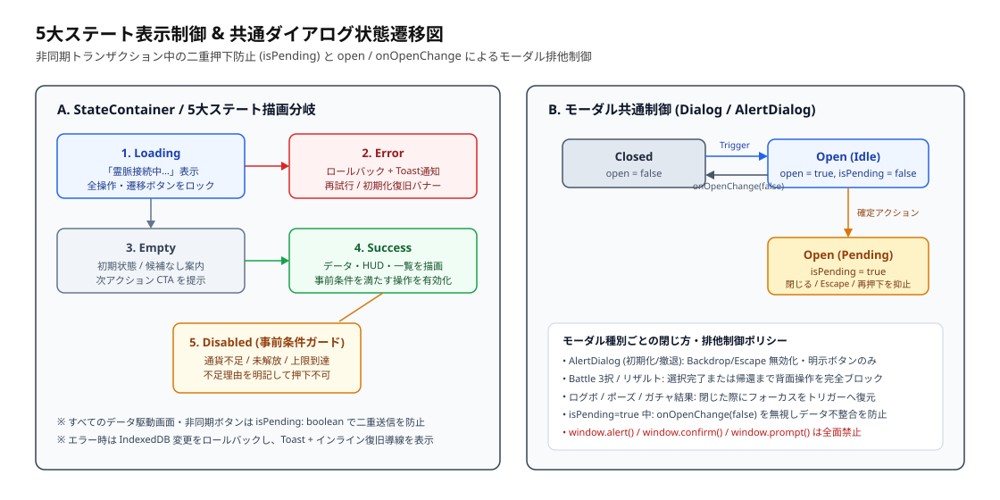

# 共通UIコンポーネント仕様書・調達方針 (Component Specification): 穢土浄化奇譚 〜 妖魔祓ひの旅路 〜

本書は、[specs/screens.md](./screens.md) および [specs/requirements.md](./requirements.md) に基づき、和風縦型ローグライクタワーディフェンス Web ゲーム『穢土浄化奇譚 〜 妖魔祓ひの旅路 〜』の全6画面および6モーダルで共通利用する UI コンポーネントの原子分解結果、調達方針、およびアーキテクチャ規約を定義します。

## 目次

1. [基本方針と2層アーキテクチャ原則](#1-基本方針と2層アーキテクチャ原則)
2. [UI原子分解 (Atomic Breakdown)](#2-ui原子分解-atomic-breakdown)
3. [UIライブラリカタログ全件逆引き突合](#3-uiライブラリカタログ全件逆引き突合)
4. [調達プリミティブ層 (components/ui/) カタログ](#4-調達プリミティブ層-componentsui-カタログ)
5. [共有ラッパー層 (components/shared/) カタログ](#5-共有ラッパー層-componentsshared-カタログ)
6. [画面・モーダル別 コンポーネント対応トレース表](#6-画面モーダル別-コンポーネント対応トレース表)
7. [アクセシビリティ・モバイル・実装監査ルール](#7-アクセシビリティモバイル実装監査ルール)

---

## 1. 基本方針と2層アーキテクチャ原則

### 1.1 調達技術スタックの確定方針

[specs/requirements.md](./requirements.md) で定めた「汎用 UI キット不使用で和風デザインを実現」の方針と、[.agents/rules/coding-rules.md](../.agents/rules/coding-rules.md) の「WAI-ARIA 準拠・Compound Component パターン・生 HTML タグへのフォールバック禁止」を両立するため、以下の調達方針を採用する。

- **ヘッドレス UI プリミティブ**: **Radix UI Primitives**（`radix-ui` または `@radix-ui/react-*`）を採用する。視覚的スタイルを持たないため、既成 UI キットの見た目を引きずることなくカスタム和風デザインを実現しつつ、フォーカストラップ・キーボード操作・ARIA 属性を完全担保する。
- **スタイリング**: **Tailwind CSS** + CSS カスタムプロパティ（デザインシステムトークン、`.agents/rules/design-rules.md` で具体化）。
- **アイコン**: 標準 UI 操作アイコン（戻る・鍵・停止・再生・閉じる・警告等）は **`lucide-react`** を調達し、和風固有モチーフ（水晶の勾玉・翡翠・武器ジャンル紋章）はカスタム SVG アイコンコンポーネントとして実装する。

### 1.2 調達プリミティブ (`components/ui/`) + 共有ラッパー (`components/shared/`) の2層原則

自前実装（素の `div` + CSS のみでのダイアログやタブ実装）を禁止し、責務を明確に2層へ分離する。

1. **第1層：調達プリミティブ層 (`components/ui/`)**
   - Radix UI Primitives や基本 HTML 要素をラップし、和風デザイントークンと Compound Component API（`Root`, `Trigger`, `Content` 等）のみを提供する**純粋な UI プリミティブ**。
   - **ドメイン知識（通貨、ステージ、ガチャ、セーブ等）や `domain/`・`storage/` への依存を一切持たない**。
   - `.agents/rules/coding-rules.md` の Colocated Component Pattern（`components/ui/{ComponentName}/index.ts` バレル公開）に従う。
2. **第2層：共有ラッパー層 (`components/shared/`)**
   - `components/ui/` のプリミティブを組み合わせ、ドメイン型（`CurrencyType`, `StageMaster`, `DomainError` 等）や 5大ステート（Empty / Loading / Success / Error / Disabled）の振る舞いを組み込んだ**業務共有 UI ブロック**。
   - 複数画面（または複数モーダル）から再利用されるレイアウト枠・ヘッダー・フッター・通貨ピル・確認ダイアログ・状態ビューをここに集約する。

---

## 2. UI原子分解 (Atomic Breakdown)

[specs/screens.md](./screens.md) の全6画面・全6モーダル・共通レイアウトから複合 UI ブロックを分解し、最小構成単位（Atoms）および最小複合単位（Molecules）まで網羅的に抽出する。

| 大分類             | 画面複合ブロック             | 分解された UI 原子 / 分子要素                                                                                 | 対応層・部品名                                 |
| :----------------- | :--------------------------- | :------------------------------------------------------------------------------------------------------------ | :--------------------------------------------- |
| **レイアウト**     | PC縦型枠 / モバイル全高枠    | 縦型ビューポート枠 (`max-w-[450px]`)、左右和紙余白、Safe Area パディング (`100dvh`)                           | `shared/AppShell`                              |
| **レイアウト**     | ヘッダーバー                 | 戻るアイコンボタン、画面見出し (`h1`)、通貨ピル×2、補助ボタン（ログボ・初期化）                               | `shared/ScreenHeader`                          |
| **レイアウト**     | 共通4タブフッター            | ナビゲーションコンテナ (`nav`)、タブ項目×4（アイコン＋ラベル＋アクティブ強調）                                | `shared/BottomTabNav`                          |
| **タイポグラフィ** | 見出し・本文・数値           | タイトルロゴ、セクション見出し (`h2`/`h3`)、注記テキスト、等幅数値 (`tabular-nums`)                           | `ui/Typography`, `ui/Separator`                |
| **操作・入力**     | 各種アクションボタン         | プライマリ/セカンダリ/破壊的/ゴーストボタン、`isPending` スピナー、`disabled` 状態                            | `ui/Button`                                    |
| **操作・入力**     | バトル速度・ポーズ操作       | 等速 (`1x`) / 2倍速 (`2x`) トグルボタン、一時停止アイコンボタン、ツールチップ                                 | `ui/Toggle`, `ui/Tooltip`, `ui/VisuallyHidden` |
| **選択肢・切替**   | プール/対象切替タブ          | 「キャラ召喚 / 武器召喚」「主人公 / 持ち込み武器」切替タブリスト＆パネル                                      | `ui/Tabs`                                      |
| **選択肢・切替**   | 排他単一選択リスト           | 編成画面の所持キャラ・所持武器選択カード、バトル中3択スキル選択カード                                         | `ui/RadioGroup`, `shared/SelectableCard`       |
| **フィードバック** | 状態・属性バッジ             | 未浄化/浄化済/未解放、編成中、新規/覚醒Lv+1/精錬Lv+1/上限→勾玉変換済み                                        | `ui/Badge`, `shared/StatusBadge`               |
| **フィードバック** | 通貨残高・不足表示           | 勾玉アイコン＋数値、翡翠アイコン＋数値、必要数未満時の強調表示                                                | `shared/CurrencyPill`                          |
| **フィードバック** | ゲージ・スロット             | 結界耐久バー、霊力 (EXP) ゲージ、最大3枠の武器スキル枠スロット                                                | `ui/Progress`, `shared/WeaponSlotBar`          |
| **フィードバック** | 5大ステート・通知            | ローディング表示（「霊脈接続中…」）、エラー復旧バナー、空状態案内、ロールバック Toast                         | `ui/Toast`, `shared/StateView`                 |
| **オーバーレイ**   | 汎用モーダル・確認ダイアログ | フォーカス制御付きダイアログ（ログボ・3択・ポーズ・リザルト・ガチャ結果）、破壊的確認アラート（初期化・撤退） | `ui/Dialog`, `ui/AlertDialog`                  |
| **オーバーレイ**   | 詳細補足ポップオーバー       | 提供割合・排出一覧モーダル、パッシブ/武器効果のタップ詳細ポップオーバー                                       | `ui/Popover`, `ui/Dialog`, `ui/ScrollArea`     |
| **メディア・枠**   | キャラ・武器サムネイル       | 画像/アイコン表示＋未読込フォールバック和紋章、アスペクト比固定コンテナ                                       | `ui/Avatar`, `ui/AspectRatio`                  |

---

## 3. UIライブラリカタログ全件逆引き突合

採用ライブラリ（**Radix UI Primitives**）の公式コンポーネント一覧全29種を機械的に列挙し、[specs/screens.md](./screens.md) の要件と突き合わせて調達漏れを防止する。

| #   | 公式プリミティブ名 |   判定   | 本プロダクトでの用途 / 不採用理由                                                                 | 調達先モジュール    |
| :-- | :----------------- | :------: | :------------------------------------------------------------------------------------------------ | :------------------ |
| 1   | `Accordion`        |   不要   | ステージ全3節・強化3項目・所持一覧は一望性が重要であり折りたたみ不要                              | -                   |
| 2   | `AlertDialog`      | **採用** | セーブ初期化確認 (`save-reset-confirm-modal`)、バトル撤退確認（Backdrop/Escape 無効で誤操作防止） | `ui/AlertDialog`    |
| 3   | `AspectRatio`      | **採用** | メインビジュアル領域、ピックアップバナー、Canvas 2D 描画枠の縦横比維持                            | `ui/AspectRatio`    |
| 4   | `Avatar`           | **採用** | 主人公・武器・妖怪アイコンのサムネイル枠とフォールバック紋章表示                                  | `ui/Avatar`         |
| 5   | `Checkbox`         |   不要   | 複数選択チェックボックス入力が存在しない                                                          | -                   |
| 6   | `Collapsible`      |   不要   | 折りたたみ式コンテンツ要件なし                                                                    | -                   |
| 7   | `ContextMenu`      |   不要   | モバイル主体の縦型操作のため右クリックメニュー不使用                                              | -                   |
| 8   | `Dialog`           | **採用** | ログボ、3択スキル、ポーズ、勝敗リザルト、ガチャ結果、提供割合詳細モーダル                         | `ui/Dialog`         |
| 9   | `DropdownMenu`     |   不要   | ヘッダー操作は1タップ直接ボタン配置のためメニュー格納不要                                         | -                   |
| 10  | `Form`             |   不要   | テキスト入力フォームが存在しない（選択・ボタン操作のみ）                                          | -                   |
| 11  | `HoverCard`        |   不要   | モバイルタップ操作を優先するため `Popover` で代替                                                 | -                   |
| 12  | `Label`            | **採用** | トグルボタン・ラジオ選択カード・ステータス項目のアクセシブルなラベル関連付け                      | `ui/Label`          |
| 13  | `Menubar`          |   不要   | デスクトップアプリケーション型メニューバー不要                                                    | -                   |
| 14  | `NavigationMenu`   |   不要   | 下部4タブナビはシンプルな `<nav>` + リンク群で構成可能                                            | -                   |
| 15  | `Popover`          | **採用** | 重複上限変換ルール注記、パッシブ効果・武器特性のタップ詳細表示                                    | `ui/Popover`        |
| 16  | `Progress`         | **採用** | バトル上部 HUD の結界耐久バー、霊力 (EXP) ゲージ（`aria-valuenow` 自動付与）                      | `ui/Progress`       |
| 17  | `RadioGroup`       | **採用** | 編成画面の主人公(1名)/持ち込み武器(1枠)の排他的単一選択リスト                                     | `ui/RadioGroup`     |
| 18  | `ScrollArea`       | **採用** | 編成の所持一覧リスト、ガチャ10回結果一覧、提供割合一覧のスクロール領域                            | `ui/ScrollArea`     |
| 19  | `Select`           |   不要   | ドロップダウン選択 UI なし（`Tabs` と `RadioGroup` で完結）                                       | -                   |
| 20  | `Separator`        | **採用** | 和風区切り線（ヘッダー境界、セクション間、モーダル内区切り）                                      | `ui/Separator`      |
| 21  | `Slider`           |   不要   | 数値スライダー入力要件なし                                                                        | -                   |
| 22  | `Switch`           |   不要   | 2値切替は `1x`/`2x` 切替であり `Toggle` が適切                                                    | -                   |
| 23  | `Tabs`             | **採用** | ガチャ画面（「キャラ召喚 / 武器召喚」）、編成画面（「主人公 / 持ち込み武器」）                    | `ui/Tabs`           |
| 24  | `Toast`            | **採用** | IndexedDB 書込失敗時のロールバックエラー通知、強化成功、不正遷移リダイレクト通知                  | `ui/Toast`          |
| 25  | `Toggle`           | **採用** | バトル HUD の等速 (`1x`) / 2倍速 (`2x`) 切替ボタン（`aria-pressed` 担保）                         | `ui/Toggle`         |
| 26  | `ToggleGroup`      |   不要   | 排他選択は `Tabs` または `RadioGroup` で代替                                                      | -                   |
| 27  | `Tooltip`          | **採用** | PC 操作時のアイコンボタン（「ログボ」「初期化」「停止」「1x/2x」）補足説明                        | `ui/Tooltip`        |
| 28  | `VisuallyHidden`   | **採用** | アイコン専用ボタン、Canvas 領域のスクリーンリーダー向け代替テキスト                               | `ui/VisuallyHidden` |
| 29  | `Slot`             | **採用** | `ui/Button` の `asChild` プロップ対応（ルーター `Link` へのボタン外観適用）                       | `ui/Button` 内包    |

---

## 4. 調達プリミティブ層 (`components/ui/`) カタログ

すべてのプリミティブは `components/ui/{ComponentName}/index.ts` から公開 API のみをバレルエクスポートし、React 19 規約に従い `ref` を通常プロップとして受け取るアロー関数コンポーネントとして実装する（`forwardRef`・`React.FC` 禁止）。

### 4.1 オーバーレイ・通知プリミティブ

| コンポーネント   | 基盤ライブラリ                 | 公開サブコンポーネント / Props 規約                                                                                                                          | 用途・振る舞い                                                                                                         |
| :--------------- | :----------------------------- | :----------------------------------------------------------------------------------------------------------------------------------------------------------- | :--------------------------------------------------------------------------------------------------------------------- |
| `ui/Dialog`      | `@radix-ui/react-dialog`       | `Dialog.Root`, `Dialog.Trigger`, `Dialog.Content`, `Dialog.Header`, `Dialog.Title`, `Dialog.Description`, `Dialog.Footer`, `Dialog.Close`                    | 制御 Props は `open: boolean` / `onOpenChange: (open: boolean) => void` に統一。`isPending` 時は閉じる操作を抑止可能。 |
| `ui/AlertDialog` | `@radix-ui/react-alert-dialog` | `AlertDialog.Root`, `AlertDialog.Trigger`, `AlertDialog.Content`, `AlertDialog.Title`, `AlertDialog.Description`, `AlertDialog.Action`, `AlertDialog.Cancel` | セーブ初期化やバトル撤退など不可逆操作の確認専用。Backdrop クリックでは閉じない。                                      |
| `ui/Popover`     | `@radix-ui/react-popover`      | `Popover.Root`, `Popover.Trigger`, `Popover.Content`, `Popover.Arrow`                                                                                        | モバイルのタップ操作でも開ける詳細解説バルーン（武器特性・ルール注記）。                                               |
| `ui/Tooltip`     | `@radix-ui/react-tooltip`      | `Tooltip.Provider`, `Tooltip.Root`, `Tooltip.Trigger`, `Tooltip.Content`                                                                                     | アイコンボタンの補足ラベル表示。                                                                                       |
| `ui/Toast`       | `@radix-ui/react-toast`        | `Toast.Provider`, `Toast.Viewport`, `Toast.Root`, `Toast.Title`, `Toast.Description`, `Toast.Close`                                                          | 非同期保存エラー・ロールバック通知・不正遷移エラー・成功フィードバック。                                               |

### 4.2 ナビゲーション・選択・入力プリミティブ

| コンポーネント  | 基盤ライブラリ                | 公開サブコンポーネント / Props 規約                                                                                                                                  | 用途・振る舞い                                                                                                           |
| :-------------- | :---------------------------- | :------------------------------------------------------------------------------------------------------------------------------------------------------------------- | :----------------------------------------------------------------------------------------------------------------------- |
| `ui/Button`     | `@radix-ui/react-slot`        | `variant`: `"primary" \| "secondary" \| "destructive" \| "ghost" \| "outline"`, `size`: `"sm" \| "md" \| "lg" \| "icon"`, `isPending?: boolean`, `asChild?: boolean` | 最小タッチ領域 `44x44px`、`touch-action: manipulation` を内蔵。`isPending=true` で自動的に `disabled` 化＋スピナー表示。 |
| `ui/Tabs`       | `@radix-ui/react-tabs`        | `Tabs.Root`, `Tabs.List`, `Tabs.Trigger`, `Tabs.Content`                                                                                                             | ガチャの召喚プール切替、編成の対象切替。キーボード矢印操作対応。                                                         |
| `ui/RadioGroup` | `@radix-ui/react-radio-group` | `RadioGroup.Root`, `RadioGroup.Item`, `RadioGroup.Indicator`                                                                                                         | 編成画面のキャラ・武器の単一選択、3択スキルカードのアクセシブルな選択肢基盤。                                            |
| `ui/Toggle`     | `@radix-ui/react-toggle`      | `Toggle.Root` (`pressed`, `onPressedChange`, `disabled`)                                                                                                             | バトル HUD の等速 (`1x`) / 2倍速 (`2x`) トグル。                                                                         |
| `ui/Label`      | `@radix-ui/react-label`       | `Label` (`htmlFor`)                                                                                                                                                  | コントロールとテキストのセマンティック関連付け。                                                                         |

### 4.3 表示・レイアウト・タイポグラフィプリミティブ

| コンポーネント      | 基盤ライブラリ                    | 公開サブコンポーネント / Props 規約                                                                | 用途・振る舞い                                                                             |
| :------------------ | :-------------------------------- | :------------------------------------------------------------------------------------------------- | :----------------------------------------------------------------------------------------- |
| `ui/Progress`       | `@radix-ui/react-progress`        | `Progress.Root`, `Progress.Indicator` (`value`, `max`, `variant`: `"barrier" \| "exp"`)            | 結界耐久バー・霊力ゲージ。幅パーセントをインラインではなくトークン＋変換式で滑らかに描画。 |
| `ui/Card`           | カスタム和風コンテナ              | `Card.Root`, `Card.Header`, `Card.Title`, `Card.Content`, `Card.Footer`                            | ステージカード・強化カード・編成サマリー枠の和紙/墨枠コンテナ。                            |
| `ui/Badge`          | カスタム軽量プリミティブ          | `Badge` (`variant`: `"default" \| "success" \| "warning" \| "destructive" \| "muted" \| "accent"`) | 状態ラベル（未浄化/浄化済/未解放、新規/覚醒/精錬/変換済み）。                              |
| `ui/Avatar`         | `@radix-ui/react-avatar`          | `Avatar.Root`, `Avatar.Image`, `Avatar.Fallback`                                                   | キャラ・武器アイコン枠と和紋章フォールバック。                                             |
| `ui/AspectRatio`    | `@radix-ui/react-aspect-ratio`    | `AspectRatio` (`ratio`)                                                                            | ビジュアル領域・バナーの比率固定。                                                         |
| `ui/ScrollArea`     | `@radix-ui/react-scroll-area`     | `ScrollArea.Root`, `ScrollArea.Viewport`, `ScrollArea.Scrollbar`, `ScrollArea.Thumb`               | 縦長リストの和風カスタムスクロール領域。                                                   |
| `ui/Separator`      | `@radix-ui/react-separator`       | `Separator` (`orientation`: `"horizontal" \| "vertical"`)                                          | セクション区切り線。                                                                       |
| `ui/Typography`     | カスタムセマンティックテキスト    | `Heading` (`as`: `"h1" \| "h2" \| "h3" \| "h4"`), `Text` (`tone`, `tabularNums`)                   | 見出し階層の厳格化と数値の `tabular-nums` 統一。                                           |
| `ui/VisuallyHidden` | `@radix-ui/react-visually-hidden` | `VisuallyHidden`                                                                                   | スクリーンリーダー専用テキスト。                                                           |

---

## 5. 共有ラッパー層 (`components/shared/`) カタログ

`components/ui/` を組み合わせ、業務ルール・ドメイン型・5大ステートを内包する共有ラッパー群を定義する。

### 5.1 共通シェル・ナビゲーション・通貨ラッパー

| コンポーネント        | 利用する `ui/` 部品                                        | 主な責務・ドメイン連携                                                                                                                                                      |
| :-------------------- | :--------------------------------------------------------- | :-------------------------------------------------------------------------------------------------------------------------------------------------------------------------- |
| `shared/AppShell`     | `ui/ScrollArea`, `ui/Toast`                                | PC 時の中央縦型ビューポート (`max-w-[450px]`) と左右和紙背景フレーム、モバイル時の `100dvh` + Safe Area 余白、および `BottomTabNav` の表示制御（`battle` 画面では非表示）。 |
| `shared/ScreenHeader` | `ui/Button`, `ui/Typography`, `ui/Tooltip`, `ui/Separator` | 戻るボタン（遷移元に応じた戻り先制御）、画面タイトル (`h1`)、右側の `CurrencyPill` 群、および画面固有の補助スロット（ホームの「ログボ」「初期化」ボタン）。                 |
| `shared/BottomTabNav` | `ui/Button` (`asChild`), `ui/Typography`                   | 「出撃 (`/stages`)」「ガチャ (`/gacha`)」「社 (`/enhance`)」「編成 (`/formation`)」の4タブ固定フッター。現在ルートの強調表示と `44x44px` タッチ領域を保証。                 |
| `shared/CurrencyPill` | `ui/Badge`, `ui/Typography`, `ui/Tooltip`                  | `CurrencyType` (`"magatama" \| "hisui"`) と数量 (`tabular-nums`) を表示。必要コスト指定時に残高不足を強調表示するオプションを持つ。                                         |

### 5.2 業務表示・インタラクション・5大ステートラッパー

| コンポーネント              | 利用する `ui/` 部品                                     | 主な責務・ドメイン連携                                                                                                                                                                |
| :-------------------------- | :------------------------------------------------------ | :------------------------------------------------------------------------------------------------------------------------------------------------------------------------------------ |
| `shared/ConfirmAlertDialog` | `ui/AlertDialog`, `ui/Button`                           | `open` / `onOpenChange` / `isPending` 準拠の汎用破壊的確認ダイアログ。セーブ初期化確認 (`save-reset-confirm-modal`) とバトル撤退確認で共通利用。                                      |
| `shared/StateView`          | `ui/Card`, `ui/Button`, `ui/Typography`                 | 全画面共通の **5大ステート（Empty / Loading / Error）** レンダリングラッパー。Loading 時は「霊脈接続中…」表示＋操作ロック、Error 時は「再試行」およびセーブ初期化復旧導線を統一表示。 |
| `shared/StatusBadge`        | `ui/Badge`                                              | ドメイン状態（ステージの `未浄化 / 浄化済み / 未解放`、ガチャの `新規獲得 / 覚醒Lv+1 / 精錬Lv+1 / 上限→勾玉変換済み`、編成の `編成中`）をトークン色へマッピング。                     |
| `shared/ItemAvatar`         | `ui/Avatar`, `ui/Badge`                                 | `CharacterMaster` / `WeaponMaster` のサムネイルと覚醒/精錬レベル (`Lv.X`) を重ねて表示。                                                                                              |
| `shared/SelectableCard`     | `ui/RadioGroup`, `ui/Card`, `ui/Badge`, `ui/Typography` | 編成画面のキャラ・武器選択カード、およびバトル中3択スキルカードの共通選択カード枠（選択中強調・`disabled` 制御）。                                                                    |
| `shared/StatSummaryGrid`    | `ui/Card`, `ui/Typography`, `ui/Separator`              | 結界耐久 / 霊力攻撃 / 会心発生率の合算ステータス（または強化前→強化後差分）を3列グリッドで表示。`enhance` と `formation` で共用。                                                     |
| `shared/WeaponSlotBar`      | `ui/Card`, `ui/Avatar`, `ui/Badge`                      | 最大3枠の持ち込み/解放済み武器スロット表示（バトル下部 HUD およびポーズモーダル内で共用）。                                                                                           |
| `shared/AppToastProvider`   | `ui/Toast`                                              | `DomainError` コードを日本語メッセージへ変換して通知するグローバル Toast 制御ラッパー。                                                                                               |

---

## 6. 画面・モーダル別 コンポーネント対応トレース表

[specs/screens.md](./screens.md) の全6画面・6モーダルが、本仕様書の部品のみで漏れなく構築できることを検証する。

| 対象画面 / モーダル               | 使用する `shared/` ラッパー                                                                                                               | 使用する `ui/` プリミティブ（直接利用含む）                                                                                                                           |
| :-------------------------------- | :---------------------------------------------------------------------------------------------------------------------------------------- | :-------------------------------------------------------------------------------------------------------------------------------------------------------------------- |
| **`home` (`/`)**                  | `AppShell`, `ScreenHeader`, `BottomTabNav`, `CurrencyPill`, `StateView`, `ItemAvatar`, `ConfirmAlertDialog`                               | `ui/AspectRatio`, `ui/Button`, `ui/Card`, `ui/Dialog` (`login-bonus-modal`), `ui/Typography`                                                                          |
| **`stage-select` (`/stages`)**    | `AppShell`, `ScreenHeader`, `BottomTabNav`, `CurrencyPill`, `StateView`, `StatusBadge`, `ItemAvatar`                                      | `ui/Button`, `ui/Card`, `ui/Separator`, `ui/Typography`                                                                                                               |
| **`battle` (`/battle/:stageId`)** | `StateView`, `WeaponSlotBar`, `SelectableCard`, `ConfirmAlertDialog`, `CurrencyPill`                                                      | `ui/AspectRatio` (Canvas枠), `ui/Progress` (結界HP/霊力EXP), `ui/Toggle` (`1x/2x`), `ui/Button`, `ui/Dialog` (3択/ポーズ/リザルト), `ui/Tooltip`, `ui/VisuallyHidden` |
| **`gacha` (`/gacha`)**            | `AppShell`, `ScreenHeader`, `BottomTabNav`, `CurrencyPill`, `StateView`, `StatusBadge`, `ItemAvatar`                                      | `ui/Tabs` (キャラ/武器), `ui/AspectRatio`, `ui/Button`, `ui/Dialog` (結果/提供割合), `ui/Popover` (変換ルール), `ui/ScrollArea`                                       |
| **`enhance` (`/enhance`)**        | `AppShell`, `ScreenHeader`, `BottomTabNav`, `CurrencyPill`, `StateView`, `StatSummaryGrid`                                                | `ui/Card`, `ui/Button`, `ui/Separator`, `ui/Typography`                                                                                                               |
| **`formation` (`/formation`)**    | `AppShell`, `ScreenHeader`, `BottomTabNav`, `CurrencyPill`, `StateView`, `StatSummaryGrid`, `SelectableCard`, `StatusBadge`, `ItemAvatar` | `ui/Tabs` (主人公/武器), `ui/RadioGroup`, `ui/ScrollArea`, `ui/Button`, `ui/Popover` (パッシブ詳細)                                                                   |

---

## 7. アクセシビリティ・モバイル・実装監査ルール

Phase 3.4（`.agents/rules/design-rules.md` 策定）、Phase 3.7（プロジェクト初期化）、および Phase 4（垂直スライス実装）における遵守事項を以下に固定する。

1. **生 HTML タグへのフォールバック禁止**:
   - ダイアログに `<dialog>` や独自 `div` モーダル、タブに独自 `div` 切替、選択リストに `<select>` 等を直書きすることを禁止する。必ず第4章・第5章のコンポーネントを経由すること。
2. **ブラウザネイティブダイアログ禁止**:
   - `window.alert()`, `window.confirm()`, `window.prompt()` の使用は全面禁止。必ず `shared/ConfirmAlertDialog` または `ui/Dialog` を使用する。
3. **二重押下・競合防止 (`isPending`)**:
   - IndexedDB への保存を伴う操作（ログボ受取、初期化、ガチャ召喚、強化、編成変更、バトルリザルト確定）は、ボタンおよびモーダルに `isPending: boolean` を伝播させ、処理中の再押下およびモーダル閉じ操作を確実に抑止する。
4. **モバイル操作性とタッチターゲット**:
   - すべてのインタラクティブ部品は `44x44px` 以上のタップ領域を確保し、連打・バトル操作部には `touch-action: manipulation` を付与する。
5. **バレル公開と 200行制限**:
   - `components/ui/*` および `components/shared/*` は必ず `index.ts` を配置し、呼び出し側はバレル経由（例: `@/components/ui/Dialog`, `@/components/shared/AppShell`）でのみインポートする。各実装ファイルは 200行以内に保つ。
