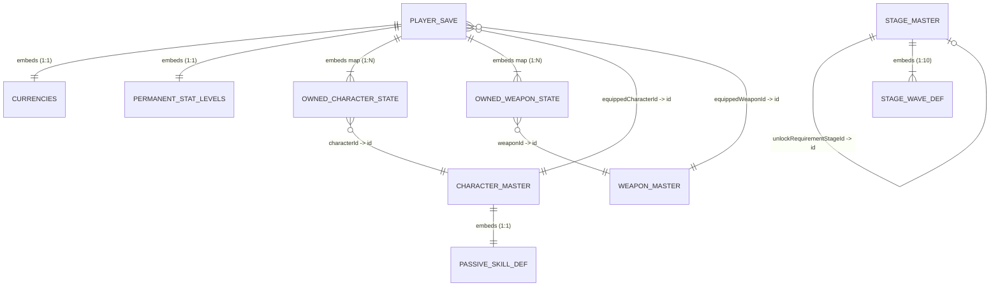

# DBスキーマ設計書 (Database Schema Specification): 穢土浄化奇譚 〜 妖魔祓ひの旅路 〜

本書は、[specs/requirements.md](./requirements.md) および [specs/screens.md](./screens.md) に基づき、完全クライアント完結型Webゲーム『穢土浄化奇譚 〜 妖魔祓ひの旅路 〜』の永続化データモデル（IndexedDB + `idb`）、テーブル（Object Store / 論理エンティティ）定義、PK/FK・一意性制約、ステータスEnum、インデックス設計、およびトランザクション・復旧方針を定義します。

> [!NOTE]
> 共通型定義ブループリントは [specs/types/](./types/index.ts) に配置しています。Phase 3.7 のプロジェクト初期化時に実装コードツリー（`data/`・`storage/`・`domain/` 等）へ正式移行し、以降は実装側の型・スキーマを正本（Single Source of Truth）として運用します。

## 目次

1. [データベース全体構成と設計方針](#1-データベース全体構成と設計方針)
2. [ER図・エンティティ関連図](#2-er図エンティティ関連図)
3. [Object Store（テーブル）定義](#3-object-storeテーブル定義)
4. [論理エンティティ・埋め込み構造定義](#4-論理エンティティ埋め込み構造定義)
5. [PK / FK・一意性制約・参照整合性マトリクス](#5-pk--fk一意性制約参照整合性マトリクス)
6. [ステータス・列挙型（Enum）定義](#6-ステータス列挙型enum定義)
7. [インデックス設計](#7-インデックス設計)
8. [トランザクション境界・スキーマバージョニング・復旧戦略](#8-トランザクション境界スキーマバージョニング復旧戦略)

---

## 1. データベース全体構成と設計方針

| 項目                                             | 仕様                                                                                          |
| :----------------------------------------------- | :-------------------------------------------------------------------------------------------- |
| **ストレージエンジン**                           | ブラウザ標準 IndexedDB（`idb` ライブラリによる型安全Promiseラッパー）                         |
| **データベース名 (`DB_NAME`)**                   | `"edo-purification-db"`                                                                       |
| **DBスキーマバージョン (`DB_VERSION`)**          | `1`                                                                                           |
| **セーブデータ構造バージョン (`schemaVersion`)** | `1`                                                                                           |
| **永続化対象**                                   | プレイヤー進行データ（通貨・永続強化・所持キャラ/武器・装備編成・ステージ進行・ログボ日付）   |
| **アプリバンドル（不変マスタ）**                 | キャラ・武器・敵・ステージ定義は `data/` 配下の静的TypeScript定数として保持（DB非格納）       |
| **オンメモリ状態（非永続）**                     | バトル中のウェーブ・結界HP・3択スキル・バフ状態はメモリ上のみで管理（リロード時は初期状態へ） |

### 設計上の重要判断（単一ドキュメント・アトミック設計）

本ゲームは単一ローカルプレイヤー（`PLAYER`）向けであり、通貨消費（`hisui` / `magatama`）とアイテム獲得・強化（`ownedCharacters` / `ownedWeapons` / `permanentStats`）を**絶対に不整合なく同時コミット**する必要がある。
そのため、永続セーブは `playerSave` ストア内の単一キー `"primary"` に集約し、すべての更新を単一 `readwrite` トランザクション内のアトミックな read-modify-write として実行する。

---

## 2. ER図・エンティティ関連図

IndexedDB の `playerSave` ドキュメント（論理ルートエンティティ）と、アプリバンドルの不変マスタデータ間の参照関係を示す。

---

## 3. Object Store（テーブル）定義

### 3.1 `playerSave` ストア（永続セーブデータ）

- **ストア名**: `playerSave`
- **キー設計**: Out-of-line キー（`keyPath` なし）、固定シングルトンキー `"primary"` のみを使用
- **型定義**: `EdoPurificationDB["playerSave"]`（[specs/types/save.ts](./types/save.ts)）

| 論理カラム（フィールド） | TypeScript型                               | NULL | デフォルト（初期値）                       | 制約・ドメインルール                                |
| :----------------------- | :----------------------------------------- | :--: | :----------------------------------------- | :-------------------------------------------------- |
| `key` _(Store Key)_      | `"primary"`                                |  NO  | `"primary"`                                | **PK**。シングルトン一意キー                        |
| `schemaVersion`          | `number`                                   |  NO  | `1`                                        | 正の整数（`>= 1`）。マイグレーション判定に使用      |
| `currencies`             | `CurrencyBalances`                         |  NO  | `{ magatama: 100, hisui: 5 }`              | 各通貨 `>= 0` の非負整数                            |
| `permanentStats`         | `PermanentStatLevels`                      |  NO  | `{ hpLevel: 0, atkLevel: 0, lukLevel: 0 }` | 各レベル `>= 0` かつマスタ上限以下                  |
| `ownedCharacters`        | `Record<CharacterId, OwnedCharacterState>` |  NO  | `{ apprentice_onmyoji: ... }`              | 最低1件（初期キャラ）を保持                         |
| `ownedWeapons`           | `Record<WeaponId, OwnedWeaponState>`       |  NO  | `{ sword_hamon: ... }`                     | 最低1件（初期武器）を保持                           |
| `equippedCharacterId`    | `CharacterId`                              |  NO  | `"apprentice_onmyoji"`                     | **FK**: `ownedCharacters` に存在するキー必須        |
| `equippedWeaponId`       | `WeaponId`                                 |  NO  | `"sword_hamon"`                            | **FK**: `ownedWeapons` に存在するキー必須（空禁止） |
| `unlockedStageIds`       | `StageId[]`                                |  NO  | `["stage_1_bamboo"]`                       | **FK配列**: `StageMaster.id` 参照、重複不可         |
| `clearedStageIds`        | `StageId[]`                                |  NO  | `[]`                                       | **FK配列**: `unlockedStageIds` の部分集合、重複不可 |
| `lastLoginBonusDate`     | `string \| null`                           | YES  | `null`                                     | `YYYY-MM-DD` 形式（ローカル時刻）または `null`      |
| `updatedAt`              | `string`                                   |  NO  | 生成時 ISO 8601                            | 最終更新日時（ISO 8601 UTC文字列）                  |

---

## 4. 論理エンティティ・埋め込み構造定義

### 4.1 `currencies`（所持通貨）

| フィールド | 型       | 制約         | 説明                                    |
| :--------- | :------- | :----------- | :-------------------------------------- |
| `magatama` | `number` | 整数, `>= 0` | 水晶の勾玉（永続強化・3択リロール通貨） |
| `hisui`    | `number` | 整数, `>= 0` | 翡翠（キャラ/武器ガチャ通貨）           |

### 4.2 `permanentStats`（永続強化レベル）

| フィールド | 型       | 制約         | 説明                            |
| :--------- | :------- | :----------- | :------------------------------ |
| `hpLevel`  | `number` | 整数, `>= 0` | 結界耐久（HP）永続強化レベル    |
| `atkLevel` | `number` | 整数, `>= 0` | 霊力攻撃（ATK）永続強化レベル   |
| `lukLevel` | `number` | 整数, `>= 0` | 会心発生率（LUK）永続強化レベル |

### 4.3 `ownedCharacters[characterId]`（所持キャラクター状態）

| フィールド       | 型            | 制約                           | 説明                            |
| :--------------- | :------------ | :----------------------------- | :------------------------------ |
| `characterId`    | `CharacterId` | **PK(Mapキー)** / **FK**       | `CharacterMaster.id` と一致必須 |
| `awakeningLevel` | `number`      | `0 <= lv <= maxAwakeningLevel` | 覚醒レベル（0 = 無凸）          |
| `obtainedAt`     | `string`      | ISO 8601                       | 初回獲得日時                    |

### 4.4 `ownedWeapons[weaponId]`（所持武器状態）

| フィールド    | 型         | 制約                        | 説明                         |
| :------------ | :--------- | :-------------------------- | :--------------------------- |
| `weaponId`    | `WeaponId` | **PK(Mapキー)** / **FK**    | `WeaponMaster.id` と一致必須 |
| `refineLevel` | `number`   | `0 <= lv <= maxRefineLevel` | 精錬レベル（0 = 未精錬）     |
| `obtainedAt`  | `string`   | ISO 8601                    | 初回獲得日時                 |

---

## 5. PK / FK・一意性制約・参照整合性マトリクス

IndexedDB はリレーショナルDBの外部キー制約を自動強制しないため、`storage/` の読込バリデーションおよび `domain/` の事前条件ガードにて以下の制約をプログラム的に保証する。

| 制約種別             | 対象                                       | 参照先 / 定義                          | 検証タイミング・違反時挙動                                                  |
| :------------------- | :----------------------------------------- | :------------------------------------- | :-------------------------------------------------------------------------- |
| **PK（一意性）**     | `playerSave` ストアキー                    | 固定値 `"primary"`                     | 常に単一レコードのみ操作                                                    |
| **PK / Unique**      | `ownedCharacters` キー                     | `characterId`                          | オブジェクトマップのキーにより構造的に一意                                  |
| **PK / Unique**      | `ownedWeapons` キー                        | `weaponId`                             | オブジェクトマップのキーにより構造的に一意                                  |
| **Unique（配列）**   | `unlockedStageIds`                         | `StageId` 集合                         | 追加時に重複チェック（Set同等のユニーク保証）                               |
| **Unique（配列）**   | `clearedStageIds`                          | `StageId` 集合                         | 追加時に重複チェック（Set同等のユニーク保証）                               |
| **FK（内部整合）**   | `equippedCharacterId`                      | `ownedCharacters[equippedCharacterId]` | 未所持ID指定時は `UNOWNED_CHARACTER` エラーで拒否                           |
| **FK（内部整合）**   | `equippedWeaponId`                         | `ownedWeapons[equippedWeaponId]`       | 空文字・未所持ID指定時は `EMPTY_WEAPON_SELECTION` / `UNOWNED_WEAPON` で拒否 |
| **FK（マスタ参照）** | `ownedCharacters[].characterId`            | `CHARACTER_MASTERS`                    | 読込時に存在チェック。未知IDは破損または旧バージョン残骸として隔離/検証     |
| **FK（マスタ参照）** | `ownedWeapons[].weaponId`                  | `WEAPON_MASTERS`                       | 読込時に存在チェック                                                        |
| **FK（マスタ参照）** | `unlockedStageIds[]` / `clearedStageIds[]` | `STAGE_MASTERS`                        | バトル出撃時に存在・解放チェック（未解放時は `STAGE_LOCKED`）               |
| **部分集合制約**     | `clearedStageIds` ⊆ `unlockedStageIds`     | 進行順序整合性                         | ステージクリア時は対象IDと次解放IDを同一トランザクションで更新              |

---

## 6. ステータス・列挙型（Enum）定義

すべての列挙型は TypeScript の文字列リテラルユニオン型として定義する（詳細: [specs/types/common.ts](./types/common.ts) / [specs/types/battle.ts](./types/battle.ts)）。

| Enum / Union名          | 許可値                                                                                                                                                                                                                                                          | 用途・画面/モジュール                  |
| :---------------------- | :-------------------------------------------------------------------------------------------------------------------------------------------------------------------------------------------------------------------------------------------------------------- | :------------------------------------- |
| `CurrencyType`          | `"magatama"`, `"hisui"`                                                                                                                                                                                                                                         | 通貨種別（勾玉 / 翡翠）                |
| `WeaponGenre`           | `"bow"`, `"sword"`, `"shuriken"`, `"mirror"`, `"talisman"`, `"matchlock"`, `"fan"`, `"bell"`, `"orb"`                                                                                                                                                           | 9系統の武器ジャンル                    |
| `PassiveEffectType`     | `"barrier_regen"`, `"luk_and_drop_boost"`, `"attack_speed_boost"`                                                                                                                                                                                               | キャラ固有パッシブ効果種別             |
| `BattlePhase`           | `"preparing"`, `"playing"`, `"paused"`, `"level_up_modal"`, `"victory"`, `"defeat"`                                                                                                                                                                             | バトル画面のフェーズ状態マシン         |
| `InGameUpgradeCategory` | `"base_stat"`, `"weapon_stat"`, `"weapon_unlock"`                                                                                                                                                                                                               | レベルアップ3択のカテゴリ              |
| `InGameStatType`        | `"atk_pct"`, `"crit_rate"`, `"crit_dmg"`, `"attack_freq"`, `"weapon_dmg"`, `"duration"`                                                                                                                                                                         | 3択強化の対象ステータス                |
| `GachaPoolType`         | `"character"`, `"weapon"`                                                                                                                                                                                                                                       | ガチャタブ・排出プール切替             |
| `GachaOutcomeType`      | `"new"`, `"awakening_or_refine"`, `"converted_to_magatama"`                                                                                                                                                                                                     | ガチャ結果バッジ表示                   |
| `DomainErrorCode`       | `"INSUFFICIENT_MAGATAMA"`, `"INSUFFICIENT_HISUI"`, `"ALREADY_MAX_LEVEL"`, `"LOGIN_BONUS_ALREADY_CLAIMED"`, `"UNOWNED_CHARACTER"`, `"UNOWNED_WEAPON"`, `"EMPTY_WEAPON_SELECTION"`, `"STAGE_LOCKED"`, `"INVALID_STAGE_ID"`, `"SAVE_CORRUPTED"`, `"STORAGE_ERROR"` | ドメインガード拒否時の標準エラーコード |

---

## 7. インデックス設計

### 7.1 IndexedDB (`playerSave`) のインデックス設計

- **セカンダリインデックスを作成しない方針（v1）**:
  - `playerSave` ストアは単一の `"primary"` キーのみを格納する設計であるため、プライマリキーによる直接ルックアップ（`store.get("primary")`）が常に **O(1)** で完結する。不要な `createIndex` はブラウザの書き込みオーバーヘッドを増やすため作成しない。
- **埋め込みコレクションの O(1) ルックアップ設計**:
  - 所持キャラ・所持武器は配列（`OwnedCharacterState[]`）ではなくキーマップ（`Record<CharacterId, OwnedCharacterState>` / `Record<WeaponId, OwnedWeaponState>`）として永続化することで、重複判定・装備検証・強化算出を常に **O(1)** で実行する。

### 7.2 マスタデータのメモリ上インデックス（`data/` 層）

- `CHARACTER_MASTERS` / `WEAPON_MASTERS` / `STAGE_MASTERS` / `ENEMY_MASTERS` は、配列一覧（UI表示順序保持用）と並行して `Record<Id, Master>`（または `Map<Id, Master>`）のインデックスをモジュール初期化時に構築し、戦闘ループ（60fps）およびガチャ抽選中の参照を **O(1)** に保つ。

### 7.3 将来拡張時のインデックス設計指針（v2以降）

将来的に履歴ストア（例: `gachaHistory` や `battleLogs`）を追加する場合は、以下のインデックスを `onupgradeneeded` で追加する。

- `gachaHistory`: `keyPath: "id"`（autoIncrement） / Index: `by_pool_and_date` (`["poolType", "executedAt"]`)
- `battleLogs`: `keyPath: "id"`（autoIncrement） / Index: `by_stage_and_date` (`["stageId", "finishedAt"]`)

---

## 8. トランザクション境界・スキーマバージョニング・復旧戦略

### 8.1 トランザクション境界とロールバック

すべての書き込み操作（初期生成・ログインボーナス受取・ガチャ実行・永続強化・編成変更・バトル報酬確定・初期化）は、`storage/` のリポジトリ関数内で単一 `db.transaction("playerSave", "readwrite")` として実行する。

1. トランザクション内で最新の `"primary"` レコードを読込（メモリ上の古いキャッシュを盲信しない）。
2. `domain/` の純粋関数で事前条件を検証し、新しい `PlayerSaveData` スナップショットを生成。
3. 同一トランザクション内で `store.put(nextSave, "primary")` を実行し、`tx.done` を待機。
4. 失敗時はトランザクションが自動アボートされるため、Reactメモリ状態も更新せずエラー通知を行う（通貨だけ減る等の部分更新を完全に防止）。

### 8.2 スキーママイグレーション (`DB_VERSION` & `schemaVersion`)

- **IndexedDB構造変更（ストア追加等）**: `openDB<EdoPurificationDB>(DB_NAME, DB_VERSION, { upgrade(db, oldVersion) { ... } })` の `upgrade` フックで段階的マイグレーションを実施。
- **ドキュメント構造変更（フィールド追加等）**: `PlayerSaveData.schemaVersion` を検査し、旧バージョンのセーブデータ読込時にデフォルト値を補完する純粋マイグレーション関数を通してから最新型として扱う。

### 8.3 ランタイムバリデーションと破損時復旧

IndexedDB から取得したデータは外部入力と同等に扱い、読込時に以下を検証する。

- 必須トップレベルキーの存在、数値の有限数（`Number.isFinite`）かつ非負（`>= 0`）チェック。
- `equippedCharacterId` / `equippedWeaponId` が各 `owned*` マップおよびマスタに存在すること。
- 検証失敗時は `SAVE_CORRUPTED` エラーを返却し、ホーム画面（`Error` ステート）にて「再試行」および「確認モーダル付きセーブデータ初期化復旧」を案内する。
