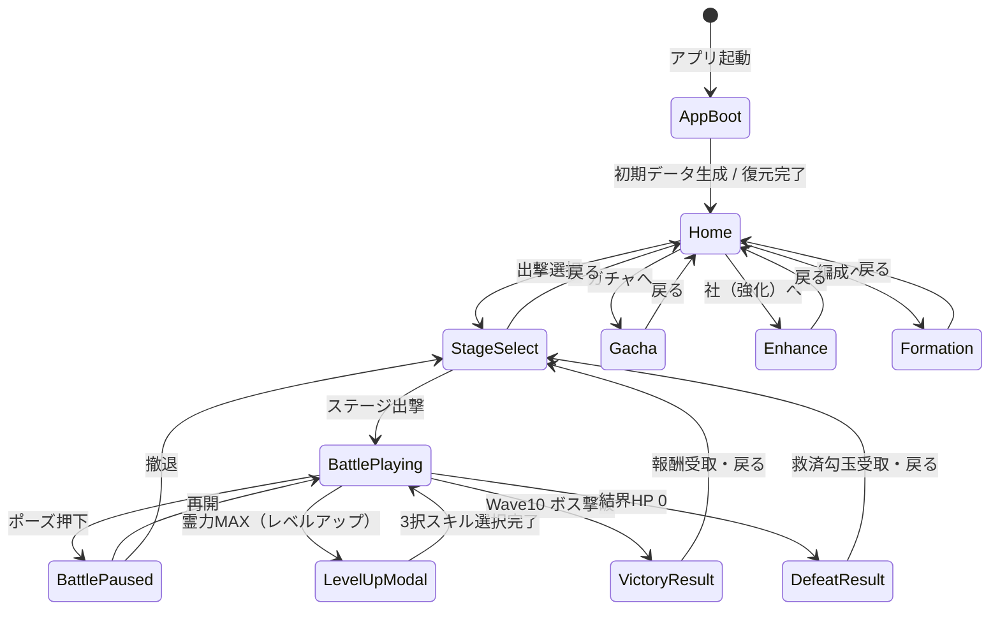

# 要件定義書 (Requirements Specification): 穢土浄化奇譚 〜 妖魔祓ひの旅路 〜

本書は、[specs/rfp.md](./rfp.md) および確定した技術スタックに基づき、和風縦型ローグライクタワーディフェンスWebゲーム『穢土浄化奇譚 〜 妖魔祓ひの旅路 〜』のデータスキーマ、型骨格、権限境界、業務ルール、および5大ステート標準を定義する要件定義書です。

## 目次

1. [概要と確定技術スタック](#1-概要と確定技術スタック)
2. [ユーザーロールと権限マトリクス](#2-ユーザーロールと権限マトリクス)
3. [スキーマ・型定義骨格](#3-スキーマ型定義骨格)
4. [業務ドメインルールとステートマシン](#4-業務ドメインルールとステートマシン)
5. [5大ステート標準 (Universal 5-State Contracts)](#5-5大ステート標準-universal-5-state-contracts)
6. [非機能要件・セキュリティ・堅牢性要件](#6-非機能要件セキュリティ堅牢性要件)
7. [対象外事項と将来拡張方針](#7-対象外事項と将来拡張方針)

---

## 1. 概要と確定技術スタック

### 1.1 プロダクト概要

主人公（陰陽師・巫女等）が穢れた土地に守護結界を展開し、迫り来る妖怪を遠隔術で迎撃・浄化する、完全クライアント完結型の和風縦型ローグライクタワーディフェンスWebゲーム。広告・スタミナ・課金要素を排し、1プレイ3〜5分のバトルとメタプログレッション（勾玉育成・無料翡翠ガチャ）を提供する。

### 1.2 確定技術スタック

| レイヤー                      | 採用技術                                  | 役割・設計方針                                              |
| :---------------------------- | :---------------------------------------- | :---------------------------------------------------------- |
| **言語**                      | TypeScript（strictモード）                | 全ドメインロジック・UI・マスタデータの型安全性担保          |
| **フロントエンドFW / ビルド** | React + Vite                              | 6大画面・モーダル群の宣言的UI構築、高速バンドル             |
| **バックエンドFW**            | なし                                      | 完全クライアント完結・静的Webホスティング（無料枠）         |
| **描画エンジン**              | HTML5 Canvas API (2D Context)             | 戦闘描画専用。`useRef` 等でReact再描画から分離し60fps維持   |
| **DB / ストレージ**           | IndexedDB + `idb`                         | 軽量Promiseラッパーによる型安全なローカルセーブ永続化       |
| **認証基盤**                  | なし                                      | Out of Scope（個人利用・外部通信不要）                      |
| **UIライブラリ方針**          | Tailwind CSS + カスタム和風UI             | DOMオーバーレイ方式。汎用UIキット不使用で和風デザインを実現 |
| **状態管理方針**              | React Context / Hooks（または `zustand`） | CanvasゲームループとHUD・モーダル間の疎結合な状態同期       |

---

## 2. ユーザーロールと権限マトリクス

本プロダクトは外部サーバー通信およびアカウント認証を持たない完全クライアント完結型アプリケーションである。そのため、ロールは「ローカルプレイヤー」単一となるが、不正状態遷移・通貨不足・データ破損を防ぐための**ドメインサービス層の認可・事前条件ガード境界**を明確に定義する。

### 2.1 ロール定義

| ロールID | ロール名           | 説明                                                                       |
| :------- | :----------------- | :------------------------------------------------------------------------- |
| `PLAYER` | ローカルプレイヤー | ブラウザ上でゲームをプレイする正規利用者（唯一のユーザーロール）。         |
| `SYSTEM` | システム自動処理   | 初回起動時の初期データ生成、日付境界（0:00）判定、重複自動合成・変換処理。 |

### 2.2 操作・エンティティ別 権限マトリクス

| 対象エンティティ / 機能           | 操作 (Action)              | `PLAYER` | `SYSTEM` | 事前条件・拒否時の振る舞い（ローカルガード）                                     |
| :-------------------------------- | :------------------------- | :------: | :------: | :------------------------------------------------------------------------------- |
| **セーブデータ (`playerSave`)**   | 初期生成 (Create)          |    -     |   許可   | 既存データがない場合のみ自動生成。                                               |
| **セーブデータ (`playerSave`)**   | 読込・復元 (Read)          |   許可   |   許可   | スキーマ破損時はエラー状態へ遷移し、初期化復旧導線を提示。                       |
| **セーブデータ (`playerSave`)**   | 初期化 (Delete/Reset)      |   許可   |    -     | 確認モーダルでの明示的承認が必須。誤操作防止。                                   |
| **通貨 (`magatama` / `hisui`)**   | 消費 (Update)              |   許可   |    -     | 残高不足時は操作不可（Disabled）およびドメインエラー（拒否）を返却。負数化禁止。 |
| **ログインボーナス**              | 受取 (Update)              |   許可   |   判定   | 当日（ローカル0:00以降）受取済みの場合は再受取を拒否（Disabled）。               |
| **キャラクター / 武器**           | 召喚・獲得 (Create/Update) |   許可   |    -     | 翡翠不足時（1回:5個、10回:50個）は実行拒否。重複時は自動強化・余剰変換。         |
| **編成 (`equipped*`)**            | 変更 (Update)              |   許可   |    -     | 未所持キャラ/武器の装備、および武器未選択は拒否。持ち込み武器は1枠のみ。         |
| **ステージ (`unlockedStageIds`)** | 出撃 (Read/Play)           |   許可   |    -     | 未解放ステージへの出撃は拒否（Disabled）。                                       |
| **ステージ解放・報酬付与**        | 進行更新 (Update)          |    -     |   許可   | バトル終了イベント経由のみ許可。直接の任意書き換えUIは提供しない。               |

> [!NOTE]
> バックエンドAPIが存在しないためHTTP 401/403は発生しないが、ドメインサービス層（セーブ操作・ガチャ・強化・編成・出撃）において「事前条件違反（残高不足、未解放、未所持、上限超過）」を必ず検証し、単体テストで拒否ケース（エラー返却・状態不変）を網羅する。

---

## 3. スキーマ・型定義骨格

TypeScript（strictモード）および `idb`（`DBSchema`）に準拠したデータモデル骨格を以下に定義する。

### 3.1 基本識別子・列挙型

```typescript
export type CurrencyType = "magatama" | "hisui";

export type WeaponGenre =
  | "bow" // 弓矢系: 長射程・直線貫通
  | "sword" // 刀剣系: 中射程・扇状薙ぎ払い
  | "shuriken" // 手裏剣系: 高連射・多重拡散・滞留
  | "mirror" // 鏡系: 持続照射・光線反射
  | "talisman" // 呪符系: 誘導・状態異常・時限爆発
  | "matchlock" // 火縄銃系: 超高火力・着弾範囲爆発
  | "fan" // 扇・軍配系: 突風・ノックバック
  | "bell" // 神具・鈴系: 全方位円形波動
  | "orb"; // 霊珠・勾玉系: 旋回オービット・接触削り

export type CharacterId =
  | "apprentice_onmyoji"
  | "white_fox_miko"
  | "shadow_shinobi"
  | (string & {});
export type WeaponId = string;
export type StageId =
  | "stage_1_bamboo"
  | "stage_2_old_road"
  | "stage_3_shrine"
  | (string & {});
export type EnemyId = string;
```

### 3.2 マスタデータ定義型（不変・アプリバンドル）

```typescript
export interface PassiveSkillDefinition {
  id: string;
  name: string;
  description: string;
  effectType: "barrier_regen" | "luk_and_drop_boost" | "attack_speed_boost";
  baseValue: number;
  valuePerAwakening: number; // 覚醒Lvごとの加算値
}

export interface CharacterMaster {
  id: CharacterId;
  name: string;
  title: string;
  description: string;
  baseHp: number;
  baseAtk: number;
  baseLuk: number; // 会心率ベース（%）
  hpPerAwakening: number;
  atkPerAwakening: number;
  lukPerAwakening: number;
  maxAwakeningLevel: number; // 例: 5
  duplicateRewardMagatama: number; // 上限到達後の重複変換量
  passiveSkill: PassiveSkillDefinition;
  isInitial: boolean;
}

export interface WeaponMaster {
  id: WeaponId;
  name: string;
  genre: WeaponGenre;
  description: string;
  baseDamage: number;
  damagePerRefine: number;
  baseCooldownMs: number;
  baseDurationMs: number;
  projectileSpeed: number;
  genreParams: Record<string, number>; // ジャンル固有パラメータ（反射回数、爆発半径、ノックバック距離等）
  maxRefineLevel: number; // 例: 5
  duplicateRewardMagatama: number; // 上限到達後の重複変換量
  isInitial: boolean;
}

export interface WaveSpawnEntry {
  enemyId: EnemyId;
  count: number;
  spawnIntervalMs: number;
  isBoss?: boolean;
}

export interface StageWaveDefinition {
  waveNumber: number; // 1 〜 10
  spawns: WaveSpawnEntry[];
}

export interface StageMaster {
  id: StageId;
  order: number;
  name: string;
  description: string;
  corruptionLevel: number; // 推奨戦力・難易度指標
  unlockRequirementStageId: StageId | null;
  waves: StageWaveDefinition[]; // 全10ウェーブ
  clearReward: {
    magatama: number;
    hisui: number;
  };
  firstClearBonusHisui: number;
}
```

### 3.3 永続セーブデータ型 & IndexedDB (`idb`) スキーマ

```typescript
import type { DBSchema } from "idb";

export interface PermanentStatLevels {
  hpLevel: number; // 0以上
  atkLevel: number; // 0以上
  lukLevel: number; // 0以上
}

export interface OwnedCharacterState {
  characterId: CharacterId;
  awakeningLevel: number; // 0（無凸）〜 maxAwakeningLevel
  obtainedAt: string; // ISO 8601
}

export interface OwnedWeaponState {
  weaponId: WeaponId;
  refineLevel: number; // 0（未精錬）〜 maxRefineLevel
  obtainedAt: string; // ISO 8601
}

export interface PlayerSaveData {
  schemaVersion: number; // 例: 1
  currencies: {
    magatama: number; // 水晶の勾玉（>= 0）
    hisui: number; // 翡翠（>= 0）
  };
  permanentStats: PermanentStatLevels;
  ownedCharacters: Record<CharacterId, OwnedCharacterState>;
  ownedWeapons: Record<WeaponId, OwnedWeaponState>;
  equippedCharacterId: CharacterId;
  equippedWeaponId: WeaponId; // バトル持ち込み主武器（1枠のみ選択）
  unlockedStageIds: StageId[];
  clearedStageIds: StageId[];
  lastLoginBonusDate: string | null; // "YYYY-MM-DD"（ローカル時刻基準）
  updatedAt: string; // ISO 8601
}

export interface EdoPurificationDB extends DBSchema {
  playerSave: {
    key: "primary";
    value: PlayerSaveData;
  };
}
```

### 3.4 バトル（ラン内）状態・3択スキル型（オンメモリ）

```typescript
export type BattlePhase =
  | "preparing"
  | "playing"
  | "paused"
  | "level_up_modal"
  | "victory"
  | "defeat";

export type InGameUpgradeCategory =
  | "base_stat"
  | "weapon_stat"
  | "weapon_unlock";

export interface InGameUpgradeOption {
  id: string;
  category: InGameUpgradeCategory;
  targetWeaponId?: WeaponId;
  statType?:
    | "atk_pct"
    | "crit_rate"
    | "crit_dmg"
    | "attack_freq"
    | "weapon_dmg"
    | "duration";
  title: string;
  description: string;
  multiplierOrDelta: number;
}

export interface InGameBuffState {
  // 基本ステータス強化（複利乗算方式）
  atkMultiplier: number; // 初期値 1.0
  critRateBonusPct: number; // 初期値 0
  critDamageMultiplier: number; // 初期値 1.5（基礎150%等）
  // 武器別強化状態
  unlockedWeaponIds: WeaponId[];
  weaponModifiers: Record<
    WeaponId,
    {
      damageMultiplier: number; // 初期値 1.0
      cooldownMultiplier: number; // 初期値 1.0（小さいほど高速）
      durationMultiplier: number; // 初期値 1.0
    }
  >;
}

export interface BattleHudSnapshot {
  phase: BattlePhase;
  stageId: StageId;
  currentWave: number;
  totalWaves: number; // 10
  barrierHp: number;
  barrierMaxHp: number;
  level: number;
  exp: number;
  expToNextLevel: number;
  gameSpeed: 1 | 2;
  rerollCostMagatama: number;
  pendingUpgradeChoices: InGameUpgradeOption[];
}
```

---

## 4. 業務ドメインルールとステートマシン

### 4.1 初期セーブデータ生成・初期化ルール

初回起動時（IndexedDBに `'primary'` レコードが存在しない場合）、以下の初期状態を生成して保存する。

- 所持キャラ: `apprentice_onmyoji`（見習い陰陽師 / 覚醒Lv.0）
- 所持武器: 初期刀剣（例: `sword_hamon`「銘刀・波紋」 / 精錬Lv.0）
- 装備状態: キャラ = `apprentice_onmyoji`、持ち込み武器 = `sword_hamon`（1枠のみ）
- 初期通貨: 翡翠 = `5` 個（初ガチャ1回分）、水晶の勾玉 = 初期強化用少量（例: `100`）
- 解放済みステージ: `[stage_1_bamboo]`（第壱節：迷いの竹林）

**セーブデータ初期化（リセット）フロー**:

- ホーム画面の「セーブデータ初期化ボタン」押下時は確認モーダルを表示し、ユーザーの明示的な承認を得た場合のみ IndexedDB `'primary'` レコードを削除・再初期化し、上記の初期セーブデータ生成ルールを即座に再実行する。

### 4.2 ステータス算出・強化ルール

1. **永続強化（加算方式 / Additive）**:
   - 勾玉を消費して `HP`, `ATK`, `LUK` を恒久強化する。
   - 算出式: `基礎値 + キャラ覚醒加算 + (永続強化Lv × Lvあたり固定上昇値)`。
   - 強化コスト算出式: `baseCost + currentLevel * costStep` 等のマスタ定数駆動で定義し、最大強化レベル上限もマスタ定数で設定可能とする。
2. **インゲーム基本ステータス強化（複利乗算方式 / Multiplicative）**:
   - バトル中のレベルアップ3択で「攻撃力（ATK%）」「会心強化率」等を取得した場合、乗算で累積する。
   - 算出例: 基礎ATK `100` に対し `1.5` 倍を2回取得した場合、`100 × 1.5 × 1.5 = 225`。
3. **インゲーム再抽選（リロール）**:
   - 3択モーダル表示中、所持「水晶の勾玉」が `rerollCostMagatama` 以上であれば消費して候補を再抽選できる。

### 4.3 ログインボーナス判定ルール（0:00境界）

- ローカルタイムゾーンの現在日付を `YYYY-MM-DD` 形式で取得する独立モジュール（`getLocalDateKey(now)`）で判定する。
- `lastLoginBonusDate !== todayKey` の場合、受取可能（起動時モーダル自動表示＋ホーム画面ボタンからの再確認可能）。
- 受取完了時に所定の「水晶の勾玉」および「翡翠」を付与し、`lastLoginBonusDate = todayKey` を即座にIndexedDBへ永続化する。

### 4.4 ガチャ（召喚）・重複強化・余剰変換ルール

- **コスト**: 1回召喚 = 翡翠 `5` 個、10回連続召喚 = 翡翠 `50` 個。
- **タブ種別**: 「キャラガチャ」と「武器ガチャ」で排出プールを分離する。
- **重複時自動強化（勾玉消費なし）**:
  - 既に所持しているキャラが排出された場合、`awakeningLevel < maxAwakeningLevel` なら `awakeningLevel + 1`（覚醒）。
  - 既に所持している武器が排出された場合、`refineLevel < maxRefineLevel` なら `refineLevel + 1`（精錬）。
- **上限到達後の余剰変換**:
  - 既に最大レベル（`maxAwakeningLevel` / `maxRefineLevel`）に達している対象が排出された場合、対象マスタに定義された `duplicateRewardMagatama` 分の「水晶の勾玉」へ自動変換し、結果モーダルに「変換済み」と明示する。
- **演出スキップ**: 召喚演出中のタップ/クリックで即座に結果一覧表示へ遷移可能とする。

### 4.5 ステージ進行・バトル・敗北救済ルール

- **全3ステージ構成（v1）**:
  - 第壱節：迷いの竹林（初期解放） → クリアで第弐節解放
  - 第弐節：逢魔の古道 → クリアで第参節解放
  - 第参節：怨嗟の廃神社
- **ウェーブと勝敗**:
  - 各ステージ全10ウェーブ。第10ウェーブの大妖怪（ボス）撃破で `victory`（ステージ浄化）。
  - 結界HP `<= 0` で `defeat`（結界決壊）。
- **敗北時の救済仕様**:
  - `defeat` 時も、到達ウェーブ数に応じた少量の「水晶の勾玉」を必ず付与して持ち帰れる（`Math.floor(reachedWave * baseWaveRescueMagatama)` 等）。
- **オートエイム＆武器自律発動（持ち込み1枠＋ラン内アンロック）**:
  - 主人公は画面下部中央に固定。バトル開始時は編成画面で選択した持ち込み武器1枠（`equippedWeaponId`）のみが解放済み（`unlockedWeaponIds = [equippedWeaponId]`）として自動発動する。
  - バトル中のレベルアップ3択「武器スキルの開放（`weapon_unlock`）」を選択することで、未開放の他武器スキルをバトル中一時的に追加アンロック（最大計3枠まで同時発動など、マスタ上限まで）でき、解放済みの武器はクールダウン完了ごとに「結界に最も近い妖怪」を自動索敵して発動する。
  - ※すでにバトル中の同時発動枠が上限に達している場合、3択候補から `weapon_unlock` は除外し、他系統（基本ステータス強化／武器ステータス強化）を提示する。

### 4.6 状態遷移図（画面遷移 & バトルフェーズ）



---

## 5. 5大ステート標準 (Universal 5-State Contracts)

すべての主要画面およびデータ操作機能について、**Empty / Loading / Success / Error / Disabled・Unauthorized** の5大ステートにおける振る舞いを定義する。

### 5.1 アプリ起動・トップ画面（ホーム）

| ステート                    | 振る舞い・UI表示契約                                                                                                                                                         |
| :-------------------------- | :--------------------------------------------------------------------------------------------------------------------------------------------------------------------------- |
| **Empty**                   | 初回起動時（IndexedDB未作成）は自動的に初期セーブデータを生成し、チュートリアル的な初回ログインボーナスモーダルを表示してSuccess状態へ移行する。                             |
| **Loading**                 | IndexedDBからのセーブデータ読込中。和風ローディングインジケータ（「霊脈接続中…」等）を表示し、各画面遷移ボタンを非活性化する。                                               |
| **Success**                 | 所持「水晶の勾玉」「翡翠」を表示。未受取のログインボーナスがあれば自動モーダル表示（閉じた後も常設ボタンで再確認可能）。各画面ナビゲーション・データ初期化ボタンが操作可能。 |
| **Error**                   | IndexedDB読込失敗・スキーマ不整合・ストレージ容量エラー時。エラーメッセージと「再試行」ボタン、および「セーブデータ初期化して復旧」導線を表示する。                          |
| **Disabled / Unauthorized** | 当日のログインボーナス受取済み時は「受取済み」表示とし、再受取アクションを無効化（Disabled）する。                                                                           |

### 5.2 ステージ選択画面

| ステート                    | 振る舞い・UI表示契約                                                                                                                           |
| :-------------------------- | :--------------------------------------------------------------------------------------------------------------------------------------------- |
| **Empty**                   | マスタデータ不備等でステージ一覧が空の場合（異常系）、「選択可能な土地がありません」の案内とホームへ戻る導線を表示。                           |
| **Loading**                 | セーブデータ参照中・出撃準備中は出撃ボタンをスピナー表示＋二重クリック防止。                                                                   |
| **Success**                 | 全3ステージ（第壱節〜第参節）を表示。解放済みステージに「未浄化 / 浄化済み」バッジ、推奨穢れ度、報酬プレビューを表示し「出撃」ボタンを有効化。 |
| **Error**                   | ステージマスタ参照エラーや、装備武器が0個等の不正状態で出撃を試みた場合、インライン警告（「武器を1つ以上編成してください」等）を表示。         |
| **Disabled / Unauthorized** | 前ステージ未クリアでロック中のステージはグレーアウト＋鍵アイコン表示とし、出撃ボタンをDisabled（解放条件ツールチップ/注記付き）にする。        |

### 5.3 ゲーム画面（バトル・Canvas描画 ＋ HUDオーバーレイ）

| ステート                    | 振る舞い・UI表示契約                                                                                                                                                           |
| :-------------------------- | :----------------------------------------------------------------------------------------------------------------------------------------------------------------------------- |
| **Empty**                   | バトル開始直前（`preparing`）はウェーブ開始演出を表示し、第1ウェーブの妖怪出現を待機。                                                                                         |
| **Loading**                 | Canvasコンテキスト初期化中・バトル結果のIndexedDB保存中は、遷移ボタンをロックし二重保存を防止。                                                                                |
| **Success**                 | 60fpsでCanvas戦闘を描画。HUDに結界HP、現在Wave（1〜10）、霊力ゲージ、等速/2倍速切替、ポーズを表示。3択モーダル・リザルトモーダルをオーバーレイ表示。                           |
| **Error**                   | Canvas 2D Context取得不可またはアニメーションループ内の予期せぬ例外発生時は、ループを安全停止しエラーモーダル（「戦闘処理で問題が発生しました」）＋ホーム帰還ボタンを表示。    |
| **Disabled / Unauthorized** | 3択スキルモーダルにおいて所持「水晶の勾玉」がリロール費用未満の場合、「再抽選」ボタンをDisabled（不足表示）にする。ポーズ中/モーダル表示中は背面の倍速切替等を操作不可にする。 |

### 5.4 ガチャ画面（キャラ／武器召喚）

| ステート                    | 振る舞い・UI表示契約                                                                                                                            |
| :-------------------------- | :---------------------------------------------------------------------------------------------------------------------------------------------- |
| **Empty**                   | 初回遷移時（履歴なし）はピックアップ情報・提供割合・保有翡翠数を表示して召喚待機。                                                              |
| **Loading**                 | 抽選計算およびIndexedDBへの保存トランザクション実行中、および召喚演出再生中（スキップボタンのみ有効、再召喚ボタンはDisabledで多重実行を防止）。 |
| **Success**                 | 排出結果一覧モーダルを表示。「新規獲得」「覚醒/精錬 Lv+1」「上限到達→勾玉変換」のステータスバッジを明示。                                       |
| **Error**                   | IndexedDB書き込み失敗時は通貨減算をロールバック（メモリ状態も戻す）し、エラートーストと再試行導線を表示。                                       |
| **Disabled / Unauthorized** | 所持翡翠が5個未満なら「1回召喚」を、50個未満なら「10回召喚」をDisabled表示（必要数と不足数を明記）。                                            |

### 5.5 強化画面（社・永続育成）

| ステート                    | 振る舞い・UI表示契約                                                                                     |
| :-------------------------- | :------------------------------------------------------------------------------------------------------- |
| **Empty**                   | すべての強化レベルが `0` の初期状態では「未強化（Lv.0）」と現在値・次レベル上昇幅を明示して強化を促す。  |
| **Loading**                 | 強化確定後のIndexedDB永続化中、連打による二重消費を防ぐため強化ボタンを一時Disabled化。                  |
| **Success**                 | 勾玉消費後の最新ステータス（HP / ATK / LUK）と加算プレビューを即時反映し、強化フィードバック演出を表示。 |
| **Error**                   | 保存失敗時は通貨とレベルを元に戻し、エラートーストを表示。                                               |
| **Disabled / Unauthorized** | 所持「水晶の勾玉」が次レベル必要量に満たない項目は強化ボタンをDisabled化。                               |

### 5.6 編成画面（キャラ1名・持ち込み武器1枠選択）

| ステート                    | 振る舞い・UI表示契約                                                                                                            |
| :-------------------------- | :------------------------------------------------------------------------------------------------------------------------------ |
| **Empty**                   | 所持済みのキャラ・武器が初期1種のみの場合は、切り替え候補なし（ガチャで獲得できる旨）を案内。未所持は一覧に表示しない。         |
| **Loading**                 | 装備変更のIndexedDB保存中は変更操作を一時ロック。                                                                               |
| **Success**                 | 選択中の主人公1名（パッシブ効果含む）と持ち込み主武器1枠、および合算後の総合ステータスプレビューを即時表示。                    |
| **Error**                   | 武器未選択（未装備状態）にしようとする操作や未所持IDの指定はバリデーションエラー（「武器は1つ選択する必要があります」）で拒否。 |
| **Disabled / Unauthorized** | 既に選択中のキャラ/武器に対する再選択操作は無効化（選択中バッジ表示）。                                                         |

---

## 6. 非機能要件・セキュリティ・堅牢性要件

1. **パフォーマンス要件（60fps維持）**:
   - Canvas 2Dの描画ループ（`requestAnimationFrame`）はReactコンポーネントツリーから独立させ、HUDへの状態通知は状態変化時（HP変動・Wave更新・Exp増加等）または間引き同期に留める。
   - 不要になった弾丸・パーティクル・撃破済み妖怪オブジェクトは毎フレーム確実に破棄し、GCスパイクを抑制する。
2. **レスポンシブ・マルチデバイス対応**:
   - PC（マウス）およびスマートフォン（iOS Safari / Android Chrome、タッチ操作）の両方で縦型レイアウト（アスペクト比維持＋余白調整）が崩れないこと。
   - タッチ操作時のダブルタップズームやスクロール誤爆を防ぐCSS制御（`touch-action` 等）を適用する。
3. **オフライン動作・データ整合性**:
   - 外部API通信を行わず、オフライン環境でも起動〜バトル〜セーブまで完結すること。
   - IndexedDBへの書き込みは単一キー `'primary'` に対するトランザクションとして実行し、通貨消費とアイテム付与が片方だけ反映される不整合を防ぐ。
   - セーブデータ読込時に最低限のランタイムバリデーション（型・必須キー・数値の下限チェック）を行い、破損データによるクラッシュを防止する。
4. **疎結合・拡張性**:
   - レンダラー（Canvas 2Dプロシージャル描画）とゲームロジック（物理・衝突・ダメージ計算）を分離し、将来のスプライト画像差し替えを容易にする。
   - オーディオマネージャーはインターフェース定義のみ行い、v1はNo-op実装とする。

---

## 7. Out of Scope と将来拡張方針

### 7.1 v1 対象外事項 (Out of Scope)

- ユーザー認証・アカウント管理・外部サーバーDB・オンラインランキング・マルチプレイ
- 有償課金・スタミナ制限・外部広告システム
- キャラクターの自由移動操作・近接直接攻撃
- 外部画像アセット（スプライトシート）およびBGM/SEの再生（v1は幾何学プロシージャル描画・無音）

### 7.2 RFP記述との整合方針（確定事項）

- [specs/rfp.md](./rfp.md) セクション4およびセクション7の記載を正とし、v1では「全3ステージ（第壱節〜第参節）＋順次解放＋ステージ選択画面」を提供する（RFPセクション6末尾の「単一連続防衛ステージのみ」の記載は、セクション4の方針で上書き確定とする）。
- 編成画面での武器装備は「バトル持ち込み主武器1枠のみ」に変更し、バトル中のレベルアップ3択（`weapon_unlock`）で他武器を追加開放する仕様を確定とする。

### 7.3 将来拡張（v2以降）

- チャプター・ステージ・大妖怪ボスの追加（`StageMaster` のデータ追加のみで拡張可能）
- 和風スプライト画像・アニメーションへのレンダラー差し替え
- 和楽器BGM・効果音（SE）のAudio実装追加
