# 画面設計書 (Screen Specification): 穢土浄化奇譚 〜 妖魔祓ひの旅路 〜

本書は、[specs/requirements.md](./requirements.md) に基づき、和風縦型ローグライクタワーディフェンスWebゲーム『穢土浄化奇譚 〜 妖魔祓ひの旅路 〜』の全体画面一覧、URLルーティング、ロール別アクセス権限、画面遷移図、各画面の主要UIブロックおよび5大ステート表示方針を定義します。

## 目次

1. [全体画面一覧とURLルーティング](#1-全体画面一覧とurlルーティング)
2. [ロール別アクセス権限とガード仕様](#2-ロール別アクセス権限とガード仕様)
3. [画面遷移図](#3-画面遷移図)
4. [共通レイアウト・レスポンシブ・UI規約](#4-共通レイアウトレスポンシブui規約)
5. [各画面の詳細仕様と5大ステート](#5-各画面の詳細仕様と5大ステート)

---

## 1. 全体画面一覧とURLルーティング

本アプリケーションは完全クライアント完結型SPA（React + Vite）であり、静的ホスティング環境でのリロード耐性を確保するため、クライアントサイドルーティング（Hashルーターまたは履歴ルーター＋SPAフォールバック）を採用する。

### 1.1 主要画面一覧（6画面）

| 画面ID         | 画面名               | URLパス            | 機能概要                                                                             | 主な対応機能ディレクトリ |
| :------------- | :------------------- | :----------------- | :----------------------------------------------------------------------------------- | :----------------------- |
| `home`         | トップ画面（ホーム） | `/`                | 通貨表示、ログインボーナス確認・受取、セーブ初期化、各画面へのナビゲーション         | `features/home/`         |
| `stage-select` | ステージ選択画面     | `/stages`          | 全3節のステージ一覧、進行状態（未浄化/浄化済/未解放）確認、出撃前編成確認            | `features/stage-select/` |
| `battle`       | ゲーム画面（バトル） | `/battle/:stageId` | Canvas 2D戦闘描画、DOM HUDオーバーレイ、3択スキル・ポーズ・勝敗モーダル              | `features/battle/`       |
| `gacha`        | ガチャ画面（召喚）   | `/gacha`           | キャラ/武器ガチャ切替、翡翠消費召喚（1回/10回）、演出スキップ、結果表示              | `features/gacha/`        |
| `enhance`      | 強化画面（社・育成） | `/enhance`         | 水晶の勾玉を消費した基礎ステータス（結界耐久 / 霊力攻撃 / 会心発生率）の永続加算強化 | `features/enhance/`      |
| `formation`    | 編成画面             | `/formation`       | 主人公1名（パッシブ）および持ち込み主武器1枠の選択、総合ステータス確認               | `features/formation/`    |

### 1.2 主要オーバーレイモーダル一覧

画面遷移を伴わず、各画面上にDOMオーバーレイとして表示するモーダル群を以下に示す。すべてカスタム和風ダイアログ（`open` / `onOpenChange` 制御）で実装し、`window.alert()` / `window.confirm()` の使用は禁止する。

| モーダルID                 | 親画面   | 表示トリガー                                                         | 主な役割                                                     |
| :------------------------- | :------- | :------------------------------------------------------------------- | :----------------------------------------------------------- |
| `login-bonus-modal`        | `home`   | 当日0:00以降未受取での起動時（自動）、またはヘッダー「ログボ」ボタン | ログインボーナス（水晶の勾玉・翡翠）の受取・確認             |
| `save-reset-confirm-modal` | `home`   | ヘッダー「初期化」ボタン押下時                                       | セーブデータ初期化の明示的承認確認（誤操作防止）             |
| `level-up-choice-modal`    | `battle` | 戦闘中の霊力（EXP）ゲージMAX到達時                                   | 3択スキル選択および水晶の勾玉消費による再抽選（リロール）    |
| `battle-pause-modal`       | `battle` | HUD「停止（ポーズ）」ボタン押下時                                    | 現在のバフ・解放武器確認、戦闘再開、ステージ選択への撤退確認 |
| `battle-result-modal`      | `battle` | Wave10ボス撃破（`victory`）または結界耐久 0（`defeat`）              | 報酬（勾玉・翡翠・救済勾玉）の提示と帰還遷移                 |
| `gacha-result-modal`       | `gacha`  | 召喚演出完了または演出スキップタップ時                               | 獲得一覧、新規/覚醒・精錬Lv+1/上限勾玉変換バッジの提示       |

### 1.3 直リンク・リロード時のルーティング保護

- **未定義ルート (`*`)**: ホーム画面（`/`）へフォールバックリダイレクトする。
- **`/battle/:stageId` への直アクセス・リロード**:
  - 戦闘状態はオンメモリ保持のため、リロード時は新規バトル開始前の事前条件チェック（ステージ存在・解放済み・武器1枠装備済み）を実施する。
  - 事前条件を満たさない場合（不正な `stageId`、未解放ステージ、武器未装備）は即座に `/stages` へリダイレクトし、エラートーストを表示する。

---

## 2. ロール別アクセス権限とガード仕様

[specs/requirements.md](./requirements.md) セクション2に基づき、本プロダクトは外部認証を持たないためユーザーロールは `PLAYER`（ローカルプレイヤー）単一、および自動処理 `SYSTEM` の2種で定義する。すべての保護アクションおよび画面遷移はドメインサービス層の事前条件ガードによって検証される。

| 対象画面 / ルート             |  `PLAYER`  | `SYSTEM` | 事前条件ガード・拒否時の振る舞い                                                                                                            |
| :---------------------------- | :--------: | :------: | :------------------------------------------------------------------------------------------------------------------------------------------ |
| `home` (`/`)                  |    許可    | 初期生成 | セーブデータ未存在時は `SYSTEM` が初期データ自動生成。破損時はエラー復旧UIを表示。                                                          |
| `stage-select` (`/stages`)    |    許可    |    -     | セーブデータ読込完了が前提。未解放ステージの出撃ボタンは `Disabled` 表示。                                                                  |
| `battle` (`/battle/:stageId`) | 条件付許可 | 報酬確定 | `stageId` が `unlockedStageIds` に含まれ、かつ `equippedWeaponId` が有効な所持武器である場合のみ進入可。違反時は `/stages` へリダイレクト。 |
| `gacha` (`/gacha`)            |    許可    | 重複変換 | 翡翠不足時（1回:5個、10回:50個）は召喚ボタンを `Disabled`。書込失敗時は通貨減算をロールバック。                                             |
| `enhance` (`/enhance`)        |    許可    |    -     | 勾玉不足時および最大Lv到達時は強化ボタンを `Disabled`。書込失敗時は状態をロールバック。                                                     |
| `formation` (`/formation`)    |    許可    |    -     | 一覧は所持済みのみ表示。未所持ID指定や武器未装備（空）への変更はバリデーションエラーで拒否。                                                |

---

## 3. 画面遷移図

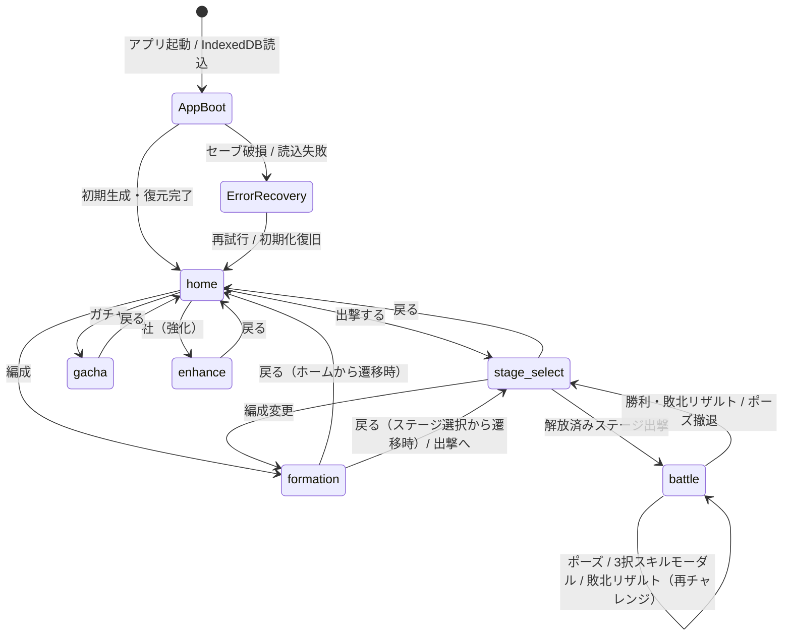

> [!NOTE]
> `battle` を除く全画面（`home` / `stage_select` / `gacha` / `enhance` / `formation`）では共通フッター（「出撃」「ガチャ」「社（強化）」「編成」）が常時表示されるため、アウトゲーム画面間は相互に1タップで直接遷移可能です。

---

## 4. 共通レイアウト・レスポンシブ・UI規約

- **共通フッターナビゲーション（バトル中を除く全画面常設）**: `battle`（`/battle/:stageId`）以外の全画面（`home`, `stage-select`, `gacha`, `enhance`, `formation`）において、トップ画面と同じ4タブフッター（「出撃」`/stages`、「ガチャ」`/gacha`、「社（強化）」`/enhance`、「編成」`/formation`）を下部に常時固定表示し、現在の画面に対応するタブを強調表示する。
- **PC（デスクトップ）レイアウト**: 画面中央に縦型ゲームビューポート（最大幅 `450px` 相当、アスペクト比維持）を配置し、左右余白には和紙・墨色を基調とした背景フレームを敷く。
- **スマートフォン（モバイル）レイアウト**: 画面全幅・全高（`100dvh`）を使用し、iOS / Android の Safe Area を考慮した余白と、親指操作圏（画面下部）への主要CTA・ナビゲーション配置を徹底する。
- **誤操作・ズーム防止**: バトル画面および連続タップ操作部には `touch-action: manipulation` を適用し、ダブルタップズームや不要なスクロールを防止する。
- **トークン準拠**: 配色・余白・タイポグラフィはすべてデザインシステムのトークン（CSSカスタムプロパティ）経由で参照し、コンポーネント内に生のカラーコードを直書きしない。

---

## 5. 各画面の詳細仕様と5大ステート

### 5.1 トップ画面（ホーム） (`home`)

- **URL**: `/`
- **主要UIブロック**:
  - **ヘッダーバー**: 所持通貨（水晶の勾玉・翡翠）、常設「ログボ」再確認ボタン、「初期化」ボタン
  - **タイトルロゴバナー**: 作品タイトル『穢土浄化奇譚 〜 妖魔祓ひの旅路 〜』
  - **メインビジュアルエリア**: 装備中主人公（覚醒Lv表示）＋結界モチーフ＋持ち込み主武器プレビュー
  - **メインCTA**: 「出撃する（ステージ選択へ）」ボタン
  - **下部4大ナビゲーション**: 「出撃」「ガチャ」「社（強化）」「編成」

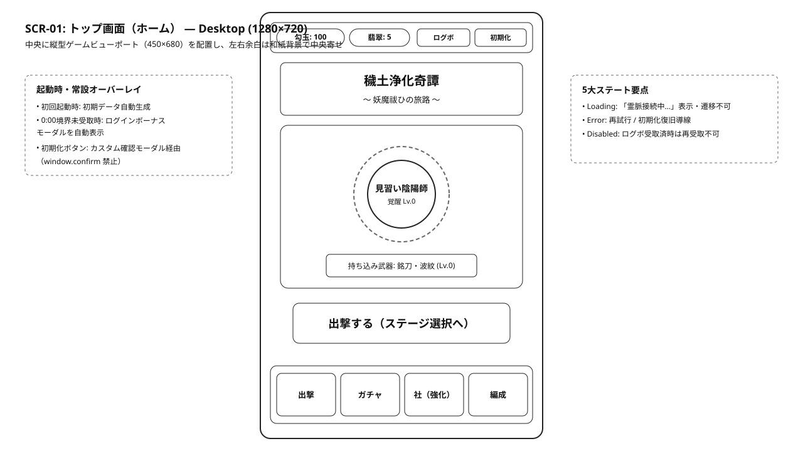

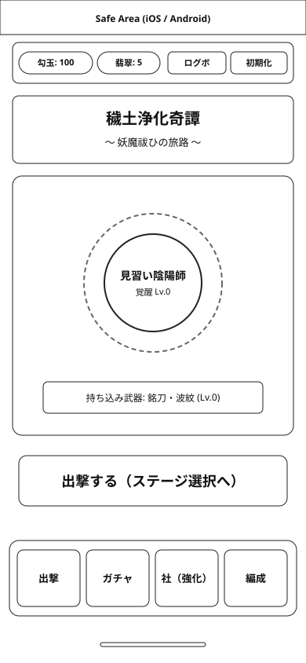

#### 5大ステート表示方針 (`home`)

| ステート     | 表示・振る舞い方針                                                                                                                       |
| :----------- | :--------------------------------------------------------------------------------------------------------------------------------------- |
| **Empty**    | 初回起動時（IndexedDB未作成）は自動的に初期セーブデータを生成し、初回ログインボーナスモーダルを表示したうえで `Success` 状態へ移行する。 |
| **Loading**  | IndexedDB読込中・初期化処理中は「霊脈接続中…」の和風ローディング表示を出し、すべての画面遷移ボタンを非活性化する。                       |
| **Success**  | 最新通貨・装備中キャラ/武器を表示。当日0:00以降の未受取ログボがあればモーダルを自動表示する。                                            |
| **Error**    | IndexedDB読込失敗・スキーマ破損時はエラーバナーと「再試行」ボタン、および「セーブデータ初期化して復旧」導線を表示する。                  |
| **Disabled** | 当日のログインボーナス受取済み時は、モーダル内の受取ボタンを「受取済み」表示かつ `Disabled` とする。                                     |

---

### 5.2 ステージ選択画面 (`stage-select`)

- **URL**: `/stages`
- **主要UIブロック**:
  - **ヘッダーバー**: 「戻る」ボタン（`/` へ）、画面タイトル、所持通貨（勾玉・翡翠）
  - **ステージ一覧カード群（全3節）**: ステージ名、状態バッジ（未浄化 / 浄化済み / 未解放）、全10ウェーブ・推奨穢れ度、報酬プレビュー（勾玉・翡翠・初回ボーナス）、「出撃する」ボタン
  - **現在の出撃編成フッター**: 装備中主人公と持ち込み主武器1枠のサマリー、および「編成変更」（`/formation`）ショートカット
  - **共通フッターナビゲーション**: 「出撃（選択中）」「ガチャ」「社（強化）」「編成」の4タブバー

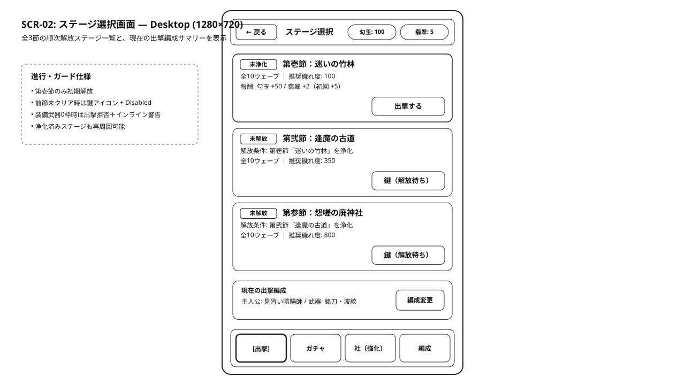

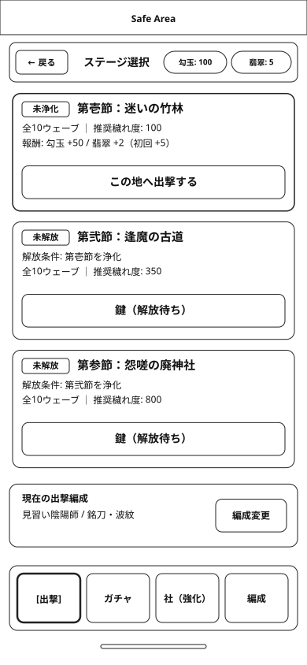

#### 5大ステート表示方針 (`stage-select`)

| ステート     | 表示・振る舞い方針                                                                                                                              |
| :----------- | :---------------------------------------------------------------------------------------------------------------------------------------------- |
| **Empty**    | マスタ定義不備等でステージ一覧が空の場合、「選択可能な土地がありません」のメッセージとホーム帰還導線を表示する。                                |
| **Loading**  | セーブデータ参照中・出撃前検証中は「出撃する」ボタンにローディング表示を行い、二重クリックを防止する。                                          |
| **Success**  | 全3節を一覧表示し、解放済みステージの「出撃する」ボタンを有効化する。浄化済みステージも周回可能とする。                                         |
| **Error**    | マスタ不整合または装備武器未設定等の不正状態で出撃を試みた場合、インライン警告（「武器を1つ以上編成してください」等）を表示して遷移を阻止する。 |
| **Disabled** | 前節未クリアでロック中のステージはグレーアウト＋鍵アイコン表示とし、解放条件を注記して出撃ボタンを `Disabled` とする。                          |

---

### 5.3 ゲーム画面（バトル） (`battle`)

- **URL**: `/battle/:stageId`
- **主要UIブロック**:
  - **Canvas 2D 戦闘描画領域**: 画面上部から進軍する妖怪群（デバフ付与時の視覚オーラ・状態表示含む）、中央下部に固定配置された主人公と円形/半円形の守護結界、自動索敵による遠隔術・弾道・爆発エフェクト・外側が濃い放射グラデーション斬撃
  - **上部HUDオーバーレイ（DOM）**: ステージ名、現在ウェーブ（`Wave X / 10`）、等速(`1x`)/2倍速(`2x`)切替ボタン、一時停止（`停止`）ボタン、結界耐久バー、霊力ゲージ＆レベル表示
  - **下部武器スロットオーバーレイ（DOM）**: バトル中に解放済みの武器スキル枠（最大3枠：初期持ち込み1枠＋ラン内レベルアップ開放最大2枠）
  - **オーバーレイモーダル群**: 3択スキルモーダル（勾玉リロール対応）、ポーズモーダル、勝敗リザルトモーダル（敗北時は「ステージ選択に戻る」に加え「再チャレンジ」ボタンを表示）

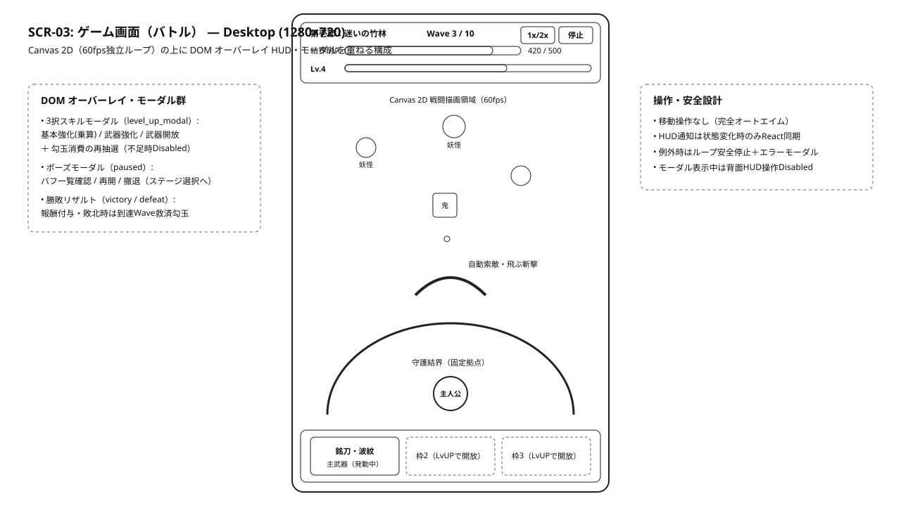

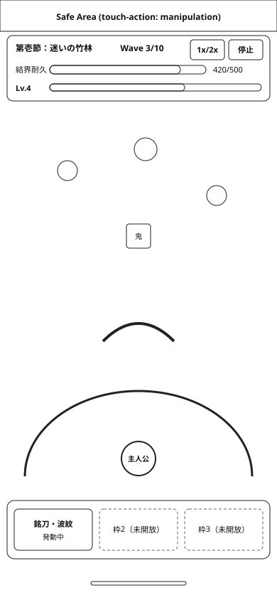

#### 5大ステート表示方針 (`battle`)

| ステート     | 表示・振る舞い方針                                                                                                                              |
| :----------- | :---------------------------------------------------------------------------------------------------------------------------------------------- |
| **Empty**    | バトル開始直前（`preparing` フェーズ）はウェーブ開始演出を表示し、第1ウェーブの妖怪出現を待機する。                                             |
| **Loading**  | Canvas初期化中およびバトル終了時のIndexedDB報酬保存中は、遷移ボタンをロックし二重保存を防止する。                                               |
| **Success**  | 60fpsのCanvas戦闘を描画し、状態変化時のみHUDへ通知同期する。3択モーダル・ポーズ・リザルトを適切にオーバーレイ表示する。                         |
| **Error**    | Canvas 2Dコンテキスト取得失敗またはループ内例外発生時は、アニメーションループを安全停止しエラーモーダルとステージ選択への帰還ボタンを表示する。 |
| **Disabled** | 3択スキルモーダルで所持勾玉がリロール費用未満の場合、「再抽選」ボタンを `Disabled` とする。モーダル表示中は背面の倍速切替等を操作不可とする。   |

---

### 5.4 ガチャ画面（召喚） (`gacha`)

- **URL**: `/gacha`
- **主要UIブロック**:
  - **ヘッダーバー**: 「戻る」ボタン、画面タイトル、所持通貨（勾玉・翡翠）
  - **排出プール切替タブ**: 「キャラ召喚」 / 「武器召喚」
  - **ピックアップバナー領域**: 注目キャラ/武器プレビュー、「提供割合・排出一覧」詳細導線
  - **重複・上限変換ルール注記**: 自動覚醒/精錬および上限到達後の勾玉変換ルール表示
  - **召喚実行ボタン群**: 「1回召喚（翡翠 5個）」「10回連続召喚（翡翠 50個）」
  - **共通フッターナビゲーション**: 「出撃」「ガチャ（選択中）」「社（強化）」「編成」の4タブバー

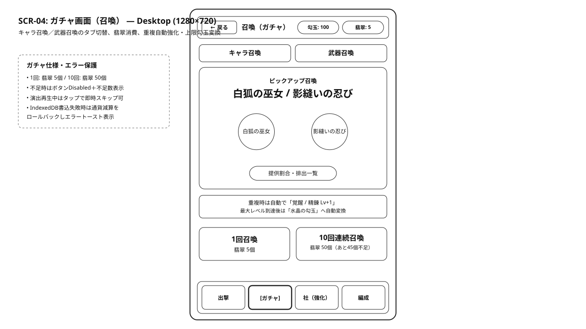

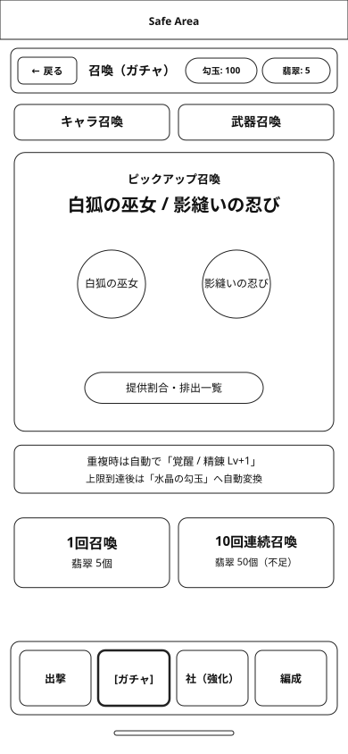

#### 5大ステート表示方針 (`gacha`)

| ステート     | 表示・振る舞い方針                                                                                                                                |
| :----------- | :------------------------------------------------------------------------------------------------------------------------------------------------ |
| **Empty**    | 初回遷移時（実行前）はピックアップ情報・提供割合・現在所持翡翠数を表示して召喚待機する。                                                          |
| **Loading**  | 抽選計算・IndexedDB保存トランザクション中、および召喚演出再生中は再召喚ボタンを `Disabled` とし、演出中はタップによる「スキップ」のみ有効化する。 |
| **Success**  | 結果モーダルに獲得対象と「新規獲得」「覚醒/精錬 Lv+1」「上限到達→勾玉変換済み」バッジを表示する。                                                 |
| **Error**    | IndexedDB書込失敗時は通貨減算をメモリ・ストレージともにロールバックし、エラートーストと再試行導線を表示する。                                     |
| **Disabled** | 所持翡翠が5個未満なら「1回召喚」を、50個未満なら「10回連続召喚」を `Disabled`（不足数明記）とする。                                               |

---

### 5.5 強化画面（社・永続育成） (`enhance`)

- **URL**: `/enhance`
- **主要UIブロック**:
  - **ヘッダーバー**: 「戻る」ボタン、画面タイトル、所持「水晶の勾玉」表示
  - **総合基礎ステータスサマリー**: 現在の装備と永続強化を合算した 結界耐久 / 霊力攻撃 / 会心発生率 プレビュー
  - **永続強化カード群（3項目）**: 「結界耐久」「霊力攻撃」「会心発生率」の現在Lv、現在加算値 → 次Lv加算値、必要勾玉数、「強化する」ボタン
  - **共通フッターナビゲーション**: 「出撃」「ガチャ」「社（強化）（選択中）」「編成」の4タブバー

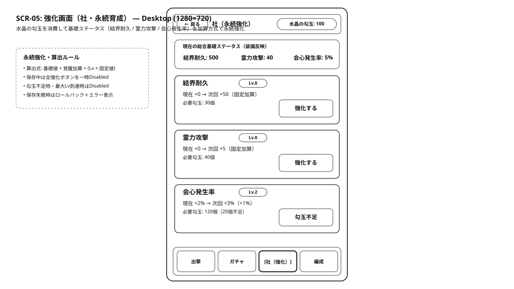

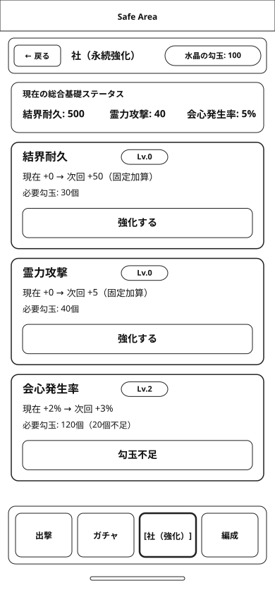

#### 5大ステート表示方針 (`enhance`)

| ステート     | 表示・振る舞い方針                                                                                          |
| :----------- | :---------------------------------------------------------------------------------------------------------- |
| **Empty**    | 全強化レベルが `0` の初期状態では「Lv.0（未強化）」と初回強化時の上昇幅を明示して育成を促す。               |
| **Loading**  | 強化確定後のIndexedDB永続化中は、連打による二重消費を防ぐため全「強化する」ボタンを一時 `Disabled` とする。 |
| **Success**  | 勾玉消費後の最新レベル・総合ステータスを即時反映し、強化フィードバックを表示する。                          |
| **Error**    | 保存失敗時は通貨と強化レベルをロールバックし、エラートーストを表示する。                                    |
| **Disabled** | 所持勾玉が次レベル必要数に満たない項目、または最大レベル到達項目は「強化する」ボタンを `Disabled` とする。  |

---

### 5.6 編成画面 (`formation`)

- **URL**: `/formation`（ステージ選択からの遷移時は `/formation?from=stages` またはルーター履歴で遷移元を保持）
- **主要UIブロック**:
  - **ヘッダーバー**: 「戻る」ボタン（遷移元に応じて `/` または `/stages` へ復帰）、画面タイトル、所持通貨（勾玉・翡翠）
  - **現在の編成 & 総合ステータスプレビュー**: 選択中の主人公1名（覚醒Lv・パッシブ効果）、持ち込み主武器1枠（精錬Lv・ジャンル特性）、合算基礎ステータス（結界耐久 / 霊力攻撃 / 会心発生率）
  - **対象切替タブ**: 「主人公（1名）」 / 「持ち込み武器（1枠）」
  - **所持一覧リスト**: 所持済みのキャラ/武器のみを表示する選択カード（選択中は「編成中」バッジ表示。未解放キャラ/武器は一覧に表示しない）
  - **フッターアクションバー**: 「ステージ選択へ」ボタン（`/stages` への直接遷移導線。編成確認後すぐに出撃選択へ進める）
  - **共通フッターナビゲーション**: 「出撃」「ガチャ」「社（強化）」「編成（選択中）」の4タブバー

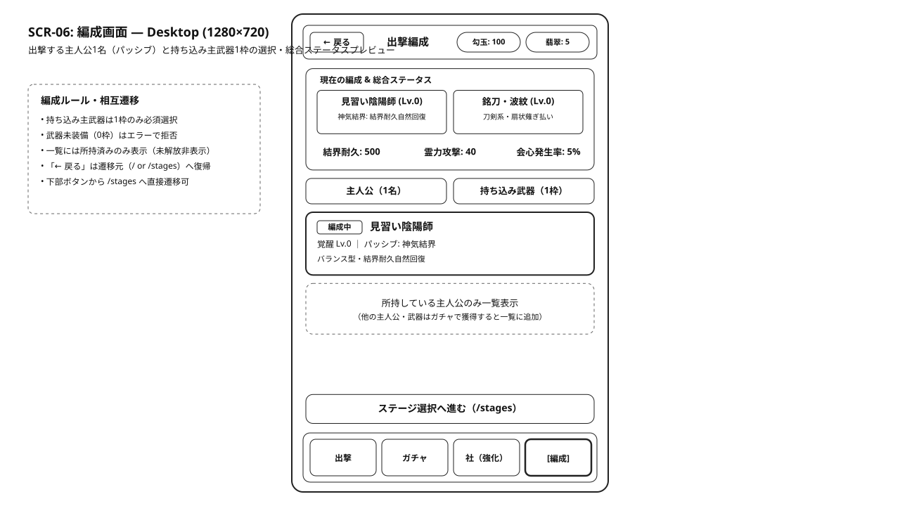

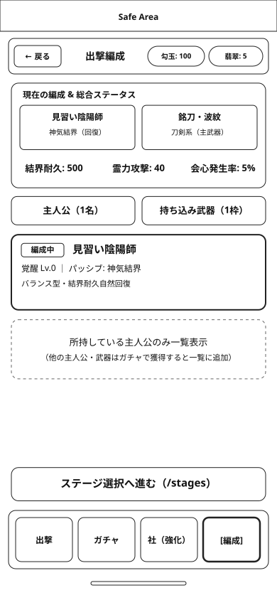

#### 5大ステート表示方針 (`formation`)

| ステート     | 表示・振る舞い方針                                                                                                           |
| :----------- | :--------------------------------------------------------------------------------------------------------------------------- |
| **Empty**    | 所持済みのキャラ/武器が初期1種のみの場合は、他に切替候補がない旨（ガチャで獲得できる旨）の案内を表示する。                   |
| **Loading**  | 編成変更のIndexedDB保存中は選択操作を一時ロックする。                                                                        |
| **Success**  | 選択中の主人公1名と持ち込み主武器1枠、および合算後の総合ステータスを即時プレビュー表示する。                                 |
| **Error**    | 武器未装備（0枠）にしようとする操作や未所持IDの指定はバリデーションエラー（「武器は1つ選択する必要があります」）で拒否する。 |
| **Disabled** | 現在選択中のアイテムに対する再選択操作は無効化（`Disabled`）する。                                                           |
