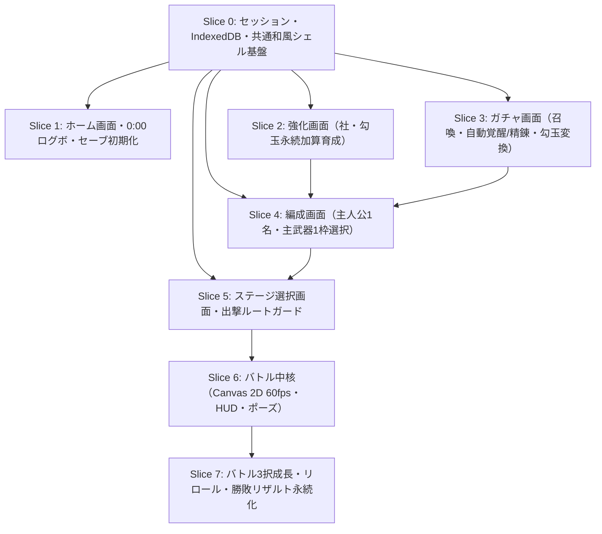

# 垂直スライス実装計画書 (Vertical Slice Roadmap): 穢土浄化奇譚 〜 妖魔祓ひの旅路 〜

本書は、[specs/requirements.md](./requirements.md)、[specs/screens.md](./screens.md)、[specs/db.md](./db.md)、[specs/components.md](./components.md)、および [specs/auth.md](./auth.md) に基づき、Phase 4 で実装する機能単位と着手順序を定義します。

> [!IMPORTANT]
> **垂直分割原則（Vertical Slicing）**:
> レイヤー別の水平分割（DBのみ、ロジックのみ、UIのみ等）は禁止します。Slice 0（認証・セッション・共通レイアウト基盤）以降は、**「1スライス＝1ユースケース（IndexedDB / `storage/` 〜 `domain/` / `engine/` 〜 `features/` UI 貫通）」** を単位として実装し、各スライス完了時点でビルド・型検査・401/403 相当ガードテスト・動作確認が完結する構成とします。

---

## 1. 進捗ステータス凡例

| 記号  | ステータス | 意味                                                               |
| :---: | :--------- | :----------------------------------------------------------------- |
| `[ ]` | 未着手     | Phase 4 実装待ち                                                   |
| `[~]` | 進行中     | 現在実装・テスト中                                                 |
| `[x]` | 完了       | 実装・単体テスト（401/403相当ガード含む）・`/code-review` 通過済み |

---

## 2. スライス依存関係マップ

---

## 3. スライス一覧（着手推奨順序）

| スライスID  | 進捗  | ユースケース名                                    | 対象画面 / モーダル                                                           | 主な API / サービス（`storage/`・`domain/`・`engine/`）                                                              | 対象ストア / テーブル・マスタ                                                                                                                      | 先行依存                  |
| :---------- | :---: | :------------------------------------------------ | :---------------------------------------------------------------------------- | :------------------------------------------------------------------------------------------------------------------- | :------------------------------------------------------------------------------------------------------------------------------------------------- | :------------------------ |
| **Slice 0** | `[x]` | 共通基盤・セッション初期化・和風シェル            | 全画面共通枠（`/` 初期疎通・エラー復旧枠含む）                                | `openPlayerDb`, `loadOrInitializeSave`, `validatePlayerSaveData`, `createInitialPlayerSave`, `ok` / `err` ガード基盤 | `playerSave`（キー `"primary"` 初期化・検証）、`data/` 初期マスタ骨格、`tokens.css`                                                                | なし                      |
| **Slice 1** | `[x]` | トップ画面・0:00ログインボーナス・セーブ初期化    | `home` (`/`), `login-bonus-modal`, `save-reset-confirm-modal`                 | `claimLoginBonus`, `resetPlayerSave`, `getLocalDateKey`, `guardLoginBonusClaimable`                                  | `playerSave` (`currencies`, `lastLoginBonusDate`, `equipped*`), `LOGIN_BONUS_CONFIG`, `CHARACTER_MASTERS`, `WEAPON_MASTERS`                        | Slice 0                   |
| **Slice 2** | `[x]` | 社（強化）による勾玉永続加算強化                  | `enhance` (`/enhance`)                                                        | `enhancePermanentStat`, `calculateTotalMetaStats`, `guardEnhanceable`                                                | `playerSave` (`currencies.magatama`, `permanentStats`), `ENHANCE_STAT_CONFIGS`, `CHARACTER_MASTERS`                                                | Slice 0                   |
| **Slice 3** | `[x]` | キャラ／武器ガチャ召喚・重複覚醒精錬・上限変換    | `gacha` (`/gacha`), `gacha-result-modal`                                      | `executeGachaPull`, `guardCurrencySufficient`, 重複・上限変換ロジック                                                | `playerSave` (`currencies.hisui`, `currencies.magatama`, `ownedCharacters`, `ownedWeapons`), `GACHA_CONFIG`, `CHARACTER_MASTERS`, `WEAPON_MASTERS` | Slice 0                   |
| **Slice 4** | `[x]` | 編成画面（主人公1名・持ち込み武器1枠切替）        | `formation` (`/formation`)                                                    | `updateFormation`, `guardEquipmentSelection`, `calculateTotalMetaStats`                                              | `playerSave` (`ownedCharacters`, `ownedWeapons`, `equippedCharacterId`, `equippedWeaponId`), `CHARACTER_MASTERS`, `WEAPON_MASTERS`                 | Slice 0, Slice 2, Slice 3 |
| **Slice 5** | `[x]` | ステージ選択・全3節一覧・出撃ルートガード         | `stage-select` (`/stages`)                                                    | `guardBattleSortie`, ルートガード（`/battle/:stageId` 直リンク検証）                                                 | `playerSave` (`unlockedStageIds`, `clearedStageIds`, `equipped*`), `STAGE_MASTERS`                                                                 | Slice 0, Slice 4          |
| **Slice 6** | `[ ]` | バトル中核（Canvas 2D戦闘・HUD・ポーズ・撤退）    | `battle` (`/battle/:stageId`), `battle-pause-modal`                           | `BattleEngine`, `useBattleEngine`, 9系統武器・敵AI・パッシブ・No-op Audio                                            | `playerSave`（読込のみ）, `STAGE_MASTERS`, `ENEMY_MASTERS`, `WEAPON_MASTERS`, `CHARACTER_MASTERS`                                                  | Slice 5                   |
| **Slice 7** | `[ ]` | バトル3択成長・リロール・勝敗リザルト・報酬永続化 | `battle` (`/battle/:stageId`), `level-up-choice-modal`, `battle-result-modal` | `generateUpgradeChoices`, `applyUpgradeOption`, `rerollBattleChoices`, `commitBattleResult`                          | `playerSave` (`currencies`, `unlockedStageIds`, `clearedStageIds`), `STAGE_MASTERS`, `WEAPON_MASTERS`                                              | Slice 6                   |

---

## 4. 各スライスの詳細スコープと完了条件

### Slice 0: 共通基盤・セッション初期化・和風シェル基盤

- **進捗ステータス**: `[x]` 完了
- **対象画面**: 全画面共通レイアウト枠（`/`, `*` フォールバック、エラー復旧枠）
- **API / サービス**:
  - `storage/`: `openPlayerDb()`, `loadOrInitializeSave()`（`readwrite` トランザクション内初期生成＋マイグレーション）
  - `domain/`: `validatePlayerSaveData()`, `createInitialPlayerSave()`, `ok()` / `err()` 共通 `DomainResult` ヘルパー
  - `app/`: `PlayerSessionContext`（5大ステート管理）、クライアントサイドルーター（`*` → `/`）、`AppToastProvider`
- **テーブル / マスタ**:
  - IndexedDB `edo-purification-db` v1 / `playerSave`（キー `"primary"`）
  - `data/`: `CharacterMaster` / `WeaponMaster` / `StageMaster` / `EnemyMaster` 型・初期定義
  - `app/styles/tokens.css` & `components/ui/*`, `components/shared/*`（`AppShell`, `ScreenHeader`, `BottomTabNav`, `CurrencyPill`, `StateView`, `ConfirmAlertDialog`）
- **先行依存**: なし
- **完了条件（Acceptance Criteria）**:
  1. 初回起動時に `"primary"` セーブデータが自動生成され、`apprentice_onmyoji`・`sword_hamon`・翡翠 `5`・勾玉 `100`・`stage_1_bamboo` 解放状態が保存される。
  2. 破損データ（負数通貨、未知の装備ID、欠損キー）に対する `validatePlayerSaveData` の 401 相当拒否テスト（`SAVE_CORRUPTED`）がパスする。
  3. 生カラー直書きゼロ、Radix Primitives 準拠、`pnpm typecheck` / `pnpm lint` / `pnpm build` がパスする。

### Slice 1: トップ画面（ホーム）・0:00 ログインボーナス・セーブ初期化

- **進捗ステータス**: `[x]` 完了
- **対象画面 / モーダル**: `home` (`/`), `login-bonus-modal`, `save-reset-confirm-modal`
- **API / サービス**:
  - `domain/`: `getLocalDateKey(now)`, `guardLoginBonusClaimable(save, todayKey)`, `applyLoginBonus(save, todayKey, config)`
  - `storage/`: `claimLoginBonus(now)`, `resetPlayerSave(now)`（単一 `readwrite` トランザクション）
- **テーブル / マスタ**: `playerSave`（`currencies`, `lastLoginBonusDate`, `equippedCharacterId`, `equippedWeaponId`, `updatedAt`）, `LOGIN_BONUS_CONFIG`, `CHARACTER_MASTERS`, `WEAPON_MASTERS`
- **先行依存**: `Slice 0`
- **完了条件（Acceptance Criteria）**:
  1. 未受取時は起動時に `login-bonus-modal` が自動表示され、受取後は同日 0:00 境界内でボタンが `Disabled`（「受取済み」）になる。ヘッダーの「ログボ」ボタンから再確認できる。
  2. ヘッダーの「初期化」ボタン押下時、`ConfirmAlertDialog`（`save-reset-confirm-modal`）で承認した場合のみセーブが初期状態へリセットされる。
  3. 日付境界テスト（`23:59:59` → `00:00:00`）および同日二重受取拒否テスト（`LOGIN_BONUS_ALREADY_CLAIMED`）がパスする。

### Slice 2: 強化画面（社・永続育成）

- **進捗ステータス**: `[x]` 完了
- **対象画面**: `enhance` (`/enhance`)
- **API / サービス**:
  - `domain/`: `calculateEnhanceCost(config, currentLevel)`, `calculateTotalMetaStats(save, charMaster)`, `guardEnhanceable(save, statKey, maxLv, cost)`
  - `storage/`: `enhancePermanentStat(statKey)`
- **テーブル / マスタ**: `playerSave`（`currencies.magatama`, `permanentStats`）, `ENHANCE_STAT_CONFIGS`, `CHARACTER_MASTERS`
- **先行依存**: `Slice 0`
- **完了条件（Acceptance Criteria）**:
  1. 「結界耐久」「霊力攻撃」「会心発生率」の現在Lv・次Lv加算値・必要勾玉数・合算ステータスが表示される。
  2. 勾玉消費とレベル加算が単一トランザクションで保存され、保存中は全強化ボタンが `Disabled`（`isPending`）になる。
  3. 勾玉不足（`INSUFFICIENT_MAGATAMA`）および最大レベル到達（`ALREADY_MAX_LEVEL`）の拒否テスト、加算方式ステータス算出テストがパスする。

### Slice 3: ガチャ画面（召喚・重複覚醒精錬・上限勾玉変換）

- **進捗ステータス**: `[x]` 完了
- **対象画面 / モーダル**: `gacha` (`/gacha`), `gacha-result-modal`
- **API / サービス**:
  - `domain/`: `guardCurrencySufficient(save, "hisui", cost)`, `resolveGachaPulls(save, poolType, count, rng, now)`
  - `storage/`: `executeGachaPull(poolType, count)`
- **テーブル / マスタ**: `playerSave`（`currencies.hisui`, `currencies.magatama`, `ownedCharacters`, `ownedWeapons`）, `GACHA_CONFIG`, `CHARACTER_MASTERS`, `WEAPON_MASTERS`
- **先行依存**: `Slice 0`
- **完了条件（Acceptance Criteria）**:
  1. 「キャラ召喚」「武器召喚」タブ切替、1回（翡翠5）/ 10回（翡翠50）の実行、召喚演出のスキップタップ、結果モーダル（新規/覚醒Lv+1/精錬Lv+1/上限→勾玉変換済みバッジ）が動作する。
  2. 提供割合・排出一覧モーダル（`ui/Dialog`）および変換ルール注記（`ui/Popover`）が閲覧できる。
  3. 翡翠不足拒否（`INSUFFICIENT_HISUI`）、重複覚醒/精錬加算、上限到達後の勾玉自動変換テストがパスする。

### Slice 4: 編成画面（主人公1名・持ち込み主武器1枠）

- **進捗ステータス**: `[x]` 完了
- **対象画面**: `formation` (`/formation`)
- **API / サービス**:
  - `domain/`: `guardEquipmentSelection(save, charId, weaponId)`, `calculateTotalMetaStats(save, charMaster)`
  - `storage/`: `updateFormation({ characterId, weaponId })`
- **テーブル / マスタ**: `playerSave`（`ownedCharacters`, `ownedWeapons`, `equippedCharacterId`, `equippedWeaponId`）, `CHARACTER_MASTERS`, `WEAPON_MASTERS`
- **先行依存**: `Slice 0`, `Slice 2`, `Slice 3`
- **完了条件（Acceptance Criteria）**:
  1. 所持済みのキャラ・武器のみが `RadioGroup` + `SelectableCard` で選択でき、未所持キャラ/武器は一覧に表示されない。
  2. 選択変更時に合算ステータスが即時更新され、IndexedDB へ保存される。`/stages` への直接遷移ボタンおよび遷移元に応じた「戻る」動作が機能する。
  3. 未所持キャラ指定（`UNOWNED_CHARACTER`）、未所持武器指定（`UNOWNED_WEAPON`）、武器空選択（`EMPTY_WEAPON_SELECTION`）の拒否テストがパスする。

### Slice 5: ステージ選択画面 & 出撃ルートガード

- **進捗ステータス**: `[x]` 完了
- **対象画面**: `stage-select` (`/stages`)
- **API / サービス**:
  - `domain/`: `guardBattleSortie(save, stageId, STAGE_MASTER_MAP)`
  - `app/`: `/battle/:stageId` ルートガード（直リンク・リロード時の事前検証＋不正時 `/stages` リダイレクト＆エラートースト）
- **テーブル / マスタ**: `playerSave`（`unlockedStageIds`, `clearedStageIds`, `equippedCharacterId`, `equippedWeaponId`）, `STAGE_MASTERS`
- **先行依存**: `Slice 0`, `Slice 4`
- **完了条件（Acceptance Criteria）**:
  1. 全3節（第壱節〜第参節）の状態バッジ（未浄化 / 浄化済み / 未解放）、Wave数・推奨穢れ度・報酬プレビュー、現在の出撃編成サマリー（「編成変更」導線含む）が表示される。
  2. 未解放ステージの出撃ボタンは鍵アイコン＋`Disabled` 表示となり、クリックできない。
  3. `/battle/stage_2_old_road`（未解放）や `/battle/unknown` への直リンクが `/stages` へ差し戻され、`STAGE_LOCKED` / `INVALID_STAGE_ID` / `EMPTY_WEAPON_SELECTION` ガードテストがパスする。

### Slice 6: バトル中核エンジン・Canvas 2D 戦闘ループ・HUD

- **進捗ステータス**: `[ ]` 未着手
- **対象画面 / モーダル**: `battle` (`/battle/:stageId`), `battle-pause-modal`
- **API / サービス**:
  - `engine/`: `BattleEngine`（60fps `requestAnimationFrame`、プロシージャル描画、守護結界・パッシブ効果・全10ウェーブ敵スポーン・オートエイム・9系統武器挙動・衝突・会心計算・No-op Audio インターフェース）
  - `features/battle/`: `useBattleEngine`（`useRef` 分離 + 変化時のみ `BattleHudSnapshot` 同期）、上部HUD（Wave・`1x`/`2x`・停止・結界HP・EXP）、下部武器スロットバー、`battle-pause-modal`（撤退確認 `ConfirmAlertDialog` 含む）
- **テーブル / マスタ**: `playerSave`（読込のみ）, `STAGE_MASTERS`, `ENEMY_MASTERS`, `WEAPON_MASTERS`, `CHARACTER_MASTERS`
- **先行依存**: `Slice 5`
- **完了条件（Acceptance Criteria）**:
  1. Canvas 2D が React 状態と分離されて 60fps で動作し、`1x`/`2x` 切替・一時停止・再開・確認モーダル付き撤退（`/stages` 帰還）が機能する。
  2. 持ち込み武器1枠から戦闘が開始され、9系統すべての武器ジャンル挙動および主人公3種の固有パッシブ効果が仕様通り動作する。
  3. Canvas 初期化失敗またはループ例外時に安全停止し、エラーモーダルと `/stages` 帰還導線が表示される。

### Slice 7: バトル3択成長・リロール・勝敗リザルト・報酬永続化

- **進捗ステータス**: `[ ]` 未着手
- **対象画面 / モーダル**: `battle` (`/battle/:stageId`), `level-up-choice-modal`, `battle-result-modal`
- **API / サービス**:
  - `domain/`: `generateUpgradeChoices`, `applyUpgradeOption`（複利乗算バフ＋最大3枠武器アンロック）, `guardCurrencySufficient`, `calculateBattleRewards`（勝利報酬＋初回翡翠ボーナス／敗北時到達Wave救済勾玉）
  - `storage/`: `rerollBattleChoices(cost)`（勾玉消費トランザクション）, `commitBattleResult(payload)`（報酬付与＋`clearedStageIds`＋次節 `unlockedStageIds` アトミック保存）
- **テーブル / マスタ**: `playerSave`（`currencies.magatama`, `currencies.hisui`, `unlockedStageIds`, `clearedStageIds`）, `STAGE_MASTERS`, `WEAPON_MASTERS`
- **先行依存**: `Slice 6`
- **完了条件（Acceptance Criteria）**:
  1. 霊力 MAX で `level-up-choice-modal` が開き、複利乗算のステータス強化または未解放武器の追加開放（最大計3枠、上限到達時は `weapon_unlock` 除外）が適用される。
  2. 勾玉残高が不足している場合「再抽選」ボタンは `Disabled` となり、不足時の直接実行は `INSUFFICIENT_MAGATAMA` で拒否される。
  3. Wave10 ボス撃破（`victory`）で次節解放・報酬保存、結界HP 0（`defeat`）で救済勾玉が保存され、`battle-result-modal` から `/stages` へ帰還できる。
  4. 複利乗算計算テスト、3枠上限到達時除外テスト、リロール残高不足拒否テスト、勝利/敗北報酬・次ステージ解放の永続化テストがパスする。
