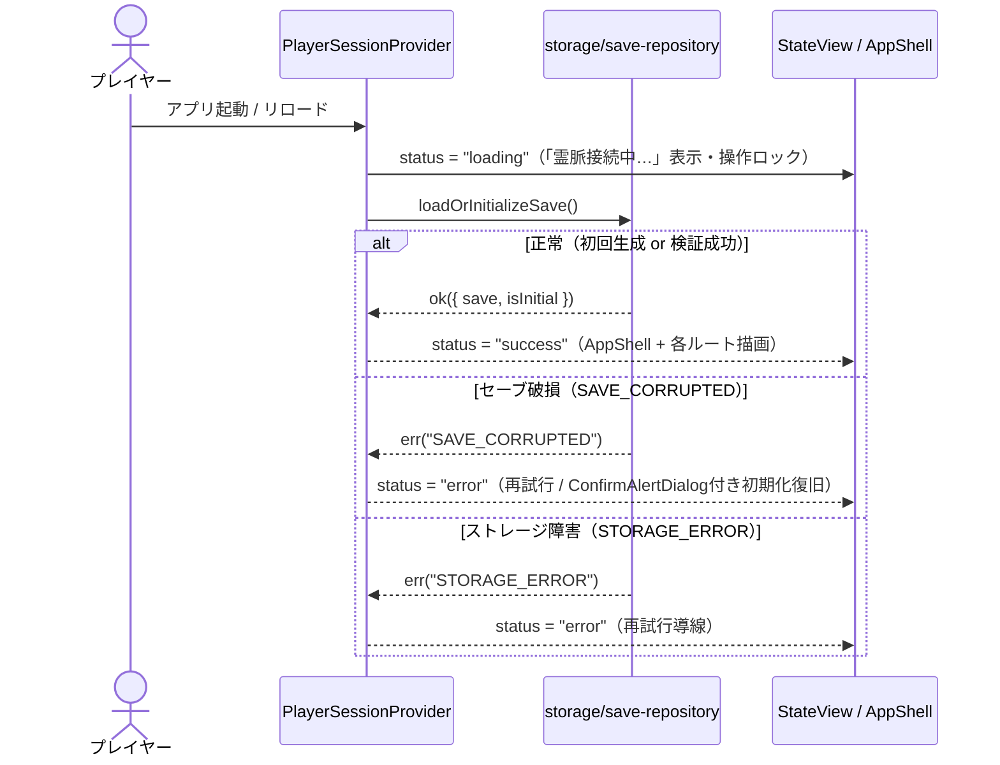

# スライス詳細設計書: Slice 0 — セッション・IndexedDB・共通和風シェル基盤

- **スライスID**: `Slice 0`
- **進捗ステータス**: `[~]` 進行中
- **先行依存**: なし
- **対象レイヤー**: `data/` / `domain/` / `storage/` / `components/ui/` / `components/shared/` / `app/`
- **準拠仕様書**:
  - [specs/slices.md](../slices.md)
  - [specs/db.md](../db.md)
  - [specs/auth.md](../auth.md)
  - [specs/components.md](../components.md)
  - [specs/screens.md](../screens.md)
  - [specs/requirements.md](../requirements.md)
  - [.agents/rules/coding-rules.md](../../.agents/rules/coding-rules.md)
  - [.agents/rules/design-rules.md](../../.agents/rules/design-rules.md)

---

## 1. 目的とスコープ

### 1.1 目的

完全クライアント完結型 SPA『穢土浄化奇譚 〜 妖魔祓ひの旅路 〜』の全機能スライス（Slice 1〜7）が依存する以下4つの共通基盤を貫通実装し、アプリ起動から IndexedDB セッション確立・異常系復旧・和風シェル表示までを疎通させる。

1. **永続化基盤 (`storage/` + `domain/`)**: `idb` を用いた IndexedDB（`edo-purification-db` v1 / `playerSave["primary"]`）の接続・初回自動生成・ランタイム検証・構造化エラー処理。
2. **マスタデータ骨格 (`data/`)**: 初期キャラ・初期武器・ステージ・敵マスタの型付き不変定義と O(1) ルックアップマップ。
3. **セッション・ルーティング基盤 (`app/`)**: `PlayerSessionContext`（5大ステート管理）、クライアントサイドルーター（`*` → `/` フォールバック）、`AppToastProvider`。
4. **和風 UI 基盤 (`components/ui/` + `components/shared/`)**: Radix UI Primitives ベースの調達プリミティブ群と共通レイアウトシェル（`AppShell`, `ScreenHeader`, `BottomTabNav`, `CurrencyPill`, `StateView`, `ConfirmAlertDialog`）。

### 1.2 既存初期化資産との接続（重複作成の禁止）

Phase 3.7 のプロジェクト初期化により以下が既に実装ツリーに存在するため、Slice 0 では新規再作成せずそのまま参照・接続する。

- 共通型定義: [types/index.ts](../../types/index.ts)（`types/common.ts`, `types/save.ts`, `types/master.ts`, `types/battle.ts`）
- 共通 Result ヘルパー: [domain/result.ts](../../domain/result.ts)（`ok`, `err`）
- デザイントークン: [app/styles/tokens.css](../../app/styles/tokens.css), [app/styles/index.css](../../app/styles/index.css)
- 環境設定・エントリ骨格: [app/env.ts](../../app/env.ts), [app/main.tsx](../../app/main.tsx), [app/App.tsx](../../app/App.tsx)

### 1.3 スコープ外（Slice 1 以降へ委譲）

- 各画面の本実装（ホームのログボ自動表示・初期化実行、強化、ガチャ、編成、ステージ選択、バトル Canvas エンジン）
- `ui/Tabs`, `ui/RadioGroup`, `ui/Popover`, `ui/Progress`, `ui/Toggle`, `ui/Dialog`, `ui/Avatar`, `ui/AspectRatio`, `ui/Label`, `shared/StatusBadge`, `shared/ItemAvatar`, `shared/SelectableCard`, `shared/StatSummaryGrid`, `shared/WeaponSlotBar`（利用する各スライスで追加実装する）

---

## 2. データモデル・マスタ骨格設計 (`data/`)

[specs/db.md](../db.md) セクション7.2 および [types/master.ts](../../types/master.ts) に準拠し、不変マスタ定数および O(1) 参照用マップを定義する。`data/` は静的定数と型のみを保持し、`storage/`・`features/`・`engine/`・`react` へ依存しない。

| モジュール                 | 公開シンボル                                | 内容・初期データ要件                                                                                                                                           |
| :------------------------- | :------------------------------------------ | :------------------------------------------------------------------------------------------------------------------------------------------------------------- |
| `data/character-master.ts` | `CHARACTER_MASTERS`, `CHARACTER_MASTER_MAP` | 初期主人公 `apprentice_onmyoji`（見習い陰陽師 / `isInitial: true`）を含む定義骨格。`Object.freeze` で不変化し、`Record<CharacterId, CharacterMaster>` を構築。 |
| `data/weapon-master.ts`    | `WEAPON_MASTERS`, `WEAPON_MASTER_MAP`       | 初期主武器 `sword_hamon`（銘刀・波紋 / `genre: "sword"` / `isInitial: true`）を含む定義骨格。                                                                  |
| `data/stage-master.ts`     | `STAGE_MASTERS`, `STAGE_MASTER_MAP`         | 第壱節 `stage_1_bamboo`（`order: 1`, `unlockRequirementStageId: null`）を含む全3節骨格（`stage_2_old_road`, `stage_3_shrine`）。                               |
| `data/enemy-master.ts`     | `ENEMY_MASTERS`, `ENEMY_MASTER_MAP`         | ステージウェーブ定義が参照する妖怪マスタ骨格。                                                                                                                 |
| `data/index.ts`            | 上記のバレル再エクスポート                  | 外部層からの単一インポート窓口。                                                                                                                               |

> [!NOTE]
> `CHARACTER_MASTER_MAP` 等への動的キー参照時はプロトタイプ汚染防止のため `Object.hasOwn(map, id)` を必須とする（[specs/auth.md](../auth.md) セクション5.2）。

---

## 3. ドメイン検証・初期セーブ生成設計 (`domain/`)

`domain/` はブラウザ API（`window` / `indexedDB`）および `react` に依存しない純粋 TypeScript で記述する。

### 3.1 `domain/save-factory.ts`

- `createInitialPlayerSave(now: Date = new Date()): PlayerSaveData`
  - [specs/db.md](../db.md) セクション3.1 および [specs/requirements.md](../requirements.md) セクション4.1 の初期値と完全一致する `PlayerSaveData` を生成する。
  - `schemaVersion`: `SAVE_SCHEMA_VERSION` (`1`)
  - `currencies`: `{ magatama: 100, hisui: 5 }`
  - `permanentStats`: `{ hpLevel: 0, atkLevel: 0, lukLevel: 0 }`
  - `ownedCharacters`: `{ apprentice_onmyoji: { characterId: "apprentice_onmyoji", awakeningLevel: 0, obtainedAt: nowIso } }`
  - `ownedWeapons`: `{ sword_hamon: { weaponId: "sword_hamon", refineLevel: 0, obtainedAt: nowIso } }`
  - `equippedCharacterId`: `"apprentice_onmyoji"`
  - `equippedWeaponId`: `"sword_hamon"`
  - `unlockedStageIds`: `["stage_1_bamboo"]`
  - `clearedStageIds`: `[]`
  - `lastLoginBonusDate`: `null`
  - `updatedAt`: `now.toISOString()`

### 3.2 `domain/save-validator.ts`

`validatePlayerSaveData(raw: unknown, masters?: MasterCatalog): DomainResult<PlayerSaveData>` および `validateAndMigrateSave(raw: unknown, masters?: MasterCatalog): DomainResult<PlayerSaveData>` を提供する。

#### 検証ルール（失敗時はすべて `err("SAVE_CORRUPTED", ...)` を返却）

1. **構造・必須キー存在チェック**: `raw` が非 `null` のプレーンオブジェクトであり、`schemaVersion`, `currencies`, `permanentStats`, `ownedCharacters`, `ownedWeapons`, `equippedCharacterId`, `equippedWeaponId`, `unlockedStageIds`, `clearedStageIds`, `lastLoginBonusDate`, `updatedAt` をすべて自身（`Object.hasOwn`）に持つこと。
2. **バージョン・数値妥当性**:
   - `schemaVersion`: 正の整数（`Number.isInteger(v) && v >= 1 && v <= SAVE_SCHEMA_VERSION`）。
   - `currencies.magatama`, `currencies.hisui`: 有限非負整数（`Number.isFinite(v) && Number.isInteger(v) && v >= 0`）。
   - `permanentStats.{hpLevel, atkLevel, lukLevel}`: 有限非負整数。
3. **所持マップ整合性（FK + 上限チェック）**:
   - `ownedCharacters` / `ownedWeapons`: 最低1件以上存在し、各キーが `Object.hasOwn(CHARACTER_MASTER_MAP, id)` / `Object.hasOwn(WEAPON_MASTER_MAP, id)` を満たすこと。
   - キーと内部の `characterId` / `weaponId` が一致し、`awakeningLevel` / `refineLevel` が `0 <= lv <= maxLevel` の整数であること。
4. **装備FK整合性**:
   - `equippedCharacterId`: 空文字でなく、`Object.hasOwn(ownedCharacters, equippedCharacterId)` かつマスタに存在すること。
   - `equippedWeaponId`: 空文字でなく、`Object.hasOwn(ownedWeapons, equippedWeaponId)` かつマスタに存在すること。
5. **ステージ進行・部分集合制約**:
   - `unlockedStageIds` / `clearedStageIds`: 配列であり、重複要素がなく、全要素が `Object.hasOwn(STAGE_MASTER_MAP, id)` を満たすこと。
   - `clearedStageIds` のすべての要素が `unlockedStageIds` に含まれること（`clearedStageIds ⊆ unlockedStageIds`）。
6. **日付フォーマット**:
   - `lastLoginBonusDate`: `null` または `/^\d{4}-\d{2}-\d{2}$/` に一致する文字列。
   - `updatedAt`: 空でない有効な日時文字列（`!Number.isNaN(Date.parse(updatedAt))`）。

---

## 4. IndexedDB リポジトリ設計 (`storage/`)

[specs/db.md](../db.md) セクション8 および [specs/auth.md](../auth.md) セクション2.2・4.2 に準拠し、`idb` ライブラリを用いた単一トランザクションリポジトリを構築する。

### 4.1 `storage/player-db.ts`

- `openPlayerDb(): Promise<IDBPDatabase<EdoPurificationDB>>`
  - `openDB<EdoPurificationDB>(DB_NAME, DB_VERSION, { upgrade(db) { ... } })` を呼び出す。
  - `upgrade` フック内で `!db.objectStoreNames.contains("playerSave")` の場合のみ `db.createObjectStore("playerSave")`（out-of-line キー）を作成する。セカンダリインデックスは作成しない。

### 4.2 `storage/save-repository.ts`

- 返却型: `Promise<DomainResult<{ save: PlayerSaveData; isInitial: boolean }>>`
- `loadOrInitializeSave(now: Date = new Date()): Promise<DomainResult<{ save: PlayerSaveData; isInitial: boolean }>>`
  1. `openPlayerDb()` で DB 接続を取得。
  2. `db.transaction("playerSave", "readwrite")` を開始し、`store.get(SAVE_RECORD_KEY)` を実行。
  3. **未存在（`undefined`）の場合**: `createInitialPlayerSave(now)` を生成して `store.put(initialSave, SAVE_RECORD_KEY)` し、`await tx.done` 後に `ok({ save: initialSave, isInitial: true })` を返却。
  4. **存在する場合**: `validateAndMigrateSave(rawSave)` を実行。
     - 成功時: `ok({ save: validated, isInitial: false })` を返却。
     - 失敗時（`SAVE_CORRUPTED`）: トランザクション内で上書き・破壊せず、`err("SAVE_CORRUPTED", ...)` をそのまま返却。
  5. **例外捕捉**: IndexedDB 容量超過・ブラウザ制限（プライベートモード等）による例外は `console.error` でコンテキスト付き構造化ログを出力した上で、内部スタックを露出せず `err("STORAGE_ERROR", "セーブデータの読み込みに失敗しました。")` を返却する（サイレント握りつぶし禁止）。
- `resetPlayerSaveToInitial(now: Date = new Date()): Promise<DomainResult<PlayerSaveData>>`
  - 破損復旧導線（Error ステートからの「初期化して復旧」）および Slice 1 以降の初期化から利用する。単一 `readwrite` トランザクション内で `createInitialPlayerSave(now)` を `store.put(..., SAVE_RECORD_KEY)` し、コミット完了後に `ok(initialSave)` を返却する。

---

## 5. セッション状態・ルーティング・通知基盤 (`app/`)

### 5.1 起動・セッション状態遷移フロー

### 5.2 `app/session/PlayerSessionContext.tsx`

- **管理状態**:
  - `status`: `"loading" | "success" | "error"`
  - `save`: `PlayerSaveData | null`
  - `error`: `DomainError | null`
  - `isPending`: `boolean`（初期化復旧等の書き込みトランザクション実行中フラグ）
  - `isInitialBoot`: `boolean`
- **公開アクション**:
  - `reloadSession(): Promise<void>`（再試行ボタン用）
  - `resetSessionToInitial(): Promise<DomainResult<PlayerSaveData>>`（`isPending` 排他制御付き初期化復旧用）
  - `applyCommittedSave(nextSave: PlayerSaveData): void`（後続スライスの書き込み成功後スナップショット同期用）

### 5.3 クライアントサイドルーティング (`app/router/`)

- Browser History API（`window.location.pathname` + `popstate`）または Hash ルーターにより、以下の全6ルートを解決し、未定義パス（`*`）は `/` へリプレースリダイレクトする。
  - `/`, `/stages`, `/gacha`, `/enhance`, `/formation`, `/battle/:stageId`
- Slice 0 時点では `/` を含む各ルートに共通シェル上の最小疎通プレースホルダー（`StateView` 連携確認用）を配置し、Slice 1〜7 で各 `features/*` 画面へ差し替える。
- `/battle/:stageId` 進入時は `status === "loading"` の間はローディング待機、`status === "error"` の場合は `/` へ誘導する（詳細ステージガードは Slice 5 で統合）。

---

## 6. UI プリミティブ (`components/ui/`) & 共有ラッパー (`components/shared/`) 設計

[.agents/rules/design-rules.md](../../.agents/rules/design-rules.md) および [specs/components.md](../components.md) に完全準拠し、以下を各ディレクトリの `index.ts` バレル経由で公開する。全ファイル **200行以下**・**アロー関数統一**・**生カラー直書き禁止**（セマンティックトークンのみ参照）を遵守する。

### 6.1 Slice 0 で構築する `components/ui/`

| コンポーネント      | 基盤ライブラリ                    | 公開API・設計ポイント                                                                                                                                                                                                                                                                                                             |
| :------------------ | :-------------------------------- | :-------------------------------------------------------------------------------------------------------------------------------------------------------------------------------------------------------------------------------------------------------------------------------------------------------------------------------- |
| `ui/Button`         | `@radix-ui/react-slot`            | `variant`: `"primary" \| "secondary" \| "destructive" \| "ghost" \| "outline"`, `size`: `"sm" \| "md" \| "lg" \| "icon"`, `isPending?: boolean`, `asChild?: boolean`。`min-h-11 min-w-11`（`44x44px`）、`touch-action: manipulation`、`focus-visible:ring-2 focus-visible:ring-ring`。`isPending` 時は自動 `disabled`＋スピナー。 |
| `ui/Card`           | カスタム和風コンテナ              | `Card.Root`, `Card.Header`, `Card.Title`, `Card.Content`, `Card.Footer`。`bg-card text-card-foreground border-border rounded-lg`。                                                                                                                                                                                                |
| `ui/Badge`          | カスタム軽量プリミティブ          | `variant`: `"default" \| "success" \| "warning" \| "destructive" \| "muted" \| "accent"`。`rounded-sm`、トークン配色のみ使用。                                                                                                                                                                                                    |
| `ui/Typography`     | カスタムセマンティックテキスト    | `Heading`（`as`: `"h1" \| "h2" \| "h3" \| "h4"`、見出し階層厳守）、`Text`（`tone`: `"default" \| "muted" \| "destructive" \| "success"`, `tabularNums?: boolean`）。                                                                                                                                                              |
| `ui/Separator`      | `@radix-ui/react-separator`       | `Separator`（`orientation`: `"horizontal" \| "vertical"`、`bg-border`）。                                                                                                                                                                                                                                                         |
| `ui/ScrollArea`     | `@radix-ui/react-scroll-area`     | `ScrollArea.Root`, `ScrollArea.Viewport`, `ScrollArea.Scrollbar`, `ScrollArea.Thumb`。                                                                                                                                                                                                                                            |
| `ui/AlertDialog`    | `@radix-ui/react-alert-dialog`    | `AlertDialog.Root` (`open`, `onOpenChange`), `Content` (`z-modal`), `Title`, `Description`, `Action`, `Cancel`。Backdrop/Escape で閉じない。                                                                                                                                                                                      |
| `ui/Toast`          | `@radix-ui/react-toast`           | `Toast.Provider`, `Toast.Viewport` (`z-toast`), `Toast.Root`, `Toast.Title`, `Toast.Description`, `Toast.Close`。                                                                                                                                                                                                                 |
| `ui/Tooltip`        | `@radix-ui/react-tooltip`         | `Tooltip.Provider`, `Tooltip.Root`, `Tooltip.Trigger`, `Tooltip.Content` (`z-popover`)。                                                                                                                                                                                                                                          |
| `ui/VisuallyHidden` | `@radix-ui/react-visually-hidden` | `VisuallyHidden`（アイコン専用ボタンのラベル補助）。                                                                                                                                                                                                                                                                              |

### 6.2 Slice 0 で構築する `components/shared/`

| コンポーネント              | 利用 `ui/` 部品                                            | 主な仕様                                                                                                                                                                                               |
| :-------------------------- | :--------------------------------------------------------- | :----------------------------------------------------------------------------------------------------------------------------------------------------------------------------------------------------- |
| `shared/AppShell`           | `ui/ScrollArea`                                            | PC（`md:` 以上）は外枠 `bg-frame-outer`＋中央 `max-w-[450px] bg-background` 縦型枠、モバイルは `min-h-dvh`＋Safe Area パディング。`hideBottomNav`（`/battle/*` 用）で `BottomTabNav` を出し分け。      |
| `shared/ScreenHeader`       | `ui/Button`, `ui/Typography`, `ui/Tooltip`, `ui/Separator` | 戻るボタン（任意）、`h1` 画面タイトル、右側 `CurrencyPill`（勾玉・翡翠）、画面固有補助スロット。`z-sticky`。                                                                                           |
| `shared/BottomTabNav`       | `ui/Button` (`asChild`), `ui/Typography`                   | `<nav>` 内に「出撃 (`/stages`)」「ガチャ (`/gacha`)」「社 (`/enhance`)」「編成 (`/formation`)」の4タブを固定配置。`z-sticky`、各タブ `min-h-11` 確保、`aria-current="page"` 付与。                     |
| `shared/CurrencyPill`       | `ui/Badge`, `ui/Typography`, `ui/Tooltip`                  | `type: CurrencyType`（`"magatama" \| "hisui"`）、`amount: number`（`tabularNums`）、任意 `requiredAmount`（不足時 `warning`/`destructive` 強調）。専用和風 SVG アイコン使用。                          |
| `shared/StateView`          | `ui/Card`, `ui/Button`, `ui/Typography`                    | 5大ステート共通表示ラッパー（`loading` / `empty` / `error` / `disabled` / `success`）。`error` 時は「再試行」および `SAVE_CORRUPTED` 時の「セーブ初期化して復旧」（`ConfirmAlertDialog` 起動）を提供。 |
| `shared/ConfirmAlertDialog` | `ui/AlertDialog`, `ui/Button`                              | `open`, `onOpenChange`, `isPending`, `title`, `description`, `confirmLabel`, `onConfirm` を統一提供。`isPending` 中は `Cancel`・確定ボタン共に非活性化し二重実行と閉じる操作を抑止。                   |
| `shared/AppToastProvider`   | `ui/Toast`                                                 | `showErrorToast(error: DomainError)` / `showSuccessToast(title, description)` を Context 経由で提供し、`DomainErrorCode` を日本語メッセージへ一元マッピング。                                          |

---

## 7. 5大ステート標準と認可境界（401 / 403 相当）

### 7.1 Slice 0 における 5大ステート網羅表

| ステート                    | セッション / UI の振る舞い                                                                                                                                                                                                        |
| :-------------------------- | :-------------------------------------------------------------------------------------------------------------------------------------------------------------------------------------------------------------------------------- |
| **Empty**                   | IndexedDB に `"primary"` が未存在の場合、`loadOrInitializeSave()` 内で `SYSTEM` が自動的に初期セーブデータ（翡翠 `5`・勾玉 `100`・`apprentice_onmyoji`・`sword_hamon`・`stage_1_bamboo`）を生成して保存し、`Success` へ移行する。 |
| **Loading**                 | DB 接続・読込中は `StateView` が「霊脈接続中…」インジケータを表示し、画面遷移・初期化ボタンをすべてロックする。                                                                                                                   |
| **Success**                 | 検証済み `PlayerSaveData` に基づき、`AppShell`・`ScreenHeader`（通貨ピル）・`BottomTabNav`・各ルートビューを描画する。                                                                                                            |
| **Error**                   | `SAVE_CORRUPTED` または `STORAGE_ERROR` 発生時は `StateView` の Error ビューを表示し、保護ルートを遮断。「再試行」ボタン、および `SAVE_CORRUPTED` 時は `ConfirmAlertDialog` による明示的承認付き初期化復旧導線を提供する。        |
| **Disabled / Unauthorized** | 書き込み中（`isPending === true`）は確認ダイアログ・復旧ボタンを `Disabled` 化し二重実行を防止。未定義ルート `*` は `/` へリダイレクトする。                                                                                      |

### 7.2 401 / 403 相当境界とセキュリティ防御

- **401 相当境界**: `PlayerSessionContext` が `loading` または `error`（`SAVE_CORRUPTED` / `STORAGE_ERROR`）の間、保護画面・アクションを遮断し、正規コンテキスト確立前にデータ変更を行わせない。
- **破壊的操作ガード**: セーブデータの初期化復旧は必ず `ConfirmAlertDialog` での明示的承認を経由し、`window.alert()` / `window.confirm()` / `window.prompt()` は一切使用しない。
- **プロトタイプ汚染・XSS 防御**: すべてのマップ参照で `Object.hasOwn` を使用し、`dangerouslySetInnerHTML` 等を禁止する。

---

## 8. 検証・単体テスト計画（No Hollow Mocks）

Vitest + `fake-indexeddb` を用い、モックによる強制パス（Hollow Mock）を禁止して実際の `validatePlayerSaveData` および `loadOrInitializeSave` を実行する。

1. **初回起動自動生成テスト (`storage/save-repository.test.ts`)**:
   - 空の IndexedDB に対して `loadOrInitializeSave()` を実行し、`isInitial: true` かつ `apprentice_onmyoji`・`sword_hamon`・翡翠 `5`・勾玉 `100`・`["stage_1_bamboo"]` が永続化されることを検証。
   - 2回目呼び出し時は `isInitial: false` で既存レコードが返却されることを検証。
2. **401 相当破損データ拒否テスト (`domain/save-validator.test.ts`)**:
   - 負数通貨（`magatama: -1`）、小数通貨、未知の装備ID（`equippedWeaponId: "unknown_sword"`）、未所持キャラ装備、欠損キー、`clearedStageIds` が `unlockedStageIds` に含まれない不正データに対し、`validatePlayerSaveData` が `ok: false` かつ `code: "SAVE_CORRUPTED"` を返すことを検証。
   - プロトタイプ汚染キー（`"__proto__"`, `"constructor"`）を装備IDに指定したケースが `SAVE_CORRUPTED` で拒否されることを検証。
3. **リセット復旧・ロールバックテスト (`storage/save-repository.test.ts`)**:
   - 破損レコードが格納された状態で `loadOrInitializeSave()` が `SAVE_CORRUPTED` を返し、かつ DB 内のレコードを上書きしないこと。
   - その後 `resetPlayerSaveToInitial()` を実行すると正常な初期セーブへ復旧することを検証。
4. **静的検証・規約チェック**:
   - `pnpm typecheck`, `pnpm lint`, `pnpm build`, `pnpm test` がすべてゼロエラーで通過すること。
   - 生カラー直書きゼロ、全プロダクションファイル 200行以下、単一末尾改行を遵守すること。
