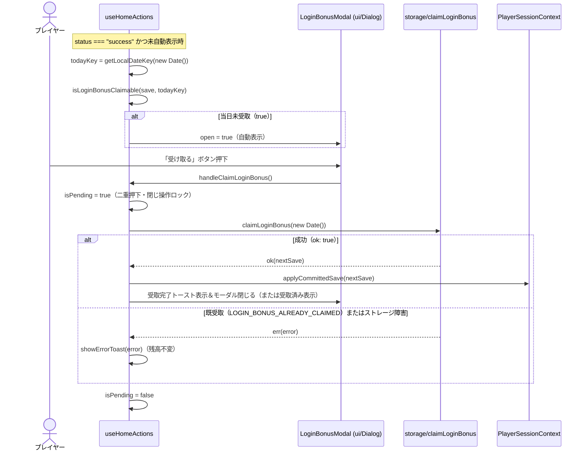

# スライス詳細設計書: Slice 1 — トップ画面・0:00ログインボーナス・セーブ初期化

- **スライスID**: `Slice 1`
- **進捗ステータス**: `[x]` 完了
- **先行依存**: `Slice 0`（完了済み）
- **対象レイヤー**: `data/` / `domain/` / `storage/` / `components/ui/` / `components/shared/` / `features/home/` / `app/`
- **準拠仕様書**:
  - [specs/slices.md](../slices.md)
  - [specs/db.md](../db.md)
  - [specs/auth.md](../auth.md)
  - [specs/components.md](../components.md)
  - [specs/screens.md](../screens.md)
  - [specs/requirements.md](../requirements.md)
  - [.agents/rules/coding-rules.md](../../.agents/rules/coding-rules.md)
  - [.agents/rules/design-rules.md](../../.agents/rules/design-rules.md)

---

## 1. 目的とスコープ

### 1.1 目的

Slice 0 で構築した永続化基盤・共通和風シェルの上に、ゲームの起点となる**トップ画面（ホーム: `/`）**を貫通実装し、以下の3つのユースケースを完結させる。

1. **ホーム画面表示 (`features/home/`)**: 作品タイトルバナー、装備中の主人公（覚醒Lv・固有パッシブ概要）および持ち込み主武器（精錬Lv・ジャンル）のプレビュー、および「出撃する（`/stages` へ）」メイン CTA を表示する。
2. **0:00 境界ログインボーナス (`login-bonus-modal`)**: ローカルタイムゾーンの `0:00` 境界（`YYYY-MM-DD`）を基準に当日未受取判定を行い、起動時の自動モーダル表示、ヘッダー「ログボ」ボタンからの再確認、および単一 `readwrite` トランザクションによる報酬付与・永続化を行う。
3. **セーブデータ初期化 (`save-reset-confirm-modal`)**: ヘッダー「初期化」ボタン押下時に `ConfirmAlertDialog` で明示的承認を取得し、承認時のみ IndexedDB `"primary"` レコードを初期状態へリセットして即時反映する。

### 1.2 既存 Slice 0 資産との接続

Slice 0 で既に実装されている以下のモジュール・コンポーネントを再利用し、重複実装を行わない。

- セッション管理: [app/session/PlayerSessionContext.tsx](../../app/session/PlayerSessionContext.tsx)（`status`, `save`, `error`, `isPending`, `resetSessionToInitial`, `applyCommittedSave`）
- 永続化基盤: [storage/save-repository.ts](../../storage/save-repository.ts)（`openPlayerDb`, `resetPlayerSaveToInitial`）
- 検証・初期生成: [domain/save-validator.ts](../../domain/save-validator.ts)（`validateAndMigrateSave`）, [domain/save-factory.ts](../../domain/save-factory.ts)（`createInitialPlayerSave`）, [domain/result.ts](../../domain/result.ts)（`ok`, `err`）
- 共通 UI シェル: `AppShell`（`headerActions` スロット）, `ScreenHeader`, `BottomTabNav`, `CurrencyPill`, `StateView`, `ConfirmAlertDialog`, `AppToastProvider`

### 1.3 スコープ外（Slice 2 以降へ委譲）

- 強化画面 (`/enhance`)・ガチャ画面 (`/gacha`)・編成画面 (`/formation`)・ステージ選択 (`/stages`)・バトル (`/battle/:stageId`) の本実装
- `ui/Tabs`, `ui/RadioGroup`, `ui/Popover`, `ui/Progress`, `ui/Toggle`, `ui/Label`, `shared/StatusBadge`, `shared/SelectableCard`, `shared/StatSummaryGrid`, `shared/WeaponSlotBar`

---

## 2. マスタデータ設計 (`data/`)

[types/master.ts](../../types/master.ts) の `LoginBonusConfig` に準拠し、ログインボーナス報酬定数を `data/` に追加する。

| モジュール                   | 公開シンボル         | 定義内容                                                                                             |
| :--------------------------- | :------------------- | :--------------------------------------------------------------------------------------------------- |
| `data/login-bonus-config.ts` | `LOGIN_BONUS_CONFIG` | `Object.freeze({ magatama: 50, hisui: 5 } satisfies LoginBonusConfig)`（1日1回受取の勾玉・翡翠報酬） |
| `data/index.ts`              | `LOGIN_BONUS_CONFIG` | バレル再エクスポートへ追加                                                                           |

> [!NOTE]
> `LOGIN_BONUS_CONFIG` は初期リリース値として勾玉 `50`・翡翠 `5` とし、UI 表示文言およびドメイン加算処理の双方が同一の `LOGIN_BONUS_CONFIG` を参照することで数値不整合を防ぐ。

---

## 3. ドメインロジック・0:00 境界ガード設計 (`domain/`)

`domain/` はブラウザ API（`window` / `indexedDB`）および `react` に依存しない純粋 TypeScript（アロー関数統一）で実装する。

### 3.1 `domain/login-bonus.ts`

1. **`getLocalDateKey(now: Date = new Date()): string`**
   - ローカルタイムゾーン（`now.getFullYear()`, `now.getMonth() + 1`, `now.getDate()`）からゼロ埋め `YYYY-MM-DD` 文字列を生成する。
   - 例: `2026-11-14T23:59:59` → `"2026-11-14"`、`2026-11-15T00:00:00` → `"2026-11-15"`（`toISOString()` の UTC 基準は使用しない）。
2. **`isLoginBonusClaimable(save: PlayerSaveData, todayKey: string): boolean`**
   - `save.lastLoginBonusDate !== todayKey` を返却する純粋判定ヘルパー（UI 表示およびガード共通利用）。
3. **`guardLoginBonusClaimable(save: PlayerSaveData, todayKey: string): DomainResult<true>`**
   - `save.lastLoginBonusDate === todayKey` の場合、`err("LOGIN_BONUS_ALREADY_CLAIMED", "本日のログインボーナスは既に受取済みです。")` を返却する（403 相当拒否）。
   - 未受取の場合は `ok(true)` を返却する。
4. **`applyLoginBonus(save: PlayerSaveData, todayKey: string, config: LoginBonusConfig = LOGIN_BONUS_CONFIG, now: Date = new Date()): DomainResult<PlayerSaveData>`**
   - 先に `guardLoginBonusClaimable(save, todayKey)` を実行し、失敗時はそのままエラー `DomainResult` を返却する。
   - 成功時は元オブジェクトを破壊せず（イミュータブル）、以下のフィールドを更新した新しい `PlayerSaveData` を返却する。
     - `currencies`: `{ magatama: save.currencies.magatama + config.magatama, hisui: save.currencies.hisui + config.hisui }`
     - `lastLoginBonusDate`: `todayKey`
     - `updatedAt`: `now.toISOString()`

### 3.2 `domain/index.ts` エクスポート追加

- `getLocalDateKey`, `isLoginBonusClaimable`, `guardLoginBonusClaimable`, `applyLoginBonus` を公開する。

---

## 4. IndexedDB リポジトリ設計 (`storage/`)

[specs/db.md](../db.md) セクション8.1 の「単一 `readwrite` トランザクション・最新レコード再読込・アトミック更新」を厳守する。

### 4.1 `storage/login-bonus-repository.ts`（または `storage/save-repository.ts` 拡張）

- **`claimLoginBonus(now: Date = new Date()): Promise<DomainResult<PlayerSaveData>>`**
  1. `openPlayerDb()` で DB 接続を取得。
  2. `db.transaction("playerSave", "readwrite")` を開始し、トランザクション内で最新の `store.get(SAVE_RECORD_KEY)` を取得する（React メモリ状態のみを信頼しない）。
  3. レコード未存在または `validateAndMigrateSave(raw)` 失敗時は、書込を行わず `err("SAVE_CORRUPTED", ...)` を返却する（401 相当拒否）。
  4. `todayKey = getLocalDateKey(now)` を算出し、`applyLoginBonus(validatedSave, todayKey, LOGIN_BONUS_CONFIG, now)` を実行する。
  5. ガード拒否（`LOGIN_BONUS_ALREADY_CLAIMED`）時は `store.put` を呼ばずに `tx.done` を待ち、`err(...)` をそのまま返却する（状態不変）。
  6. 許可時は `await store.put(nextSave, SAVE_RECORD_KEY)` と `await tx.done` を実行し、`ok(nextSave)` を返却する。
  7. IndexedDB 例外発生時は `console.error` で構造化ログを出力し、内部詳細を露出せず `err("STORAGE_ERROR", "ログインボーナスの受け取り保存に失敗しました。")` を返却する。

### 4.2 セーブ初期化の接続 (`resetPlayerSave` / `resetPlayerSaveToInitial`)

- Slice 0 で実装済みの `resetPlayerSaveToInitial(now)` をそのまま活用する（`specs/slices.md` 表記との整合として `storage/index.ts` から `resetPlayerSave` をエイリアス再エクスポートしてもよい）。
- `PlayerSessionContext.resetSessionToInitial()` は内部で `isPending` 排他制御を行い、`resetPlayerSaveToInitial()` 完了後に `save` を初期値へ、`isInitialBoot` を `true` へ更新する。

---

## 5. UI プリミティブ・共有コンポーネント追加設計 (`components/`)

[specs/components.md](../components.md) および [.agents/rules/design-rules.md](../../.agents/rules/design-rules.md) に準拠し、Slice 1 で必要な未実装コンポーネントを追加する。すべて 1 ファイル 200行以下・アロー関数統一・生カラー禁止・バレルエクスポート (`index.ts`) を遵守する。

### 5.1 `components/ui/` 追加分

| コンポーネント   | 基盤ライブラリ                 | 公開 API / 設計要件                                                                                                                                                                                                                        |
| :--------------- | :----------------------------- | :----------------------------------------------------------------------------------------------------------------------------------------------------------------------------------------------------------------------------------------- |
| `ui/Dialog`      | `@radix-ui/react-dialog`       | `Dialog.Root` (`open`, `onOpenChange`), `Portal`, `Overlay` (`z-overlay`), `Content` (`z-modal`, `bg-popover`, `rounded-lg`), `Header`, `Title`, `Description`, `Footer`, `Close`。`isPending` 時は Backdrop/Escape/Close 操作を抑止可能。 |
| `ui/Avatar`      | `@radix-ui/react-avatar`       | `Avatar.Root`, `Avatar.Image`, `Avatar.Fallback`（和風紋章・頭文字フォールバック）。`rounded-full` または和風額縁スタイル。                                                                                                                |
| `ui/AspectRatio` | `@radix-ui/react-aspect-ratio` | `AspectRatio`（メインビジュアル領域の比率維持）。                                                                                                                                                                                          |

### 5.2 `components/shared/` 追加分

| コンポーネント      | 利用 `ui/` 部品         | 公開 Props・仕様                                                                                                                                                                                                                                                  |
| :------------------ | :---------------------- | :---------------------------------------------------------------------------------------------------------------------------------------------------------------------------------------------------------------------------------------------------------------- |
| `shared/ItemAvatar` | `ui/Avatar`, `ui/Badge` | `name: string`, `badgeLabel?: string`（例: `覚醒Lv.0` / `精錬Lv.0`）, `kind: "character" \| "weapon"`, `size?: "sm" \| "md" \| "lg"`。アイコン絵柄は `lucide-react` または `components/icons/` を用いた和風紋章フォールバックで描画し、生カラー直書きを行わない。 |

---

## 6. ホーム画面・モーダル機能設計 (`features/home/`)

### 6.1 コンポーネント構成（3層分離・200行制限遵守）

```text
features/home/
├── index.ts                      # HomeScreen のみ公開
├── HomeScreen.tsx                # 純粋レイアウト構成（< 180行）
├── hooks/
│   └── useHomeActions.ts         # ログボ自動判定・受取・初期化アクション状態管理（< 150行）
└── components/
    ├── HomeHeaderActions.tsx     # ヘッダー補助スロット（「ログボ」「初期化」ボタン）
    ├── HomeEquippedPreview.tsx   # 装備中主人公＋持ち込み主武器プレビューカード
    └── LoginBonusModal.tsx       # ui/Dialog 準拠のログインボーナスモーダル
```

### 6.2 `HomeScreen` 画面仕様 (`/`)

1. **ヘッダー補助アクション (`HomeHeaderActions`)**:
   - `AppShell` の `headerActions` スロットへ渡す。
   - **「ログボ」ボタン**: 未受取時は強調バッジ/インジケータ（例: `accent` ドット）を表示し、タップで `login-bonus-modal` を開く。`min-h-11`（44px以上）。
   - **「初期化」ボタン**: 破壊的操作トーン（`ghost` / `destructive` テキスト）で配置し、タップで `save-reset-confirm-modal`（`ConfirmAlertDialog`）を開く。
   - 両ボタンとも `status !== "success" || isPending` 時は `disabled`。
2. **タイトルロゴバナー**:
   - 和風カードまたはヘッダー直下バナーとして作品タイトル『穢土浄化奇譚 〜 妖魔祓ひの旅路 〜』とサブキャッチを表示（見出し階層 `h2`、画面タイトル `h1` は `ScreenHeader` が担当）。
3. **メインビジュアル / 装備プレビュー (`HomeEquippedPreview`)**:
   - `AspectRatio` を用いた和風結界モチーフ枠内に、装備中主人公（`CHARACTER_MASTER_MAP[save.equippedCharacterId]`、`awakeningLevel`、固有パッシブ名・説明）と持ち込み主武器（`WEAPON_MASTER_MAP[save.equippedWeaponId]`、`refineLevel`、ジャンル名）を `ItemAvatar` と `Badge` で表示。
   - マスタ参照時は必ず `Object.hasOwn` で存在確認を行う。
4. **メイン CTA**:
   - 「出撃する（ステージ選択へ）」ボタン（`variant="primary"`, `size="lg"`、`w-full`）を配置し、タップで `/stages` へ遷移する。

### 6.3 ログインボーナス自動表示・受取フロー (`useHomeActions` + `LoginBonusModal`)



- **セッション内自動オープン制御**: 同一セッション中にユーザーがモーダルを閉じた後、再度画面に戻っただけで強制再表示され続けないよう `hasAutoCheckedRef` でセッション起動時（およびセーブ初期化直後）に1回だけ自動オープン判定を行う。ユーザーがヘッダーの「ログボ」ボタンを押した際はいつでも再確認できる。
- **受取後の再確認表示**: 当日受取済み（`!isLoginBonusClaimable(save, todayKey)`）の状態で開いた場合、モーダル内の受取ボタンは「本日分は受取済み」ラベル＋ `disabled={true}` として表示する。

### 6.4 セーブデータ初期化フロー (`ConfirmAlertDialog`)

- ヘッダー「初期化」ボタン押下 → `isResetDialogOpen = true` で `ConfirmAlertDialog`（`save-reset-confirm-modal`）を表示。
- 確認メッセージに「所持している翡翠・水晶の勾玉、強化レベル、獲得キャラ・武器、ステージ進行がすべて初期状態に戻ります。この操作は取り消せません。」を明記する。
- 承認ボタン押下 → `resetSessionToInitial()` を実行（`isPending` 中はダイアログのキャンセル・確定ともに非活性化）。
- 成功時: ダイアログを閉じ、成功トースト「セーブデータを初期化しました」を表示し、`hasAutoCheckedRef` をリセットして初回ログインボーナスモーダル自動判定を再評価する。
- 失敗時: `showErrorToast(res.error)` を表示し、既存セーブ状態を維持する。

### 6.5 `app/App.tsx` ルーティング接続

- `route.path === "/"` 時に `HomeScreen` を描画し、`headerActions` として `HomeHeaderActions`（または `HomeScreen` 内部制御と連携するプロパティ）を接続する。
- `/stages`, `/gacha`, `/enhance`, `/formation`, `/battle/:stageId` は Slice 2〜7 実装前まで共通プレースホルダーを維持する。

---

## 7. 5大ステート標準と認可境界（401 / 403 相当）

### 7.1 Slice 1 における 5大ステート網羅表

| ステート                    | `home` / モーダルにおける振る舞い                                                                                                                                                                                                                        |
| :-------------------------- | :------------------------------------------------------------------------------------------------------------------------------------------------------------------------------------------------------------------------------------------------------- |
| **Empty**                   | 初回起動時（IndexedDB 未作成）は Slice 0 の `loadOrInitializeSave()` により初期セーブが自動生成され、`lastLoginBonusDate === null` のため `login-bonus-modal` を自動表示して `Success` へ移行する。                                                      |
| **Loading**                 | `status === "loading"` 中は `StateView` が「霊脈接続中…」表示を出し、ヘッダーの「ログボ」「初期化」・下部ナビを非活性化する。また、受取・初期化トランザクション中（`isPending`）は実行ボタンをスピナー付き `Disabled` とし、モーダル閉じ操作も抑止する。 |
| **Success**                 | 最新の所持通貨（`CurrencyPill`）・装備中主人公・持ち込み主武器を表示し、「出撃する」・4タブナビ・「ログボ」・「初期化」が操作可能となる。                                                                                                                |
| **Error**                   | DB 読込失敗・破損時（`SAVE_CORRUPTED` / `STORAGE_ERROR`）は `StateView` のエラービュー（再試行／確認付き初期化復旧）を表示。ログボ受取・初期化失敗時はエラートーストを表示し、状態はロールバック（不変）する。                                           |
| **Disabled / Unauthorized** | 当日 0:00 境界内で既にログインボーナス受取済みの場合は `login-bonus-modal` 内の受取ボタンを「本日分は受取済み」かつ `Disabled` とする。未確立状態（401相当）や二重受取直接実行（403相当）は `claimLoginBonus` のガードで拒否する。                       |

### 7.2 401 / 403 相当境界とセキュリティ防御

- **401 相当境界**: `claimLoginBonus` はトランザクション内で再読込したレコードに対して `validateAndMigrateSave` を実行し、破損または未存在の場合は `SAVE_CORRUPTED` で書込を拒否する。
- **403 相当境界**: `guardLoginBonusClaimable` により同日二重受取を `LOGIN_BONUS_ALREADY_CLAIMED` で拒否し、通貨の不正重複付与を防止する。
- **破壊的操作防御**: `window.confirm()` / `window.alert()` を使用せず、Backdrop/Escape で閉じない `ConfirmAlertDialog` のみで承認を受け付ける。
- **XSS / プロトタイプ汚染防御**: マスタ参照は `Object.hasOwn` を徹底し、`dangerouslySetInnerHTML` を使用しない。

---

## 8. 検証・単体テスト計画（No Hollow Mocks）

Vitest + `fake-indexeddb` + `@testing-library/react` を用い、実際のガード関数・バリデーション・IndexedDB トランザクションを実行する（Hollow Mock 禁止）。

1. **0:00 日付境界・ドメインガードテスト (`domain/login-bonus.test.ts`)**:
   - `getLocalDateKey`: ローカル時刻 `23:59:59` と翌 `00:00:00` で日付キーが切り替わること。
   - `guardLoginBonusClaimable` / `applyLoginBonus`:
     - `lastLoginBonusDate === null` および前日文字列のとき `ok: true` で勾玉・翡翠が `LOGIN_BONUS_CONFIG` 分加算され、`lastLoginBonusDate` が当日キーになること。
     - **403 相当拒否テスト**: `lastLoginBonusDate === todayKey` のとき `ok: false` かつ `error.code === "LOGIN_BONUS_ALREADY_CLAIMED"` を返し、元データが不変であること。
2. **IndexedDB トランザクション永続化・拒否テスト (`storage/login-bonus-repository.test.ts`)**:
   - `claimLoginBonus(day1)` で通貨加算と日付保存がコミットされること。
   - 同日 2回目の `claimLoginBonus(day1Same)` が `LOGIN_BONUS_ALREADY_CLAIMED` で拒否され、IndexedDB 上の通貨残高が増加しないこと。
   - 翌 `00:00:00`（`day2`）の `claimLoginBonus(day2)` が再び成功し通貨が加算されること。
   - **401 相当破損データ拒否テスト**: 破損レコードが保存された状態で `claimLoginBonus` を呼ぶと `SAVE_CORRUPTED` を返し、レコードを上書きしないこと。
3. **UI・モーダル結合テスト (`features/home/HomeScreen.test.tsx`)**:
   - 初回/未受取状態で `login-bonus-modal` が自動表示され、受取ボタン押下でモーダル状態・受取済み `Disabled` 制御へ反映されること。
   - 「初期化」ボタン押下で `ConfirmAlertDialog` が開き、キャンセル時はセーブ不変、承認時は `resetSessionToInitial` が実行されること。
4. **静的検証・規約チェック**:
   - `pnpm typecheck`, `pnpm lint`, `pnpm build`, `pnpm test` がすべてゼロエラーで通過すること。
   - 生カラー直書きゼロ、全プロダクションファイル 200行以下、単一末尾改行を遵守すること。
