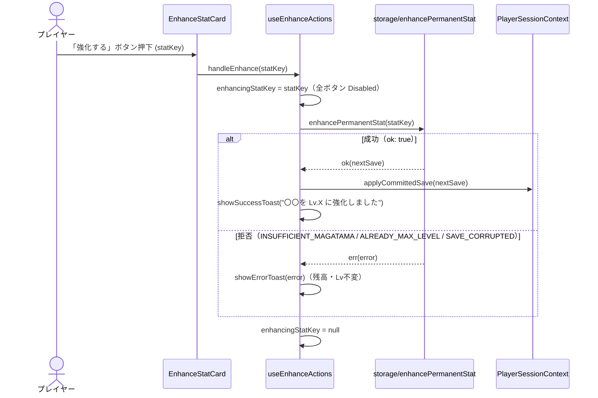

# スライス詳細設計書: Slice 2 — 社（強化）による勾玉永続加算強化

- **スライスID**: `Slice 2`
- **進捗ステータス**: `[x]` 完了
- **先行依存**: `Slice 0`（完了済み）
- **対象レイヤー**: `data/` / `domain/` / `storage/` / `components/shared/` / `features/enhance/` / `app/`
- **準拠仕様書**:
  - [specs/slices.md](../slices.md)
  - [specs/db.md](../db.md)
  - [specs/auth.md](../auth.md)
  - [specs/components.md](../components.md)
  - [specs/screens.md](../screens.md)
  - [specs/requirements.md](../requirements.md)
  - [.agents/rules/coding-rules.md](../../.agents/rules/coding-rules.md)
  - [.agents/rules/design-rules.md](../../.agents/rules/design-rules.md)

---

## 1. 目的とスコープ

### 1.1 目的

Slice 0 で構築した永続化基盤・共通和風シェルの上に、**強化画面（社・永続育成: `/enhance`）**を貫通実装し、以下のユースケースを完結させる。

1. **永続基礎ステータス強化 (`features/enhance/`)**: 所持している「水晶の勾玉（`magatama`）」を消費し、「結界耐久（`hpLevel`）」「霊力攻撃（`atkLevel`）」「会心発生率（`lukLevel`）」の3項目を恒久的に加算強化する。
2. **合算ステータスプレビュー (`shared/StatSummaryGrid`)**: 現在装備中の主人公（基礎値＋覚醒Lv加算）と永続強化（`permanentStats`）を加算方式で合算した総合ステータス（HP / ATK / LUK）をリアルタイムに表示する。
3. **単一トランザクション原子保存 (`storage/`)**: 勾玉の減算と強化レベルのインクリメントを IndexedDB 単一 `readwrite` トランザクション内でアトミックにコミットし、残高不足・最大レベル到達・破損データを確実に拒否する。

### 1.2 既存 Slice 0 / Slice 1 資産との接続

Slice 0・Slice 1 で既に実装されている以下のモジュール・コンポーネントを再利用し、重複実装を行わない。

- セッション管理: [app/session/PlayerSessionContext.tsx](../../app/session/PlayerSessionContext.tsx)（`status`, `save`, `error`, `isPending`, `applyCommittedSave`）
- 永続化基盤: [storage/save-repository.ts](../../storage/save-repository.ts)（`openPlayerDb`）
- 検証・エラー型: [domain/save-validator.ts](../../domain/save-validator.ts)（`validateAndMigrateSave`）, [domain/result.ts](../../domain/result.ts)（`ok`, `err`）
- 共通 UI 部品: `AppShell`, `ScreenHeader`, `BottomTabNav`, `CurrencyPill`, `StateView`, `AppToastProvider`, `ui/Card`, `ui/Button`, `ui/Badge`, `ui/Separator`, `ui/Typography`

### 1.3 スコープ外（Slice 3 以降へ委譲）

- ガチャ画面 (`/gacha`)・編成画面 (`/formation`)・ステージ選択 (`/stages`)・バトル (`/battle/:stageId`) の本実装
- バトル中の複利乗算バフ（`Slice 7`）
- `ui/Tabs`, `ui/RadioGroup`, `ui/Popover`, `ui/Progress`, `ui/Toggle`, `ui/Label`, `shared/StatusBadge`, `shared/SelectableCard`, `shared/WeaponSlotBar`

---

## 2. マスタデータ設計 (`data/`)

[specs/types/master.ts](../types/master.ts) の `EnhanceStatConfig` に準拠し、永続強化パラメータ定義を `data/` に追加する。

### 2.1 `data/enhance-config.ts`

```ts
export type EnhanceStatKey = EnhanceStatConfig["statKey"]; // "hpLevel" | "atkLevel" | "lukLevel"
```

| `statKey`  | `label`    | `valuePerLevel` | `baseCostMagatama` | `costStepMagatama` | `maxLevel` | 設計意図                                                     |
| :--------- | :--------- | --------------: | -----------------: | -----------------: | ---------: | :----------------------------------------------------------- |
| `hpLevel`  | 結界耐久   |            `20` |               `20` |               `10` |       `20` | 初期勾玉 `100` で Lv.0→Lv.3 まで強化可能（最大加算 `+400`）  |
| `atkLevel` | 霊力攻撃   |             `3` |               `25` |               `15` |       `20` | 初期勾玉 `100` で Lv.0→Lv.2 まで強化可能（最大加算 `+60`）   |
| `lukLevel` | 会心発生率 |             `1` |               `30` |               `20` |       `15` | 1%刻みの上昇。初期勾玉 `100` で Lv.0→Lv.2（最大加算 `+15%`） |

- `ENHANCE_STAT_CONFIGS`: `Object.freeze([...]) satisfies readonly EnhanceStatConfig[]`（表示順: `hpLevel` → `atkLevel` → `lukLevel`）
- `ENHANCE_STAT_CONFIG_MAP`: `Object.freeze(Object.fromEntries(...)) as Readonly<Record<EnhanceStatKey, EnhanceStatConfig>>`
- `data/index.ts` から `ENHANCE_STAT_CONFIGS`, `ENHANCE_STAT_CONFIG_MAP`, `type EnhanceStatKey` を再エクスポートする。

> [!NOTE]
> `ENHANCE_STAT_CONFIGS` を `Object.freeze` の単一ソースとして定義することで、UI のコスト表示・ドメインの必要勾玉算出・セーブ検証の上限値参照が常に一致する。

---

## 3. ドメインロジック・ガード設計 (`domain/`)

`domain/` はブラウザ API（`window` / `indexedDB`）および `react` に依存しない純粋 TypeScript（アロー関数統一）で実装する。

### 3.1 共通通貨ガード (`domain/currency-guard.ts` または `domain/enhance.ts`)

今後の Slice 3（ガチャ）・Slice 7（3択リロール）でも共用するため、通貨残高チェックを独立ヘルパーとして定義する。

1. **`guardCurrencySufficient(save: PlayerSaveData, currencyType: CurrencyType, cost: number): DomainResult<true>`**
   - `cost` が有限非負整数（`Number.isFinite(cost) && Number.isInteger(cost) && cost >= 0`）でない場合、または対象通貨残高 `save.currencies[currencyType] < cost` の場合、以下のエラーを返却する（403 相当拒否）。
     - `currencyType === "magatama"` → `err("INSUFFICIENT_MAGATAMA", "水晶の勾玉が不足しています。")`
     - `currencyType === "hisui"` → `err("INSUFFICIENT_HISUI", "翡翠が不足しています。")`
   - 十分な場合は `ok(true)` を返却する。

### 3.2 永続強化・ステータス算出 (`domain/enhance.ts`)

1. **`TotalMetaStats` 型**:
   - `{ readonly hp: number; readonly atk: number; readonly luk: number }`
2. **`calculateEnhanceCost(config: EnhanceStatConfig, currentLevel: number): number`**
   - `currentLevel < 0` または整数でない場合も安全に `0` 以上として正規化し、`config.baseCostMagatama + Math.max(0, Math.floor(currentLevel)) * config.costStepMagatama` を返却する。
   - 例: `hpLevel` Lv.0→1 は `20`、Lv.1→2 は `30`、Lv.2→3 は `40`。
3. **`calculateTotalMetaStats(save: PlayerSaveData, charMaster: CharacterMaster): TotalMetaStats`**
   - [specs/requirements.md](../requirements.md) 4.2 の**加算方式（Additive）**に従い算出する。
   - `awakeningLevel = save.ownedCharacters[charMaster.id]?.awakeningLevel ?? 0`（`Object.hasOwn` で安全参照）
   - `hp = charMaster.baseHp + awakeningLevel * charMaster.hpPerAwakening + save.permanentStats.hpLevel * ENHANCE_STAT_CONFIG_MAP.hpLevel.valuePerLevel`
   - `atk = charMaster.baseAtk + awakeningLevel * charMaster.atkPerAwakening + save.permanentStats.atkLevel * ENHANCE_STAT_CONFIG_MAP.atkLevel.valuePerLevel`
   - `luk = Number((charMaster.baseLuk + awakeningLevel * charMaster.lukPerAwakening + save.permanentStats.lukLevel * ENHANCE_STAT_CONFIG_MAP.lukLevel.valuePerLevel).toFixed(1))`（小数の浮動小数点誤差を丸める）
4. **`guardEnhanceable(save: PlayerSaveData, statKey: EnhanceStatKey, maxLevel: number, cost: number): DomainResult<true>`**
   - [specs/auth.md](../auth.md) セクション3.2 に準拠し、以下の順序で検証する（403 相当拒否）。
   - `save.permanentStats[statKey] >= maxLevel` の場合: `err("ALREADY_MAX_LEVEL", "この項目は既に最大強化レベルに達しています。")`
   - 続いて `guardCurrencySufficient(save, "magatama", cost)` を実行し、不足時は `INSUFFICIENT_MAGATAMA` を返却する。
   - 両方通過した場合は `ok(true)`。
5. **`applyEnhanceStat(save: PlayerSaveData, statKey: EnhanceStatKey, configMap?: Readonly<Record<EnhanceStatKey, EnhanceStatConfig>>, now?: Date): DomainResult<PlayerSaveData>`**
   - `Object.hasOwn(configMap, statKey)` で対象キーを検証し、不正キーは `err("SAVE_CORRUPTED", ...)` で拒否する。
   - `currentLevel = save.permanentStats[statKey]`、`cost = calculateEnhanceCost(config, currentLevel)` を算出し、`guardEnhanceable(save, statKey, config.maxLevel, cost)` を実行。
   - 許可時は元オブジェクトを破壊せず（イミュータブル）、以下のフィールドを更新した新しい `PlayerSaveData` を返却する。
     - `currencies`: `{ ...save.currencies, magatama: save.currencies.magatama - cost }`
     - `permanentStats`: `{ ...save.permanentStats, [statKey]: currentLevel + 1 }`
     - `updatedAt`: `now.toISOString()`

### 3.3 `domain/save-validator.ts` との上限整合性

- [specs/db.md](../db.md) セクション4.1「各レベル `>= 0` かつマスタ上限以下」との整合性を担保するため、`validatePlayerSaveData` においても `permanentStats.hpLevel <= ENHANCE_STAT_CONFIG_MAP.hpLevel.maxLevel`（`atkLevel`, `lukLevel` も同様）を検証対象とすることを推奨する（上限超過の改ざん・破損レコードを `SAVE_CORRUPTED` として検知）。

### 3.4 `domain/index.ts` エクスポート追加

- `guardCurrencySufficient`, `calculateEnhanceCost`, `calculateTotalMetaStats`, `guardEnhanceable`, `applyEnhanceStat`, `type TotalMetaStats` を公開する。

---

## 4. IndexedDB リポジトリ設計 (`storage/`)

[specs/db.md](../db.md) セクション8.1 の「単一 `readwrite` トランザクション・最新レコード再読込・アトミック更新」を厳守する。

### 4.1 `storage/enhance-repository.ts`

- **`enhancePermanentStat(statKey: EnhanceStatKey, now: Date = new Date()): Promise<DomainResult<PlayerSaveData>>`**
  1. `openPlayerDb()` で DB 接続を取得。
  2. `db.transaction("playerSave", "readwrite")` を開始し、トランザクション内で最新の `store.get(SAVE_RECORD_KEY)` を取得する（React メモリ状態のみを信頼しない）。
  3. レコード未存在または `validateAndMigrateSave(raw)` 失敗時は、書込を行わず `err("SAVE_CORRUPTED", ...)` を返却する（401 相当拒否）。
  4. `applyEnhanceStat(validatedSave, statKey, ENHANCE_STAT_CONFIG_MAP, now)` を実行する。
  5. ガード拒否（`ALREADY_MAX_LEVEL` / `INSUFFICIENT_MAGATAMA`）時は `store.put` を呼ばずに `tx.done` を待ち、`err(...)` をそのまま返却する（状態不変）。
  6. 許可時は `await store.put(nextSave, SAVE_RECORD_KEY)` と `await tx.done` を実行し、`ok(nextSave)` を返却する。
  7. IndexedDB 例外発生時は `console.error` で構造化ログを出力し、内部詳細を露出せず `err("STORAGE_ERROR", "永続強化の保存に失敗しました。")` を返却する。

- `storage/index.ts` から `enhancePermanentStat` を再エクスポートする。

---

## 5. UI 共有コンポーネント追加設計 (`components/shared/`)

[specs/components.md](../components.md) セクション5.2・6 および [.agents/rules/design-rules.md](../../.agents/rules/design-rules.md) に準拠し、Slice 2 で必要な未実装共有コンポーネントを追加する。1 ファイル 200行以下・アロー関数統一・生カラー禁止・バレルエクスポート (`index.ts`) を遵守する。

### 5.1 `components/shared/StatSummaryGrid/`

| 利用 `ui/` 部品                            | 公開 Props・仕様                                                                                                                                                                                                            |
| :----------------------------------------- | :-------------------------------------------------------------------------------------------------------------------------------------------------------------------------------------------------------------------------- |
| `ui/Card`, `ui/Typography`, `ui/Separator` | `hp: number`, `atk: number`, `luk: number`, `title?: string`, `subtitle?: string`, `deltas?: Partial<{ hp: number; atk: number; luk: number }>`。結界耐久 / 霊力攻撃 / 会心発生率を3列グリッド・`tabular-nums` で表示する。 |

- `deltas` が指定され `> 0` の項目は、`(+20)` 等の増加プレビューを `text-success` トークンで併記できる（強化画面での次Lvプレビューおよび将来の `formation` 画面で共用）。
- `ui/` プリミティブ（`Card`, `Button`, `Badge`, `Separator`, `Typography`）は Slice 0 / Slice 1 で実装済みのため新規 `ui/` 追加は不要。

---

## 6. 強化画面機能設計 (`features/enhance/`) & ルーティング接続

### 6.1 コンポーネント構成（3層分離・200行制限遵守）

```text
features/enhance/
├── index.ts                      # EnhanceScreen のみ公開
├── EnhanceScreen.tsx             # 純粋レイアウト構成（< 180行）
├── hooks/
│   └── useEnhanceActions.ts      # 強化対象処理・isPending排他・トースト通知制御（< 150行）
└── components/
    └── EnhanceStatCard.tsx       # 個別強化項目カード（Lv・現在値→次値・必要勾玉・強化ボタン）
```

### 6.2 `EnhanceScreen` 画面仕様 (`/enhance`)

1. **ヘッダーバー (`ScreenHeader`)**:
   - `AppShell` により「戻る」ボタン（`/` へ遷移）、画面タイトル `h1`（「社（永続強化）」）、所持通貨 `CurrencyPill`（`magatama` / `hisui`）を表示。
2. **総合基礎ステータスサマリー (`StatSummaryGrid`)**:
   - 現在装備中の主人公名（`CHARACTER_MASTER_MAP[save.equippedCharacterId]`）と覚醒レベルを注記として添え、`calculateTotalMetaStats(save, charMaster)` の結果（結界耐久 / 霊力攻撃 / 会心発生率）を3列グリッドで表示する。
3. **永続強化カード群（`EnhanceStatCard` × 3）**:
   - `ENHANCE_STAT_CONFIGS` をループして「結界耐久」「霊力攻撃」「会心発生率」を描画する（重複コード禁止）。
   - 各カードの表示内容:
     - **見出し (`h3`) & レベルバッジ**: 項目名と現在レベル（`currentLevel === 0` の場合は「`Lv.0（未強化）`」、`currentLevel >= maxLevel` の場合は「`Lv.{max}（最大）`」）。
     - **現在加算値 → 次Lv加算値**: `+{currentBonus}` → `+{nextBonus}`（最大到達時は「最大強化到達」を表示）。
     - **必要勾玉数 & 「強化する」ボタン**:
       - 必要勾玉アイコン＋数値（`tabular-nums`）。残高不足時はコスト文字を `text-warning` または `text-destructive` で強調。
       - ボタン状態:
         - `isMaxLevel`: ラベル「最大Lv」、`disabled={true}`
         - `!hasEnoughMagatama`: ラベル「勾玉不足」、`disabled={true}`
         - `isPending`: ラベル「強化中…」、`disabled={true}`
         - 実行可能時: ラベル「強化する」、`variant="primary"`、`min-h-11`（44px以上）。
4. **共通フッターナビゲーション (`BottomTabNav`)**:
   - 「社（`/enhance`）」タブがアクティブ強調表示される。

### 6.3 永続強化実行フロー (`useEnhanceActions`)



### 6.4 `app/App.tsx` ルーティング接続

- `route.path === "/enhance"` 時にプレースホルダーを置き換えて `<EnhanceScreen />` を描画する。
- `EnhanceScreen` 内での強化保存中（`isMutating`）または `Session` の `isPending` 中は、二重操作・画面遷移競合を防ぐため操作をロックする。

---

## 7. 5大ステート標準と認可境界（401 / 403 相当）

### 7.1 Slice 2 における 5大ステート網羅表

| ステート                    | `enhance` (`/enhance`) における振る舞い                                                                                                                                                                          |
| :-------------------------- | :--------------------------------------------------------------------------------------------------------------------------------------------------------------------------------------------------------------- |
| **Empty**                   | 全強化レベルが `0` の初期状態では、各カードに「Lv.0（未強化）」と初回強化時の上昇幅（`+0 → +20` 等）を明示して育成を促す。                                                                                       |
| **Loading**                 | セッション読込中（`status === "loading"`）は `StateView` が「霊脈接続中…」を表示する。強化保存トランザクション中（`isPending`）は連打による二重消費を防ぐため、全3項目の「強化する」ボタンを `Disabled` とする。 |
| **Success**                 | 勾玉消費後の最新レベル・次Lv必要コスト・総合基礎ステータスサマリーを即時反映し、成功トーストを表示する。                                                                                                         |
| **Error**                   | セッション破損・読込失敗時は `StateView` のエラービューを表示。強化トランザクション失敗時は通貨・強化レベルを変更せず（不変）、日本語エラートーストを表示する。                                                  |
| **Disabled / Unauthorized** | 勾玉不足項目（`magatama < cost`）および最大レベル到達項目（`level >= maxLevel`）は「強化する」ボタンを `Disabled` とする。破損レコード（401相当）や不正直接実行（403相当）はリポジトリ層で書込拒否する。         |

### 7.2 401 / 403 相当境界とセキュリティ防御

- **401 相当境界**: `enhancePermanentStat` はトランザクション内で再読込したレコードに対して `validateAndMigrateSave` を実行し、破損または未存在の場合は `SAVE_CORRUPTED` で書込を拒否する。
- **403 相当境界**: `guardEnhanceable` により最大レベル超過を `ALREADY_MAX_LEVEL`、勾玉不足を `INSUFFICIENT_MAGATAMA` で拒否し、通貨マイナスや上限突破を完全に防止する。
- **プロトタイプ汚染・XSS 防御**: `statKey` およびマスタ参照は `Object.hasOwn` で検証し、`dangerouslySetInnerHTML` を使用しない。

---

## 8. 検証・単体テスト計画（No Hollow Mocks）

Vitest + `fake-indexeddb` + `@testing-library/react` を用い、実際のガード関数・バリデーション・IndexedDB トランザクションを実行する（Hollow Mock 禁止）。

1. **ドメイン計算・ガードテスト (`domain/enhance.test.ts`)**:
   - `calculateEnhanceCost`: `hpLevel` / `atkLevel` / `lukLevel` の Lv.0・Lv.1・上限直前で正しい必要勾玉数を返すこと。
   - `calculateTotalMetaStats`: 基礎値 ＋ キャラ覚醒加算 ＋ 永続強化加算の合算値が仕様通り算出されること。
   - **403 相当拒否テスト (`guardEnhanceable` / `applyEnhanceStat`)**:
     - 勾玉不足時に `ok: false` かつ `error.code === "INSUFFICIENT_MAGATAMA"` を返し、元データが不変であること。
     - 最大レベル到達時に `ok: false` かつ `error.code === "ALREADY_MAX_LEVEL"` を返し、元データが不変であること。
2. **IndexedDB トランザクション永続化・拒否テスト (`storage/enhance-repository.test.ts`)**:
   - `enhancePermanentStat("hpLevel")` で勾玉減算と `hpLevel + 1` が単一トランザクションでコミットされること。
   - 勾玉不足時・最大レベル到達時の `enhancePermanentStat` がエラーを返し、IndexedDB 上の勾玉・強化レベルが一切変化しないこと。
   - **401 相当破損データ拒否テスト**: 破損レコード（負数勾玉等）が保存された状態で `enhancePermanentStat` を呼ぶと `SAVE_CORRUPTED` を返し、レコードを上書きしないこと。
3. **UI 結合テスト (`features/enhance/EnhanceScreen.test.tsx`)**:
   - 初期状態（全 Lv.0）で「Lv.0（未強化）」と合算ステータスが表示されること。
   - 「強化する」ボタン押下で勾玉残高・強化レベル・合算ステータスが更新されること。
   - 勾玉不足時および最大レベル到達時に該当ボタンが `Disabled` になること。
4. **静的検証・規約チェック**:
   - `pnpm typecheck`, `pnpm lint`, `pnpm build`, `pnpm test` がすべてゼロエラーで通過すること。
   - 生カラー直書きゼロ、全プロダクションファイル 200行以下、単一末尾改行を遵守すること。
