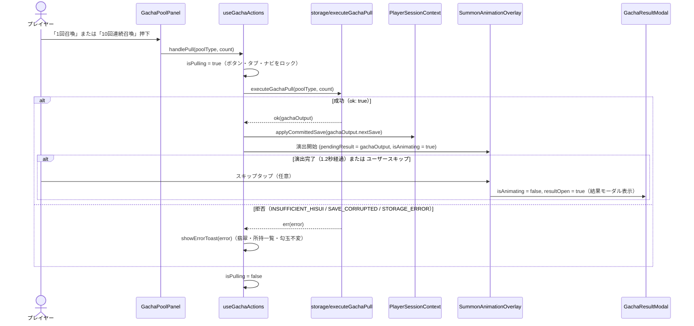

# スライス詳細設計書: Slice 3 — キャラ／武器ガチャ召喚・重複覚醒精錬・上限変換

- **スライスID**: `Slice 3`
- **進捗ステータス**: `[x]` 完了
- **先行依存**: `Slice 0`（完了済み）
- **対象レイヤー**: `data/` / `domain/` / `storage/` / `components/ui/` / `components/shared/` / `features/gacha/` / `app/`
- **準拠仕様書**:
  - [specs/slices.md](../slices.md)
  - [specs/db.md](../db.md)
  - [specs/auth.md](../auth.md)
  - [specs/components.md](../components.md)
  - [specs/screens.md](../screens.md)
  - [specs/requirements.md](../requirements.md)
  - [.agents/rules/coding-rules.md](../../.agents/rules/coding-rules.md)
  - [.agents/rules/design-rules.md](../../.agents/rules/design-rules.md)

---

## 1. 目的とスコープ

### 1.1 目的

Slice 0 で構築した永続化基盤・共通和風シェルの上に、**ガチャ画面（召喚: `/gacha`）**を貫通実装し、以下のユースケースを完結させる。

1. **キャラ／武器プール分離召喚 (`features/gacha/`)**: 「キャラ召喚」「武器召喚」の2タブを切り替え、所持「翡翠（`hisui`）」を消費して「1回召喚（翡翠 `5` 個）」または「10回連続召喚（翡翠 `50` 個）」を実行する。
2. **重複自動覚醒・精錬＆上限余剰変換 (`domain/gacha.ts`)**:
   - 未所持対象が排出された場合は新規獲得（`Lv.0`）として `ownedCharacters` / `ownedWeapons` へ登録する。
   - 既に所持しており上限レベル未満の場合は、勾玉を消費せず自動で `awakeningLevel + 1`（覚醒）または `refineLevel + 1`（精錬）を行う。
   - 既に最大レベル（`maxAwakeningLevel` / `maxRefineLevel`）へ到達している場合は、マスタ定義の `duplicateRewardMagatama` 分の「水晶の勾玉（`magatama`）」へ自動変換する。
3. **単一トランザクション原子保存 (`storage/gacha-repository.ts`)**: 翡翠の減算・新規登録または覚醒/精錬加算・余剰勾玉加算を IndexedDB 単一 `readwrite` トランザクション内でアトミックにコミットし、残高不足・破損データを確実に拒否する。
4. **召喚演出スキップ＆提供割合・結果表示**: 召喚確定後の演出再生中にタップ/クリックで即座に結果モーダル（`gacha-result-modal`）へスキップでき、提供割合一覧モーダル（`ui/Dialog`）および変換ルール注記（`ui/Popover`）を閲覧できる。

### 1.2 既存 Slice 0 〜 Slice 2 資産との接続

既に実装されている以下のモジュール・コンポーネントを再利用し、重複実装を行わない。

- セッション管理: [app/session/PlayerSessionContext.tsx](../../app/session/PlayerSessionContext.tsx)（`status`, `save`, `error`, `isPending`, `applyCommittedSave`）
- 通貨ガード: [domain/currency-guard.ts](../../domain/currency-guard.ts)（`guardCurrencySufficient`）
- 永続化基盤: [storage/save-repository.ts](../../storage/save-repository.ts)（`openPlayerDb`）
- 検証・エラー型: [domain/save-validator.ts](../../domain/save-validator.ts)（`validateAndMigrateSave`）, [domain/result.ts](../../domain/result.ts)（`ok`, `err`）
- マスタデータ: [data/character-master.ts](../../data/character-master.ts), [data/weapon-master.ts](../../data/weapon-master.ts)
- 共通 UI 部品: `AppShell`, `ScreenHeader`, `BottomTabNav`, `CurrencyPill`, `StateView`, `ItemAvatar`, `AppToastProvider`, `ui/AspectRatio`, `ui/Badge`, `ui/Button`, `ui/Card`, `ui/Dialog`, `ui/ScrollArea`, `ui/Separator`, `ui/Typography`

### 1.3 スコープ外（Slice 4 以降へ委譲）

- 編成画面 (`/formation`)・ステージ選択 (`/stages`)・バトル (`/battle/:stageId`) の本実装
- `ui/RadioGroup`, `ui/Progress`, `ui/Toggle`, `ui/Label`, `shared/SelectableCard`, `shared/WeaponSlotBar`

---

## 2. マスタデータ設計 (`data/`)

[types/master.ts](../../types/master.ts) の `GachaConfig` に準拠し、ガチャ定数定義を `data/` に追加する。

### 2.1 `data/gacha-config.ts`

```ts
import type { GachaConfig } from "@/types";

export const GACHA_CONFIG: GachaConfig = Object.freeze({
  singleCostHisui: 5,
  multiPullCount: 10,
  multiCostHisui: 50,
});
```

- **排出プール構成**:
  - **キャラ召喚 (`poolType === "character"`)**: `CHARACTER_MASTERS` 全件を対象とし、均等確率で1件を抽選する（初期キャラ `apprentice_onmyoji` も覚醒・勾玉変換対象としてプールに含む）。
  - **武器召喚 (`poolType === "weapon"`)**: `WEAPON_MASTERS` 全件を対象とし、均等確率で1件を抽選する（初期武器 `sword_hamon` も精錬・勾玉変換対象としてプールに含む）。
- `data/index.ts` から `GACHA_CONFIG` を再エクスポートする。

> [!NOTE]
> 排出確率を各マスタ配列の件数から動的に均等算出することで、将来的に9系統武器が追加された場合も提供割合表示と抽選ロジックが常に一致する。

---

## 3. ドメインロジック・ガード設計 (`domain/`)

`domain/` はブラウザ API（`window` / `indexedDB`）および `react` に依存しない純粋 TypeScript（アロー関数統一）で実装する。

### 3.1 ガチャ型定義・コスト算出・ガード (`domain/gacha.ts`)

1. **`GachaPullCount` 型**: `1 | 10`
2. **`GachaPullResultItem` 型**:
   - `poolType: GachaPoolType` (`"character" | "weapon"`)
   - `targetId: CharacterId | WeaponId`
   - `name: string`
   - `outcome: GachaOutcomeType` (`"new" | "awakening_or_refine" | "converted_to_magatama"`)
   - `previousLevel: number | null`（新規獲得時は `null`、重複時は更新前レベル）
   - `nextLevel: number`（新規獲得時は `0`、覚醒/精錬時は `previousLevel + 1`、上限変換時は最大レベル維持）
   - `convertedMagatama: number`（上限変換時は `duplicateRewardMagatama`、それ以外は `0`）
3. **`GachaExecutionOutput` 型**:
   - `nextSave: PlayerSaveData`
   - `items: readonly GachaPullResultItem[]`
   - `spentHisui: number`
   - `totalConvertedMagatama: number`
4. **`getGachaCost(count: GachaPullCount, config?: GachaConfig): number`**:
   - `count === 1` の場合は `config.singleCostHisui`（`5`）、`count === 10` の場合は `config.multiCostHisui`（`50`）を返却する。
5. **`guardGachaPullable(save: PlayerSaveData, poolType: GachaPoolType, count: GachaPullCount, config?: GachaConfig): DomainResult<number>`**:
   - `poolType`（`"character" | "weapon"`）および `count`（`1 | 10`）の妥当性を検証し、不正値は `SAVE_CORRUPTED` で拒否する。
   - `cost = getGachaCost(count, config)` を算出し、既存の `guardCurrencySufficient(save, "hisui", cost)` を呼び出す。
   - 残高不足時は `err("INSUFFICIENT_HISUI", "翡翠が不足しています。")`（403 相当拒否）、十分な場合は `ok(cost)` を返却する。

### 3.2 抽選・重複覚醒精錬・上限変換ロジック (`resolveGachaPulls`)

```ts
export const resolveGachaPulls = (
  save: PlayerSaveData,
  poolType: GachaPoolType,
  count: GachaPullCount,
  rng: () => number = Math.random,
  now: Date = new Date(),
  config: GachaConfig = GACHA_CONFIG,
): DomainResult<GachaExecutionOutput>
```

1. **事前ガード実行**: `guardGachaPullable(save, poolType, count, config)` が `{ ok: false }` の場合、即座にそのエラーを返却する（元データ不変）。
2. **10連内の逐次状態更新（同一対象重複への正確な対応）**:
   - `nextCharacters = { ...save.ownedCharacters }`、`nextWeapons = { ...save.ownedWeapons }` の作業コピーを作成し、`count` 回ループする。
   - 抽選インデックス: `rawRoll = rng()` を `[0, 1)` に安全クランプし、`Math.min(pool.length - 1, Math.max(0, Math.floor(rawRoll * pool.length)))` で対象マスタを決定する。
   - **キャラプール (`poolType === "character"`) の場合**:
     - `Object.hasOwn(nextCharacters, target.id)` で所持判定を行う（プロトタイプ汚染防御）。
     - **未所持**: `nextCharacters[target.id] = { characterId: target.id, awakeningLevel: 0, obtainedAt: nowIso }` を設定し、`outcome = "new"`, `previousLevel = null`, `nextLevel = 0`, `convertedMagatama = 0` を記録。
     - **所持かつ `awakeningLevel < target.maxAwakeningLevel`**: `nextLv = current.awakeningLevel + 1` に更新し、`outcome = "awakening_or_refine"`, `previousLevel = current.awakeningLevel`, `nextLevel = nextLv`, `convertedMagatama = 0` を記録。
     - **所持かつ `awakeningLevel >= target.maxAwakeningLevel`**: レベルは維持し、`totalConvertedMagatama += target.duplicateRewardMagatama` を加算、`outcome = "converted_to_magatama"`, `previousLevel = current.awakeningLevel`, `nextLevel = current.awakeningLevel`, `convertedMagatama = target.duplicateRewardMagatama` を記録。
   - **武器プール (`poolType === "weapon"`) の場合**:
     - `Object.hasOwn(nextWeapons, target.id)` で同様に `refineLevel` / `maxRefineLevel` / `duplicateRewardMagatama` を処理する。
3. **イミュータブルスナップショット返却**:
   - `currencies: { hisui: save.currencies.hisui - cost, magatama: save.currencies.magatama + totalConvertedMagatama }`
   - `ownedCharacters: nextCharacters` / `ownedWeapons: nextWeapons`
   - `updatedAt: now.toISOString()`

### 3.3 提供割合算出ヘルパー (`getGachaDropRates`)

- `getGachaDropRates(poolType: GachaPoolType)`: 対象マスタ一覧と各アイテムの排出確率（`100 / pool.length`）を返す純粋関数を用意し、UI の提供割合モーダルで利用する。

### 3.4 `domain/index.ts` エクスポート追加

- `getGachaCost`, `getGachaDropRates`, `guardGachaPullable`, `resolveGachaPulls`, `type GachaExecutionOutput`, `type GachaPullCount`, `type GachaPullResultItem`, `type GachaDropRateEntry` を公開する。

---

## 4. IndexedDB リポジトリ設計 (`storage/`)

[specs/db.md](../db.md) セクション8.1 の「単一 `readwrite` トランザクション・最新レコード再読込・アトミック更新」を厳守する。

### 4.1 `storage/gacha-repository.ts`

- **`executeGachaPull(poolType: GachaPoolType, count: GachaPullCount, rng?: () => number, now: Date = new Date()): Promise<DomainResult<GachaExecutionOutput>>`**
  1. `openPlayerDb()` で DB 接続を取得。
  2. `db.transaction("playerSave", "readwrite")` を開始し、トランザクション内で最新の `store.get(SAVE_RECORD_KEY)` を取得する。
  3. レコード未存在または `validateAndMigrateSave(raw)` 失敗時は、書込を行わず `err("SAVE_CORRUPTED", ...)` を返却する（401 相当拒否）。
  4. `resolveGachaPulls(validatedSave, poolType, count, rng, now, GACHA_CONFIG)` を実行する。
  5. ガード拒否（`INSUFFICIENT_HISUI` 等）時は `store.put` を呼ばずに `await tx.done` を待ち、`err(...)` をそのまま返却する（状態不変）。
  6. 許可時は `await store.put(result.data.nextSave, SAVE_RECORD_KEY)` と `await tx.done` を実行し、`ok(result.data)` を返却する。
  7. IndexedDB 例外発生時は `console.error` で構造化ログを出力し、内部詳細を露出せず `err("STORAGE_ERROR", "召喚結果の保存に失敗しました。")` を返却する。

- `storage/index.ts` から `executeGachaPull` を再エクスポートする。

---

## 5. UI プリミティブ・共有コンポーネント追加設計 (`components/`)

[specs/components.md](../components.md) セクション4・5・6 および [.agents/rules/design-rules.md](../../.agents/rules/design-rules.md) に準拠し、Slice 3 で必要な未実装コンポーネントを追加する。1ファイル 200行以下・アロー関数統一・生カラー禁止・`index.ts` バレル公開・Radix UI Compound Component パターンを遵守する。

### 5.1 `components/ui/Tabs/` (`@radix-ui/react-tabs`)

| エクスポート構造                                         | 仕様                                                                                                         |
| :------------------------------------------------------- | :----------------------------------------------------------------------------------------------------------- |
| `Tabs.Root`, `Tabs.List`, `Tabs.Trigger`, `Tabs.Content` | キーボード矢印操作・`aria-selected` 対応。`Tabs.Trigger` は `min-h-11`（44px以上）とフォーカスリングを確保。 |

### 5.2 `components/ui/Popover/` (`@radix-ui/react-popover`)

| エクスポート構造                                                      | 仕様                                                                                                                       |
| :-------------------------------------------------------------------- | :------------------------------------------------------------------------------------------------------------------------- |
| `Popover.Root`, `Popover.Trigger`, `Popover.Content`, `Popover.Arrow` | モバイルのタップ操作で開閉できる詳細解説バルーン。`z-popover` トークンおよび `bg-popover text-popover-foreground` を使用。 |

### 5.3 `components/shared/StatusBadge/` (`ui/Badge` ラッパー)

| 公開 Props・仕様                                                                                                                                                                                                    |
| :------------------------------------------------------------------------------------------------------------------------------------------------------------------------------------------------------------------ |
| `status`: `"unverified" \| "cleared" \| "locked" \| "new" \| "awakening" \| "refine" \| "converted" \| "equipped"`（および任意の `label?: string` 上書き対応）                                                      |
| ドメイン状態をセマンティックトークン色へ一貫マッピング（例: `new` → `accent`「新規獲得」、`awakening` → `success`「覚醒 Lv+1」、`refine` → `success`「精錬 Lv+1」、`converted` → `warning`「上限→勾玉変換済み」）。 |

---

## 6. ガチャ画面機能設計 (`features/gacha/`) & ルーティング接続

### 6.1 コンポーネント構成（3層分離・200行制限遵守）

```text
features/gacha/
├── index.ts                              # GachaScreen, useGachaActions のみ公開
├── GachaScreen.tsx                       # 純粋レイアウト構成（< 180行）
├── hooks/
│   └── useGachaActions.ts                # 召喚実行・isPending排他・演出タイマー/スキップ・モーダル状態（< 150行）
└── components/
    ├── GachaPoolPanel.tsx                # ピックアップバナー(AspectRatio)・ルールPopover・召喚実行ボタン群
    ├── GachaSummonAnimationOverlay.tsx   # 召喚演出オーバーレイ（タップ/クリックでスキップ）
    ├── GachaResultModal.tsx              # 召喚結果一覧モーダル（ui/Dialog + ui/ScrollArea + ItemAvatar + StatusBadge）
    └── GachaRatesModal.tsx               # 提供割合・排出一覧モーダル（ui/Dialog + ui/ScrollArea）
```

### 6.2 `GachaScreen` 画面仕様 (`/gacha`)

1. **ヘッダーバー (`ScreenHeader`)**:
   - `AppShell` により「戻る」ボタン（`/` へ遷移）、画面タイトル `h1`（「召喚（ガチャ）」）、所持通貨 `CurrencyPill`（`magatama` / `hisui`）を表示。
2. **排出プール切替タブ (`ui/Tabs`)**:
   - 「キャラ召喚 (`character`)」タブと「武器召喚 (`weapon`)」タブを切り替え。
   - 召喚トランザクション中・演出再生中はタブ切替を `disabled` とする。
3. **ピックアップバナー & 提供割合・ルール導線 (`GachaPoolPanel`)**:
   - `ui/AspectRatio`（`16 / 9`）でピックアップ対象（キャラ: 白狐の巫女・稲荷 / 武器: 破魔の梓弓 等）の和風プレビューバナーを表示。
   - 「提供割合・排出一覧」ボタン押下で `GachaRatesModal`（`ui/Dialog` + `ui/ScrollArea`）を開く。
   - 「重複・変換ルール」ボタン押下で `ui/Popover` を開き、自動覚醒/精錬と上限到達後の勾玉変換仕様を表示する。
4. **召喚実行ボタン群**:
   - **「1回召喚（翡翠 5）」**: `save.currencies.hisui < 5` の場合は `disabled={true}` かつ不足数注記（例: 「翡翠あと X 個不足」）。
   - **「10回連続召喚（翡翠 50）」**: `save.currencies.hisui < 50` の場合は `disabled={true}` かつ不足数注記。
   - どちらも `min-h-11`（44px以上）および `touch-action: manipulation` を確保し、`isPending` 中は `disabled={true}`。
5. **召喚演出オーバーレイ (`GachaSummonAnimationOverlay`)**:
   - IndexedDB への保存確定後に演出状態（`isAnimating: true`）へ移行し、約 1.2秒の和風霊符演出を表示。
   - オーバーレイ全体のタップ/クリック、または「スキップ」ボタン押下で即座にタイマーを解除して `GachaResultModal` を表示する。
6. **召喚結果モーダル (`GachaResultModal`)**:
   - `ui/Dialog`（`open` / `onOpenChange` 規約準拠）＋ `ui/ScrollArea` で 1件〜10件の獲得結果を一覧表示。
   - 各行に `shared/ItemAvatar`、アイテム名、レベル変化（`Lv.0` や `Lv.1 → Lv.2`）、`shared/StatusBadge`（「新規獲得」「覚醒 Lv+1」「精錬 Lv+1」「上限→勾玉変換済み」）、変換時は獲得勾玉数（`+XX`）を表示。
   - 10連で勾玉変換が発生した場合は、合計獲得勾玉数のサマリーを上部に表示する。
7. **共通フッターナビゲーション (`BottomTabNav`)**:
   - 「ガチャ（`/gacha`）」タブがアクティブ強調表示される。

### 6.3 召喚実行フロー (`useGachaActions`)



### 6.4 `app/App.tsx` ルーティング接続

- `route.path === "/gacha"` 時にプレースホルダーを置き換えて `<GachaScreen />` を描画する。
- `useGachaActions` の `isMutating`（保存中または演出再生中）が `true` の間は `AppShell` の `isNavigationDisabled` を有効化し、処理中の画面遷移競合を抑止する。

---

## 7. 5大ステート標準と認可境界（401 / 403 相当）

### 7.1 Slice 3 における 5大ステート網羅表

| ステート                    | `gacha` (`/gacha`) における振る舞い                                                                                                                                                                     |
| :-------------------------- | :------------------------------------------------------------------------------------------------------------------------------------------------------------------------------------------------------ |
| **Empty**                   | 召喚実行前の待機状態で、選択中プールのピックアップバナー・提供割合ボタン・重複変換ルール・現在所持翡翠数を表示して召喚を案内する。                                                                      |
| **Loading**                 | セッション読込中（`status === "loading"`）は `StateView` が「霊脈接続中…」を表示。召喚トランザクション中（`isPending`）および演出再生中は召喚ボタン・タブを `Disabled` とし、演出中はスキップのみ有効。 |
| **Success**                 | `GachaResultModal` に獲得対象（`ItemAvatar`）と `StatusBadge`（「新規獲得」「覚醒 Lv+1」「精錬 Lv+1」「上限→勾玉変換済み」）を表示し、ヘッダーの翡翠・勾玉残高を即時更新する。                          |
| **Error**                   | セッション破損・読込失敗時は `StateView` のエラービューを表示。召喚トランザクション失敗時は翡翠減算・所持更新を一切行わず（不変）、日本語エラートーストを表示する。                                     |
| **Disabled / Unauthorized** | 翡翠 `< 5` で「1回召喚」、翡翠 `< 50` で「10回連続召喚」を `Disabled`（不足数表示）とする。破損レコード（401相当）や残高不足での直接実行（403相当）はリポジトリ・ドメイン層で書込拒否する。             |

### 7.2 401 / 403 相当境界とセキュリティ防御

- **401 相当境界**: `executeGachaPull` はトランザクション内で再読込したレコードに対して `validateAndMigrateSave` を実行し、破損または未存在の場合は `SAVE_CORRUPTED` で書込を拒否する。
- **403 相当境界**: `guardGachaPullable` により翡翠不足を `INSUFFICIENT_HISUI` で拒否し、通貨マイナスや不正プール/回数指定を完全に防止する。
- **プロトタイプ汚染・XSS 防御**: `ownedCharacters` / `ownedWeapons` の参照・更新は `Object.hasOwn` で検証し、`dangerouslySetInnerHTML` を使用しない。

---

## 8. 検証・単体テスト計画（No Hollow Mocks）

Vitest + `fake-indexeddb` + `@testing-library/react` を用い、実際のガード関数・バリデーション・IndexedDB トランザクションを実行する（Hollow Mock 禁止）。

1. **ドメイン抽選・重複・上限変換・ガードテスト (`domain/gacha.test.ts`)**:
   - **新規獲得**: 未所持キャラ/武器が排出された場合、`awakeningLevel: 0` / `refineLevel: 0` で登録され、`outcome: "new"` が返ること。
   - **重複覚醒・精錬**: 所持済み（上限未満）が排出された場合、勾玉を消費せず `awakeningLevel + 1` / `refineLevel + 1` され、`outcome: "awakening_or_refine"` が返ること。
   - **上限到達後の勾玉変換**: 最大レベル到達済みが排出された場合、レベルは維持され、`duplicateRewardMagatama` 分の勾玉が加算され、`outcome: "converted_to_magatama"` が返ること。
   - **10連内の段階的遷移**: 10連ループ内で「未所持 → 新規(Lv.0) → 覚醒(Lv.1)」や「Lv.4 → 覚醒(Lv.5) → 上限変換(+勾玉)」が同一トランザクション内で正しく累積すること。
   - **403 相当拒否テスト (`guardGachaPullable` / `resolveGachaPulls`)**:
     - 翡翠不足（単発時 `< 5`、10連時 `< 50`）で `ok: false` かつ `error.code === "INSUFFICIENT_HISUI"` を返し、元データが不変であること。
2. **IndexedDB トランザクション永続化・拒否テスト (`storage/gacha-repository.test.ts`)**:
   - `executeGachaPull("character", 1)` / `executeGachaPull("weapon", 10)` で翡翠減算・所持更新・余剰勾玉加算が単一トランザクションでコミットされること。
   - 翡翠不足時の `executeGachaPull` が `INSUFFICIENT_HISUI` を返し、IndexedDB 上の翡翠・所持マップ・勾玉が一切変化しないこと。
   - **401 相当破損データ拒否テスト**: 破損レコードが保存された状態で `executeGachaPull` を呼ぶと `SAVE_CORRUPTED` を返し、レコードを上書きしないこと。
3. **UI 結合テスト (`features/gacha/GachaScreen.test.tsx`)**:
   - 「キャラ召喚」「武器召喚」タブ切替、提供割合モーダル、変換ルールポップオーバーが開閉できること。
   - 翡翠不足時に該当ボタンが `Disabled` になり不足数が表示されること。
   - 召喚実行後に演出スキップ操作で `GachaResultModal` が表示され、ステータスバッジ（「新規獲得」「覚醒 Lv+1」「精錬 Lv+1」「上限→勾玉変換済み」）と通貨残高が更新されること。
4. **静的検証・規約チェック**:
   - `pnpm typecheck`, `pnpm lint`, `pnpm build`, `pnpm test` がすべてゼロエラーで通過すること。
   - 生カラー直書きゼロ、全プロダクションファイル 200行以下、単一末尾改行を遵守すること。
