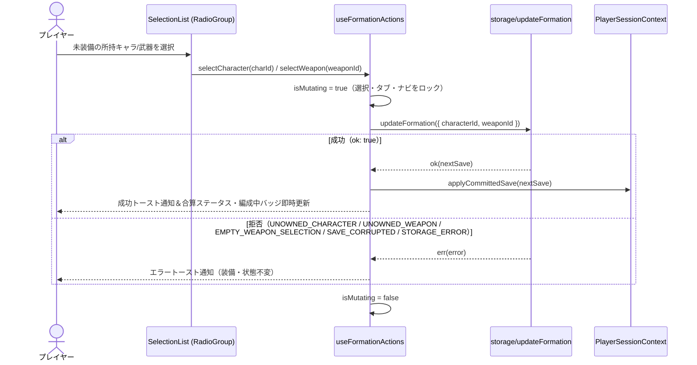

# スライス詳細設計書: Slice 4 — 編成画面（主人公1名・持ち込み武器1枠切替）

- **スライスID**: `Slice 4`
- **進捗ステータス**: `[x]` 完了
- **先行依存**: `Slice 0`, `Slice 2`, `Slice 3`（すべて完了済み）
- **対象レイヤー**: `domain/` / `storage/` / `components/ui/` / `components/shared/` / `features/formation/` / `app/`
- **準拠仕様書**:
  - [specs/slices.md](../slices.md)
  - [specs/db.md](../db.md)
  - [specs/auth.md](../auth.md)
  - [specs/components.md](../components.md)
  - [specs/screens.md](../screens.md)
  - [specs/requirements.md](../requirements.md)
  - [.agents/rules/coding-rules.md](../../.agents/rules/coding-rules.md)
  - [.agents/rules/design-rules.md](../../.agents/rules/design-rules.md)

---

## 1. 目的とスコープ

### 1.1 目的

Slice 0〜3 で構築した永続化基盤・共通和風シェル・強化ステータス算出・ガチャ所持資産の上に、**編成画面（`/formation`）**を貫通実装し、以下のユースケースを完結させる。

1. **主人公1名・持ち込み武器1枠の切替 (`features/formation/`)**:
   - タブ（「主人公（1名）」/「持ち込み武器（1枠）」）を切り替え、所持済みの主人公・武器のみを一覧表示し、単一選択（`RadioGroup` + `SelectableCard`）で装備を変更する。
   - 未所持のキャラ・武器は一覧に表示しない。現在編成中のアイテムには「編成中」バッジを表示し、再選択操作は `Disabled` とする。
2. **合算基礎ステータス＆固有特性の即時プレビュー (`domain/enhance.ts` 再利用)**:
   - 選択中の主人公（覚醒Lv・固有パッシブ効果）・持ち込み武器（精錬Lv・武器ジャンル特性）および `calculateTotalMetaStats` による合算基礎ステータス（結界耐久 / 霊力攻撃 / 会心発生率）を常時プレビュー表示する。
3. **事前条件ガードと単一トランザクション原子保存 (`domain/formation.ts`, `storage/formation-repository.ts`)**:
   - 未所持キャラ指定（`UNOWNED_CHARACTER`）、未所持武器指定（`UNOWNED_WEAPON`）、武器空選択（`EMPTY_WEAPON_SELECTION`）をドメイン層で厳格に拒否（403 相当）する。
   - IndexedDB の単一 `readwrite` トランザクション内で最新レコードを再検証した上で `equippedCharacterId` / `equippedWeaponId` / `updatedAt` をアトミックに保存する。
4. **遷移元対応ルーティング導線 (`app/router/useHashRouter.ts`, `app/App.tsx`)**:
   - `/formation?from=stages` で遷移した場合はヘッダー「戻る」で `/stages` へ復帰し、通常遷移（`/` 等から）時は `/` へ戻る。
   - 画面下部の「ステージ選択へ」ボタンから `/stages` へ直接遷移できる。

### 1.2 既存 Slice 0 〜 Slice 3 資産との接続

既に実装されている以下のモジュール・コンポーネントを再利用し、重複実装を行わない。

- セッション管理: [app/session/PlayerSessionContext.tsx](../../app/session/PlayerSessionContext.tsx)（`status`, `save`, `error`, `isPending`, `applyCommittedSave`）
- ステータス算出: [domain/enhance.ts](../../domain/enhance.ts)（`calculateTotalMetaStats`, `TotalMetaStats`）
- 永続化基盤: [storage/save-repository.ts](../../storage/save-repository.ts)（`openPlayerDb`）
- 検証・エラー型: [domain/save-validator.ts](../../domain/save-validator.ts)（`validateAndMigrateSave`）, [domain/result.ts](../../domain/result.ts)（`ok`, `err`）
- マスタデータ: [data/character-master.ts](../../data/character-master.ts), [data/weapon-master.ts](../../data/weapon-master.ts)
- 共通 UI 部品: `AppShell`, `ScreenHeader`, `BottomTabNav`, `CurrencyPill`, `StateView`, `StatSummaryGrid`, `StatusBadge`, `ItemAvatar`, `AppToastProvider`, `ui/Tabs`, `ui/Popover`, `ui/ScrollArea`, `ui/Button`, `ui/Card`, `ui/Badge`, `ui/Separator`, `ui/Typography`

### 1.3 スコープ外（Slice 5 以降へ委譲）

- ステージ選択画面（`/stages`）の本実装および `/battle/:stageId` バトル画面・Canvas 2D エンジン
- `ui/Progress`, `ui/Toggle`, `shared/WeaponSlotBar`

---

## 2. ドメインロジック・ガード設計 (`domain/`)

`domain/` はブラウザ API（`window` / `indexedDB`）および `react` に依存しない純粋 TypeScript（アロー関数統一）で実装する。

### 2.1 編成ドメイン型・事前条件ガード (`domain/formation.ts`)

1. **`FormationSelectionInput` 型**:
   - `characterId: CharacterId`
   - `weaponId: WeaponId`
2. **`OwnedCharacterEntry` 型**:
   - `master: CharacterMaster`
   - `state: OwnedCharacterState`
   - `isEquipped: boolean`
3. **`OwnedWeaponEntry` 型**:
   - `master: WeaponMaster`
   - `state: OwnedWeaponState`
   - `isEquipped: boolean`
4. **`guardEquipmentSelection`（403 相当認可ガード）**:

```ts
export const guardEquipmentSelection = (
  save: PlayerSaveData,
  characterId: string,
  weaponId: string,
  charMap: Readonly<Record<string, CharacterMaster>> = CHARACTER_MASTER_MAP,
  weaponMap: Readonly<Record<string, WeaponMaster>> = WEAPON_MASTER_MAP,
): DomainResult<FormationSelectionInput>
```

- **検証ルール（厳格順序）**:
  1. **武器空選択の拒否**: `weaponId.trim().length === 0` の場合、`err("EMPTY_WEAPON_SELECTION", "持ち込み武器を1つ選択してください。")` を返却する。
  2. **主人公所持・マスタ存在検証**: `characterId.trim().length === 0` または `!Object.hasOwn(charMap, characterId)` または `!Object.hasOwn(save.ownedCharacters, characterId)` の場合、`err("UNOWNED_CHARACTER", "未所持または存在しない主人公は編成できません。")` を返却する。
  3. **武器所持・マスタ存在検証**: `!Object.hasOwn(weaponMap, weaponId)` または `!Object.hasOwn(save.ownedWeapons, weaponId)` の場合、`err("UNOWNED_WEAPON", "未所持または存在しない武器は編成できません。")` を返却する。
  4. **通過**: `ok({ characterId: characterId as CharacterId, weaponId: weaponId as WeaponId })` を返却する。

> [!NOTE]
> マップ参照には必ず `Object.hasOwn` を使用し、`__proto__` や `constructor` 等のプロトタイプ汚染・誤参照を防止する（[specs/auth.md](../auth.md) セクション 5.2 準拠）。

### 2.2 編成更新・一覧抽出・ステータスヘルパー (`domain/formation.ts`)

1. **`applyFormationChange(save: PlayerSaveData, selection: FormationSelectionInput, now: Date = new Date()): DomainResult<PlayerSaveData>`**:
   - `guardEquipmentSelection(save, selection.characterId, selection.weaponId)` を実行し、`{ ok: false }` の場合はそのまま返却する（元データ不変）。
   - 成功時は `equippedCharacterId: valid.characterId`, `equippedWeaponId: valid.weaponId`, `updatedAt: now.toISOString()` を反映した新しい `PlayerSaveData` を `ok(...)` で返却する。
2. **`getOwnedCharacterEntries(save: PlayerSaveData, charMasters: readonly CharacterMaster[] = CHARACTER_MASTERS): readonly OwnedCharacterEntry[]`**:
   - `charMasters` の表示順を維持しつつ、`Object.hasOwn(save.ownedCharacters, master.id)` を満たす所持キャラのみを抽出して返却する（未所持キャラは一覧に含めない）。
3. **`getOwnedWeaponEntries(save: PlayerSaveData, weaponMasters: readonly WeaponMaster[] = WEAPON_MASTERS): readonly OwnedWeaponEntry[]`**:
   - `weaponMasters` の表示順を維持しつつ、`Object.hasOwn(save.ownedWeapons, master.id)` を満たす所持武器のみを抽出して返却する（未所持武器は一覧に含めない）。
4. **`getPassiveEffectValue(master: CharacterMaster, awakeningLevel: number): number`**:
   - `Number((master.passiveSkill.baseValue + awakeningLevel * master.passiveSkill.valuePerAwakening).toFixed(1))` を返却する。
5. **`getWeaponEffectiveDamage(master: WeaponMaster, refineLevel: number): number`**:
   - `master.baseDamage + refineLevel * master.damagePerRefine` を返却する。
6. **`WEAPON_GENRE_LABELS: Readonly<Record<WeaponGenre, string>>`**:
   - 9系統の武器ジャンル（`bow`: `"弓矢系"`, `sword`: `"刀剣系"`, `shuriken`: `"手裏剣系"`, `mirror`: `"鏡系"`, `talisman`: `"呪符系"`, `matchlock`: `"火縄銃系"`, `fan`: `"扇・軍配系"`, `bell`: `"神具・鈴系"`, `orb`: `"霊珠・勾玉系"`）の日本語表示マップ。

### 2.3 `domain/index.ts` エクスポート追加

- `guardEquipmentSelection`, `applyFormationChange`, `getOwnedCharacterEntries`, `getOwnedWeaponEntries`, `getPassiveEffectValue`, `getWeaponEffectiveDamage`, `WEAPON_GENRE_LABELS`, `type FormationSelectionInput`, `type OwnedCharacterEntry`, `type OwnedWeaponEntry` を公開する。

---

## 3. IndexedDB リポジトリ設計 (`storage/`)

[specs/db.md](../db.md) セクション 8.1 の「単一 `readwrite` トランザクション・最新レコード再読込・アトミック更新」を厳守する。

### 3.1 `storage/formation-repository.ts`

- **`updateFormation(selection: FormationSelectionInput, now: Date = new Date()): Promise<DomainResult<PlayerSaveData>>`**:
  1. `openPlayerDb()` で DB 接続を取得する。
  2. `db.transaction("playerSave", "readwrite")` を開始し、トランザクション内で最新の `store.get(SAVE_RECORD_KEY)` を取得する。
  3. レコード未存在または `validateAndMigrateSave(raw)` 失敗時は、書込を行わず `err("SAVE_CORRUPTED", ...)` を返却する（401 相当拒否）。
  4. `applyFormationChange(validatedSave, selection, now)` を実行する。
  5. ガード拒否（`UNOWNED_CHARACTER` / `UNOWNED_WEAPON` / `EMPTY_WEAPON_SELECTION`）時は `store.put` を呼ばずに `await tx.done` を待ち、`err(...)` をそのまま返却する（状態不変）。
  6. 許可時は `await store.put(result.data, SAVE_RECORD_KEY)` と `await tx.done` を実行し、`ok(result.data)` を返却する。
  7. IndexedDB 例外発生時は `console.error` で構造化ログを出力し、内部詳細を露出せず `err("STORAGE_ERROR", "編成の保存に失敗しました。")` を返却する。

- `storage/index.ts` から `updateFormation` を再エクスポートする。

---

## 4. UI プリミティブ・共有コンポーネント追加設計 (`components/`)

[specs/components.md](../components.md) セクション 4・5・6 および [.agents/rules/design-rules.md](../../.agents/rules/design-rules.md) に準拠し、Slice 4 で必要な未実装コンポーネントを追加する。1ファイル 200行以下・アロー関数統一・生カラー禁止・`index.ts` バレル公開・Radix UI Compound Component パターンを遵守する。

### 4.1 `components/ui/RadioGroup/` (`@radix-ui/react-radio-group`)

| エクスポート構造                                             | 仕様                                                                                                                                |
| :----------------------------------------------------------- | :---------------------------------------------------------------------------------------------------------------------------------- |
| `RadioGroup.Root`, `RadioGroup.Item`, `RadioGroup.Indicator` | キーボード矢印操作・`aria-checked` 対応。フォーカス時は `focus-visible:ring-2 focus-visible:ring-ring` の高コントラストリング表示。 |

### 4.2 `components/ui/Label/` (`@radix-ui/react-label`)

| エクスポート構造 | 仕様                                                                               |
| :--------------- | :--------------------------------------------------------------------------------- |
| `Label`          | `@radix-ui/react-label` をラップし、`htmlFor` によるセマンティック関連付けを提供。 |

### 4.3 `components/shared/SelectableCard/` (`ui/RadioGroup` + `ui/Badge` + `ui/Typography`)

| 公開 Props・仕様                                                                                                                                                                                                                            |
| :------------------------------------------------------------------------------------------------------------------------------------------------------------------------------------------------------------------------------------------ |
| `value: string`, `title: string`, `subtitle?: string`, `description?: string`, `badge?: ReactNode`, `leading?: ReactNode`, `meta?: ReactNode`, `disabled?: boolean`, `className?: string`                                                   |
| `RadioGroup.Item` をルート要素とし、`min-h-11`（44px以上）および `touch-action: manipulation` を確保。`data-[state=checked]:border-primary data-[state=checked]:bg-accent/15` で選択中を強調し、`disabled` 時は操作不可スタイルを適用する。 |

---

## 5. ルーター・アプリシェル拡張 (`app/`)

### 5.1 `app/router/useHashRouter.ts` のクエリパラメータ対応

[specs/screens.md](../screens.md) セクション 5.6 の「`/formation?from=stages`」遷移元保持を実現するため、`parseAppRoute` を以下のように拡張する。

- `ParsedRoute` に `readonly from?: string`（または `query` パース結果）を追加する。
- `normalizeHashPath` 後に `?` 以降を `URLSearchParams` で分離し、パス部分（例: `"/formation"`）で `STATIC_ROUTES` / `BATTLE_ROUTE_PATTERN` 照合を行う。
- `from` パラメータが存在する場合は `ParsedRoute.from` に格納する（例: `from=stages` → `{ path: "/formation", from: "stages" }`）。

### 5.2 `app/App.tsx` ルーティング・戻り先接続

- `route.path === "/formation"` 時にプレースホルダーを置き換えて `<FormationScreen />` を描画する。
- `AppShell` の `onBack` 制御:
  - `/formation` かつ `route.from === "stages"` の場合は `() => navigate("/stages")` を設定し、それ以外の非ホーム画面では `() => navigate("/")` を設定する。
- `isLocked` に `formationActions.isMutating` を組み込み、保存中の画面遷移競合を抑止する。

---

## 6. 編成画面機能設計 (`features/formation/`)

### 6.1 コンポーネント構成（3層分離・200行制限遵守）

```text
features/formation/
├── index.ts                              # FormationScreen, useFormationActions のみ公開
├── FormationScreen.tsx                   # 純粋レイアウト構成（< 180行）
├── hooks/
│   └── useFormationActions.ts            # タブ状態・装備変更実行・isPending排他（< 150行）
└── components/
    ├── FormationSummaryCard.tsx          # 現在の編成（主人公/武器）＋StatSummaryGrid＋パッシブPopover
    ├── CharacterSelectionList.tsx        # 所持主人公 RadioGroup + SelectableCard 一覧
    └── WeaponSelectionList.tsx           # 所持武器 RadioGroup + SelectableCard 一覧
```

### 6.2 `FormationScreen` 画面仕様 (`/formation`)

1. **ヘッダーバー (`ScreenHeader`)**:
   - `AppShell` により「戻る」ボタン（遷移元に応じて `/stages` または `/` へ遷移）、画面タイトル `h1`（「出撃編成」）、所持通貨 `CurrencyPill`（`magatama` / `hisui`）を表示。
2. **現在の編成 & 総合ステータスプレビュー (`FormationSummaryCard`)**:
   - 装備中の主人公（`ItemAvatar`, 覚醒Lv, 固有パッシブ名・現在効果値）および「パッシブ詳細」ボタン（`ui/Popover` で効果説明を表示）。
   - 装備中の持ち込み主武器（`ItemAvatar`, 精錬Lv, ジャンル名, 実効威力）。
   - `shared/StatSummaryGrid` により `calculateTotalMetaStats(save, equippedCharMaster)` の合算基礎ステータス（結界耐久 / 霊力攻撃 / 会心発生率）を3列表示。
3. **対象切替タブ (`ui/Tabs`)**:
   - 「主人公（1名）」(`character`) タブと「持ち込み武器（1枠）」(`weapon`) タブを切り替え。
   - 保存トランザクション中（`isMutating`）はタブ切替も操作ロックする。
4. **所持一覧リスト (`CharacterSelectionList` / `WeaponSelectionList`)**:
   - `ui/RadioGroup` + `ui/ScrollArea` 内に `shared/SelectableCard` を縦並び表示する。
   - **所持済みのみ表示**: `getOwnedCharacterEntries(save)` / `getOwnedWeaponEntries(save)` を使用し、未所持のキャラ/武器は一切表示しない。
   - **編成中表示・再選択抑止**: 現在装備中の対象には `StatusBadge status="equipped"`（「編成中」）を表示し、`disabled={entry.isEquipped || isPending}` とする。
   - **単一候補時の案内 (`Empty` ステート対応)**: 所持済みが 1 種のみの場合は、「他の候補はガチャ（召喚）で獲得できます。」の案内テキストを一覧下部に表示する。
5. **フッターアクションバー**:
   - 「ステージ選択へ」ボタン（`ui/Button`、`min-h-11`）を配置し、押下で `/stages` へ遷移する（`isMutating` 中は `disabled`）。
6. **共通フッターナビゲーション (`BottomTabNav`)**:
   - 「編成（`/formation`）」タブがアクティブ強調表示される。

### 6.3 編成変更フロー (`useFormationActions`)



---

## 7. 5大ステート標準と認可境界（401 / 403 相当）

### 7.1 Slice 4 における 5大ステート網羅表

| ステート                    | `formation` (`/formation`) における振る舞い                                                                                                                                                               |
| :-------------------------- | :-------------------------------------------------------------------------------------------------------------------------------------------------------------------------------------------------------- |
| **Empty**                   | 所持済みのキャラまたは武器が初期1種のみの場合、他に切替候補がない旨（「他の候補はガチャ（召喚）で獲得できます。」）の案内を表示する。                                                                     |
| **Loading**                 | セッション読込中（`status === "loading"`）は `StateView` が「霊脈接続中…」を表示。編成変更トランザクション中（`isPending`）は選択カード・タブ・「ステージ選択へ」ボタン・ナビゲーションを一時ロックする。 |
| **Success**                 | 選択中の主人公1名と持ち込み武器1枠、「編成中」バッジ、および `StatSummaryGrid` による合算基礎ステータスを即時更新表示し、保存完了トーストを通知する。                                                     |
| **Error**                   | セッション破損・読込失敗時は `StateView` のエラービューを表示。未所持IDや武器空選択等の拒否時・保存失敗時は装備状態を変更せず（不変）、日本語エラートーストを表示する。                                   |
| **Disabled / Unauthorized** | 現在編成中のキャラ・武器に対する再選択操作は `Disabled` とする。未所持キャラ/武器は一覧に表示せず、直接の不正指定（403相当）や破損セーブでの更新（401相当）はドメイン・リポジトリ層で書込拒否する。       |

### 7.2 401 / 403 相当境界とセキュリティ防御

- **401 相当境界**: `updateFormation` はトランザクション内で再読込したレコードに対して `validateAndMigrateSave` を実行し、破損または未存在の場合は `SAVE_CORRUPTED` で書込を拒否する。
- **403 相当境界**: `guardEquipmentSelection` により未所持キャラ（`UNOWNED_CHARACTER`）、未所持武器（`UNOWNED_WEAPON`）、武器空選択（`EMPTY_WEAPON_SELECTION`）を拒否し、不正な編成状態を完全に防止する。
- **プロトタイプ汚染・XSS 防御**: `ownedCharacters` / `ownedWeapons` / マスタマップの参照は `Object.hasOwn` で検証し、`dangerouslySetInnerHTML` を使用しない。

---

## 8. 検証・単体テスト計画（No Hollow Mocks）

Vitest + `fake-indexeddb` + `@testing-library/react` を用い、実際のガード関数・バリデーション・IndexedDB トランザクションを実行する（Hollow Mock 禁止）。

1. **ドメインロジック・403 相当ガードテスト (`domain/formation.test.ts`)**:
   - **正常切替**: 所持済み別キャラ・別武器への変更で `equippedCharacterId` / `equippedWeaponId` / `updatedAt` が正しく更新され、元オブジェクトが変更されないこと。
   - **一覧抽出**: 未所持キャラ・武器が `getOwnedCharacterEntries` / `getOwnedWeaponEntries` に含まれないこと。
   - **403 相当拒否テスト (`guardEquipmentSelection` / `applyFormationChange`)**:
     - 未所持キャラID指定で `UNOWNED_CHARACTER` が返ること。
     - 未所持武器ID指定で `UNOWNED_WEAPON` が返ること。
     - 空文字（`""` / `"   "`）武器指定で `EMPTY_WEAPON_SELECTION` が返ること。
     - プロトタイプキー（`"toString"`, `"__proto__"`）指定で安全に拒否されること。
2. **IndexedDB トランザクション永続化・拒否テスト (`storage/formation-repository.test.ts`)**:
   - `updateFormation` で主人公・武器の編成変更が単一トランザクションで保存され、再読込後も保持されること。
   - 未所持キャラ・未所持武器・空武器での `updateFormation` 呼び出しが各エラーコードを返し、IndexedDB 上の `equipped*` が変化しないこと。
   - **401 相当破損データ拒否テスト**: 破損レコードが保存された状態で `updateFormation` を呼ぶと `SAVE_CORRUPTED` を返し、レコードを上書きしないこと。
3. **ルーター・UI 結合テスト (`app/router/useHashRouter.test.ts`, `features/formation/FormationScreen.test.tsx`)**:
   - `parseAppRoute("#/formation?from=stages")` が `{ path: "/formation", from: "stages" }` を返すこと。
   - タブ切替（「主人公（1名）」/「持ち込み武器（1枠）」）で所持リストが切り替わり、未所持アイテムが表示されないこと。
   - 現在編成中のカードが `Disabled` かつ「編成中」バッジ表示となり、未装備の所持アイテム選択で合算基礎ステータス（`StatSummaryGrid`）が即時更新されること。
   - 所持1種のみの場合にガチャ案内（Empty 補助表示）が表示され、「ステージ選択へ」ボタンで `/stages` へ遷移できること。
4. **静的検証・規約チェック**:
   - `pnpm typecheck`, `pnpm lint`, `pnpm build`, `pnpm test` がすべてゼロエラーで通過すること。
   - 生カラー直書きゼロ、全プロダクションファイル 200行以下、単一末尾改行を遵守すること。
