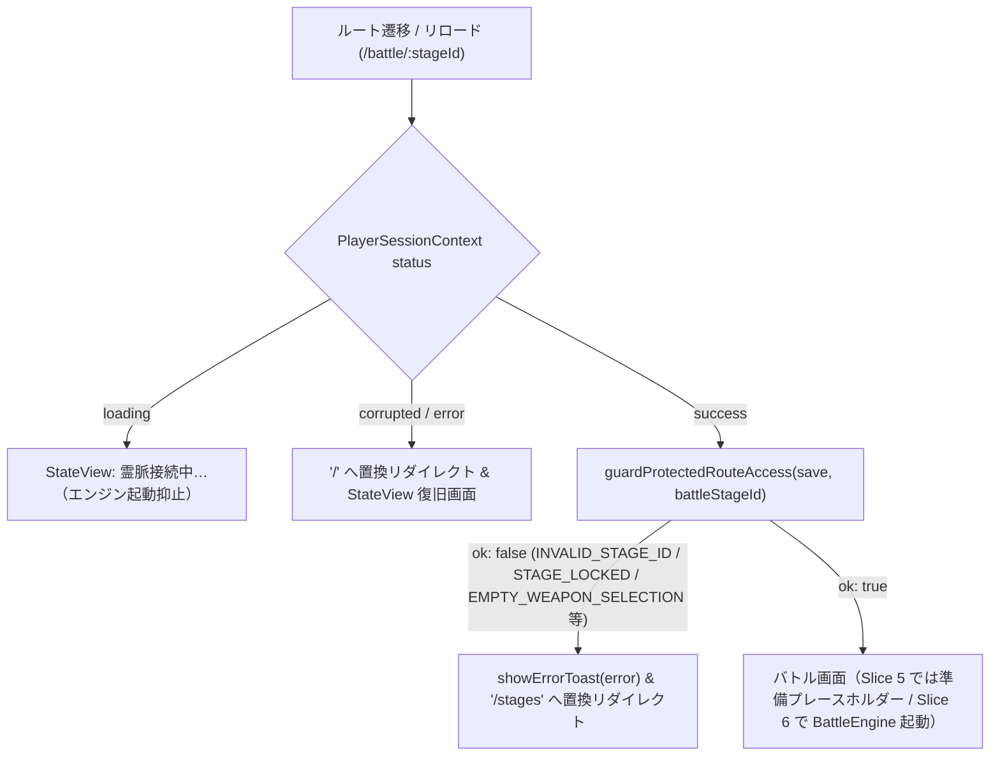
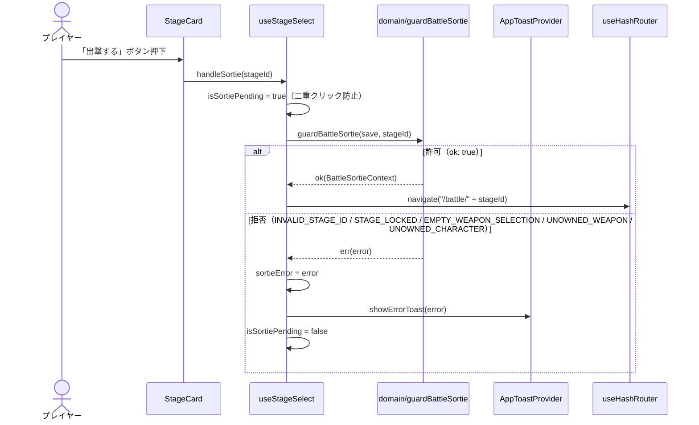

# スライス詳細設計書: Slice 5 — ステージ選択・全3節一覧・出撃ルートガード

- **スライスID**: `Slice 5`
- **進捗ステータス**: `[x]` 完了
- **先行依存**: `Slice 0`, `Slice 4`（すべて完了済み）
- **対象レイヤー**: `domain/` / `app/` / `features/stage-select/`
- **準拠仕様書**:
  - [specs/slices.md](../slices.md)
  - [specs/db.md](../db.md)
  - [specs/auth.md](../auth.md)
  - [specs/components.md](../components.md)
  - [specs/screens.md](../screens.md)
  - [specs/requirements.md](../requirements.md)
  - [.agents/rules/coding-rules.md](../../.agents/rules/coding-rules.md)
  - [.agents/rules/design-rules.md](../../.agents/rules/design-rules.md)

---

## 1. 目的とスコープ

### 1.1 目的

Slice 0〜4 で構築したセッション基盤・和風シェル・編成機能の上に、**ステージ選択画面（`/stages`）**および**出撃事前条件・ルートガード（`/battle/:stageId` 直リンク防御）**を貫通実装し、以下のユースケースを完結させる。

1. **全3節ステージ一覧と進行状態の可視化 (`features/stage-select/`)**:
   - 第壱節「迷いの竹林」〜第参節「穢れし古社」の全3節を `STAGE_MASTERS` の `order` 昇順で一覧表示する。
   - セーブデータの `unlockedStageIds` / `clearedStageIds` に基づき、各ステージを「浄化済み（`cleared`）」「未浄化（`unverified`）」「未解放（`locked`）」に判定し、`shared/StatusBadge` で明示する。
   - 各ステージのWave数（全10ウェーブ）、推奨穢れ度（`corruptionLevel`）、クリア報酬（勾玉・翡翠）、初回クリアボーナス（未浄化時のみハイライト表示）を表示する。
   - 未解放ステージは解放条件（前節の名称）を注記し、出撃ボタンを鍵アイコン（`Lock`）＋ `Disabled` 状態とする。浄化済みステージも周回出撃を可能とする。
2. **現在の出撃編成サマリー＆編成画面ショートカット (`EquippedSummaryBar`)**:
   - 現在装備中の主人公（`equippedCharacterId`、覚醒Lv）および持ち込み主武器1枠（`equippedWeaponId`、精錬Lv、ジャンル名）を `ItemAvatar` 付きで表示する。
   - 「編成変更」ボタンから `/formation?from=stages` へ遷移し、編成画面の「戻る」導線で `/stages` へシームレスに復帰できる。
3. **出撃事前条件ガード (`domain/stage-select.ts`, `domain/session-guard.ts`)**:
   - `guardBattleSortie(save, stageId, stageMap)` により、ステージ存在検証（`INVALID_STAGE_ID`）、ステージ解放状態（`STAGE_LOCKED`）、武器空選択（`EMPTY_WEAPON_SELECTION`）、武器・主人公所有検証（`UNOWNED_WEAPON` / `UNOWNED_CHARACTER`）を純粋関数で厳格に判定する。
   - 既存の `guardProtectedRouteAccess`（`domain/session-guard.ts`）内部からも `guardBattleSortie` を呼び出し、ガードロジックの重複を排除する。
4. **バトルルートガードと画面接続 (`app/App.tsx`)**:
   - `/battle/:stageId` への直リンク・リロード・ハッシュ直接書き換え時にルートガードを実行する。
   - セッション `loading` 中は待機し、`corrupted` / `error` 時は `/` へリダイレクトしてエラー復旧画面を表示する。
   - `status === "success"` 時に `guardProtectedRouteAccess(save, route.battleStageId)` が `{ ok: false }` を返した場合は、即座に `/stages` へ置換リダイレクト（`replace: true`）し、理由に応じたエラートーストを通知する。

### 1.2 既存 Slice 0 〜 Slice 4 資産との接続

既に実装されている以下のモジュール・コンポーネントを再利用し、重複実装を行わない。

- セッション管理: [app/session/PlayerSessionContext.tsx](../../app/session/PlayerSessionContext.tsx)（`status`, `save`, `error`, `isPending`）
- ルーター: [app/router/useHashRouter.ts](../../app/router/useHashRouter.ts)（`useHashRouter`, `parseAppRoute`, `from` クエリ対応済み）
- セッションガード: [domain/session-guard.ts](../../domain/session-guard.ts)（`guardSessionEstablished`, `guardProtectedRouteAccess`）
- 編成ラベル: [domain/formation.ts](../../domain/formation.ts)（`WEAPON_GENRE_LABELS`）
- 結果型・検証: [domain/result.ts](../../domain/result.ts)（`ok`, `err`）, [domain/save-validator.ts](../../domain/save-validator.ts)
- マスタデータ: [data/stage-master.ts](../../data/stage-master.ts)（`STAGE_MASTERS`, `STAGE_MASTER_MAP`）, [data/character-master.ts](../../data/character-master.ts), [data/weapon-master.ts](../../data/weapon-master.ts)
- 共通 UI 部品: `AppShell`, `ScreenHeader`, `BottomTabNav`, `CurrencyPill`, `StateView`, `StatusBadge`, `ItemAvatar`, `AppToastProvider`, `ui/Button`, `ui/Card`, `ui/Badge`, `ui/Separator`, `ui/Typography`

### 1.3 スコープ外（Slice 6 以降へ委譲）

- バトル中核エンジン（Canvas 2D 60fps ループ・敵AI・9系統武器挙動・HUD・ポーズモーダル）
- バトル3択成長モーダル・勾玉リロール・勝敗リザルト・クリア報酬および次節解放の IndexedDB 永続化
- `ui/Progress`, `ui/Toggle`, `shared/WeaponSlotBar`

---

## 2. ドメインロジック・ガード設計 (`domain/`)

`domain/` はブラウザ API（`window` / `indexedDB`）および `react` に依存しない純粋 TypeScript（アロー関数統一）で実装する。

### 2.1 ステージ選択・出撃ガード (`domain/stage-select.ts`)

1. **`StageProgressStatus` 型**:
   - `"cleared" | "unverified" | "locked"`（`StatusBadge` の `DomainStatusType` と完全一致）
2. **`StageSelectItem` 型**:
   - `master: StageMaster`
   - `status: StageProgressStatus`
   - `isUnlocked: boolean`
   - `isCleared: boolean`
   - `isFirstClearBonusAvailable: boolean`（`!isCleared` かつ `master.firstClearBonusHisui > 0`）
   - `unlockRequirementName: string | null`（`unlockRequirementStageId` に対応する前節名）
3. **`BattleSortieContext` 型**:
   - `stage: StageMaster`
   - `save: PlayerSaveData`
4. **`guardBattleSortie`（403 相当認可ガード）**:

```ts
export const guardBattleSortie = (
  save: PlayerSaveData,
  stageId: string,
  stageMap: Readonly<Record<string, StageMaster>> = STAGE_MASTER_MAP,
): DomainResult<BattleSortieContext>
```

- **検証ルール（厳格順序）**:
  1. **ステージマスタ存在検証**: `stageId.trim().length === 0` または `!Object.hasOwn(stageMap, stageId)` の場合、`err("INVALID_STAGE_ID", "指定されたステージは存在しません。")` を返却する。
  2. **ステージ解放状態検証**: `!save.unlockedStageIds.includes(stageId)` の場合、`err("STAGE_LOCKED", "このステージはまだ解放されていません。")` を返却する。
  3. **持ち込み武器空選択検証**: `save.equippedWeaponId.trim().length === 0` の場合、`err("EMPTY_WEAPON_SELECTION", "持ち込み武器を1つ選択してください。")` を返却する。
  4. **持ち込み武器所有検証**: `!Object.hasOwn(save.ownedWeapons, save.equippedWeaponId)` の場合、`err("UNOWNED_WEAPON", "装備中の武器が所持データに見つかりません。")` を返却する。
  5. **主人公所有検証**: `save.equippedCharacterId.trim().length === 0` または `!Object.hasOwn(save.ownedCharacters, save.equippedCharacterId)` の場合、`err("UNOWNED_CHARACTER", "装備中の主人公が所持データに見つかりません。")` を返却する。
  6. **通過**: `ok({ stage: stageMap[stageId], save })` を返却する。

> [!NOTE]
> マップ参照には必ず `Object.hasOwn` を使用し、`__proto__` や `constructor` 等のプロトタイプ汚染・誤参照を防止する（[specs/auth.md](../auth.md) セクション 5.2 準拠）。

5. **`buildStageSelectItems` 関数**:

```ts
export const buildStageSelectItems = (
  save: PlayerSaveData,
  stageMasters: readonly StageMaster[] = STAGE_MASTERS,
  stageMap: Readonly<Record<string, StageMaster>> = STAGE_MASTER_MAP,
): readonly StageSelectItem[]
```

- `stageMasters` を `order` 昇順でソートした上で、各ステージの `status` を判定する：
  - `save.clearedStageIds.includes(master.id)` → `"cleared"`
  - `save.unlockedStageIds.includes(master.id)` → `"unverified"`
  - 上記以外 → `"locked"`
- `unlockRequirementName` は `master.unlockRequirementStageId` が非 `null` かつ `Object.hasOwn(stageMap, master.unlockRequirementStageId)` の場合に `stageMap[master.unlockRequirementStageId].name` を設定する。

### 2.2 セッションガードとの統合 (`domain/session-guard.ts`)

既存の `guardProtectedRouteAccess(save, stageId, stageMap)` を以下のように整理し、`guardBattleSortie` とロジックを一元化する。

1. `guardSessionEstablished(save)` で 401 相当（`SAVE_CORRUPTED`）を検証する。
2. `stageId !== undefined` の場合は `guardBattleSortie(sessionResult.data, stageId, stageMap)` を呼び出し、失敗時はその `DomainResult` をそのまま返却する。
3. 成功時は `ok(sessionResult.data)` を返却する。

### 2.3 `domain/index.ts` エクスポート追加

- `guardBattleSortie`, `buildStageSelectItems`, `type StageProgressStatus`, `type StageSelectItem`, `type BattleSortieContext` を公開する。

---

## 3. ルーター・ルートガード設計 (`app/`)

### 3.1 `/battle/:stageId` 直アクセス防御フロー (`app/App.tsx`)

[specs/auth.md](../auth.md) セクション 3.3 に準拠し、URL 直リンク・リロード・ハッシュ直接編集に対して以下の順でガードを実行する。



- **実装上の注意点**:
  - `status === "corrupted" || status === "error"` かつ `isBattleRoute` の場合、`navigate("/", true)` でホームのエラー復旧ステートへリダイレクトする（[specs/auth.md](../auth.md) セクション 3.3 要件 2 準拠）。
  - `status === "success"` かつ `save` 存在時、`guardProtectedRouteAccess(save, route.battleStageId)` が `{ ok: false }` なら `showErrorToast(guardResult.error)` を呼び出し、`navigate("/stages", true)` で履歴を汚さず差し戻す。
  - ガード通過前（`!guardResult.ok`）のレンダリングフレームでバトルコンポーネントが一瞬でもマウントされないよう、描画条件にも `canEnterBattle = Boolean(isBattleRoute && save && guardProtectedRouteAccess(save, route.battleStageId).ok)` を適用する。

### 3.2 `/stages` ルート接続

- `route.path === "/stages"` 時にプレースホルダーを置き換えて `<StageSelectScreen />` を描画する。
- `AppShell` の `onBack` は `/stages` において `() => navigate("/")` とする。
- `/battle/:stageId`（ガード通過時）は `hideBottomNav={true}` を維持し、Slice 6 本実装前のプレースホルダーカード（「ステージ選択へ戻る」ボタン付き）を表示する。

---

## 4. ステージ選択画面機能設計 (`features/stage-select/`)

### 4.1 コンポーネント構成（3層分離・200行制限遵守）

```text
features/stage-select/
├── index.ts                              # StageSelectScreen のみ公開
├── StageSelectScreen.tsx                 # 純粋レイアウト構成（< 180行）
├── hooks/
│   └── useStageSelect.ts                 # 一覧構築・装備サマリー導出・出撃ガード＆二重押下防止（< 150行）
└── components/
    ├── StageCard.tsx                     # 各節カード（バッジ・Wave/穢れ度・報酬・出撃ボタン）
    └── EquippedSummaryBar.tsx            # 現在の出撃編成サマリー＆「編成変更」ボタン
```

### 4.2 `StageSelectScreen` 画面仕様 (`/stages`)

[specs/screens.md](../screens.md) セクション 5.2 および [specs/components.md](../components.md) セクション 6 に完全準拠する。

1. **ヘッダーバー (`ScreenHeader`)**:
   - `AppShell` により「戻る」ボタン（`/` へ遷移）、画面タイトル `h1`（「出撃ステージ選択」）、所持通貨 `CurrencyPill`（`magatama` / `hisui`）を表示。
2. **インライン警告バナー（条件付き Error 表示）**:
   - もし `equippedWeaponId` 未設定やマスタ不整合等で出撃ガードエラーが発生した場合、画面上部にセマンティック `destructive` トークンを用いたアラートバナー（`role="alert"`）を表示し、出撃遷移を阻止する。
3. **ステージ一覧カード群 (`StageCard` × 3節)**:
   - `STAGE_MASTERS` が空の場合（異常系 `Empty` ステート）は「選択可能な土地がありません」のメッセージと「ホームへ戻る」ボタン（`/` 遷移）を表示する。
   - 各カードの表示内容：
     - **ヘッダー**: 節タイトル（`h3`: 例「第壱節：迷いの竹林」）＋ `StatusBadge`（`cleared`: 浄化済み / `unverified`: 未浄化 / `locked`: 未解放）。
     - **概要＆仕様**: ステージ説明文、全 `waves.length`（10）ウェーブ、推奨穢れ度（`corruptionLevel`）。
     - **報酬プレビュー**: クリア報酬（勾玉・翡翠）＋ `isFirstClearBonusAvailable` 時のみ「初回浄化ボーナス: 翡翠 +N」を `accent` バッジで強調表示。
     - **アクションボタン**:
       - `locked` の場合: 「『{unlockRequirementName}』浄化で解放」の注記を表示し、ボタンは `Lock` アイコン付きで `disabled={true}`（「未解放」）とする。
       - `unverified` / `cleared` の場合: 「出撃する」（`cleared` 時は周回可能）ボタン（`min-h-11`, `touch-action: manipulation`）を表示。出撃検証・遷移中は `disabled={isSortiePending || isSessionPending}` とし、ローディング表記（「出撃準備中…」）で二重クリックを防止する。
4. **現在の出撃編成サマリー (`EquippedSummaryBar`)**:
   - 装備中主人公の `ItemAvatar`（`kind="character"`, `badgeLabel="覚醒Lv.{n}"`）・名前、および装備中武器の `ItemAvatar`（`kind="weapon"`, `badgeLabel="精錬Lv.{n}"`）・名前・ジャンル名を表示。
   - 「編成変更」ボタン（`ui/Button` variant `"secondary"`, `min-h-11`）押下で `/formation?from=stages` へ遷移する。
5. **共通フッターナビゲーション (`BottomTabNav`)**:
   - 「出撃（`/stages`）」タブがアクティブ強調表示される。

### 4.3 出撃アクションフロー (`useStageSelect`)



---

## 5. 5大ステート標準と認可境界（401 / 403 相当）

### 5.1 Slice 5 における 5大ステート網羅表

| ステート                    | `stage-select` (`/stages`) および出撃ルートガードにおける振る舞い                                                                                                                                                         |
| :-------------------------- | :------------------------------------------------------------------------------------------------------------------------------------------------------------------------------------------------------------------------ |
| **Empty**                   | マスタ定義不備等で表示可能なステージ一覧が空の場合、「選択可能な土地がありません」の案内メッセージとホーム（`/`）帰還ボタンを表示する。                                                                                   |
| **Loading**                 | セッション読込中（`status === "loading"`）は `StateView` が「霊脈接続中…」を表示し、`/battle/:stageId` 直アクセス時もバトル起動を待機する。出撃ボタン押下後の検証・遷移中（`isSortiePending`）はボタンを無効化する。      |
| **Success**                 | 全3節の進行状態（未浄化 / 浄化済み / 未解放）、Wave数・推奨穢れ度・報酬プレビュー、および現在の出撃編成サマリーを表示し、解放済みステージからの出撃・周回・編成画面への遷移を受け付ける。                                 |
| **Error**                   | セッション破損時は `StateView` のエラー復旧画面へ遷移する（`/battle/:stageId` 直アクセス時は `/` へリダイレクト）。不正ステージIDや武器未装備等での出撃時はインライン警告と日本語エラートーストを表示して遷移を阻止する。 |
| **Disabled / Unauthorized** | 前節未クリアでロック中のステージは鍵アイコン＋解放条件注記を表示し出撃ボタンを `Disabled` とする。`/battle/:stageId` への未解放・不正ID・武器未装備での直アクセスは即座に `/stages` へリダイレクトして拒否する。          |

### 5.2 401 / 403 相当境界とセキュリティ防御

- **401 相当境界**: `guardProtectedRouteAccess` が `guardSessionEstablished` を先頭で実行し、セーブ未確立または破損（`SAVE_CORRUPTED`）の場合は `/battle/:stageId` 進入を遮断する。
- **403 相当境界**: `guardBattleSortie` により、`INVALID_STAGE_ID`・`STAGE_LOCKED`・`EMPTY_WEAPON_SELECTION`・`UNOWNED_WEAPON`・`UNOWNED_CHARACTER` をすべて拒否し、URL 直打ちや改ざんルートでの出撃を完全に防止する。
- **プロトタイプ汚染・XSS 防御**: `stageMap` / `ownedWeapons` / `ownedCharacters` 参照は `Object.hasOwn` を徹底し、`decodeURIComponent` 後の `stageId` もマスタ照合のみで扱い、生HTML挿入（`dangerouslySetInnerHTML`）を行わない。

---

## 6. 検証・単体テスト計画（No Hollow Mocks）

Vitest + `@testing-library/react` を用い、実際のガード関数・ルーター・コンポーネントを実行する（Hollow Mock 禁止）。

1. **ドメインロジック・403 相当ガードテスト (`domain/stage-select.test.ts`, `domain/session-guard.test.ts`)**:
   - **一覧生成 (`buildStageSelectItems`)**:
     - 初期状態（`unlocked: ["stage_1_bamboo"]`, `cleared: []`）で第壱節が `"unverified"`、第弐節・第参節が `"locked"`、初回ボーナスフラグが適切に設定されること。
     - 第壱節クリア後（`unlocked: ["stage_1_bamboo", "stage_2_old_road"]`, `cleared: ["stage_1_bamboo"]`）で第壱節が `"cleared"`（初回ボーナス `false`）、第弐節が `"unverified"` になること。
   - **403 相当拒否テスト (`guardBattleSortie`)**:
     - 解放済みステージ＋有効装備で `ok: true` が返ること。
     - 未存在ステージID（`"unknown_stage"`, `""`, `"__proto__"`）指定で `INVALID_STAGE_ID` が返ること。
     - 未解放ステージ（`"stage_2_old_road"`）指定で `STAGE_LOCKED` が返ること。
     - `equippedWeaponId` が空文字（`""` / `"   "`）の場合に `EMPTY_WEAPON_SELECTION` が返ること。
     - `equippedWeaponId` が未所持武器IDの場合に `UNOWNED_WEAPON` が返ること。
     - `equippedCharacterId` が未所持キャラIDの場合に `UNOWNED_CHARACTER` が返ること。
2. **UI・ルートガード結合テスト (`features/stage-select/StageSelectScreen.test.tsx`, `app/App.test.tsx`)**:
   - 全3節のステータスバッジ（未浄化 / 浄化済み / 未解放）、Wave数・推奨穢れ度・報酬、現在編成サマリーが表示されること。
   - 未解放ステージ（第弐節・第参節）の出撃ボタンが `disabled` であり、クリックしても遷移しないこと。
   - 解放済みステージの「出撃する」ボタンで `/battle/stage_1_bamboo` へ遷移し、「編成変更」ボタンで `/formation?from=stages` へ遷移すること。
   - ステージ一覧が空（Empty）のとき「選択可能な土地がありません」とホーム導線が表示されること。
   - **直リンクルートガードテスト**: `#/battle/stage_2_old_road`（未解放）および `#/battle/unknown` へのアクセス時に `/stages` へリダイレクトされ、エラー通知が表示されること。
3. **静的検証・規約チェック**:
   - `pnpm typecheck`, `pnpm lint`, `pnpm build`, `pnpm test` がすべてゼロエラーで通過すること。
   - 生カラー直書きゼロ、全プロダクションファイル 200行以下、アロー関数統一、単一末尾改行を遵守すること。
